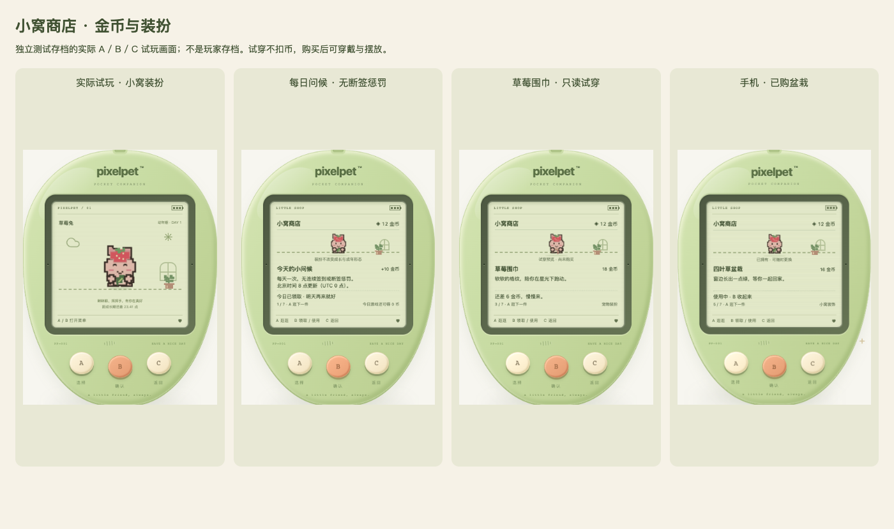

# PixelPet

一个用三个按键陪伴像素宠物长大的 Web 电子宠物。灵感来自经典 Tamagotchi，使用原创宠物角色。


## 第一版

- 本地运行，单玩家、一只宠物，无需账号。
- 屏幕只显示，所有游戏操作通过 A（选择）、B（确认）、C（返回）三个按键完成；支持键盘。
- 选择角色、孵化、喂食、清洁、睡眠、状态查看，以及按键小游戏。
- 饱食、心情、清洁、体力随时间变化；回来时结算离线状态，不做永久死亡。
- 有效照顾影响成长速度和成年形态；草莓兔、樱花喵、星星狸、云朵雀、海豚宝、蘑菇菇与蜜桃熊各有三套独立阶段造型与肢体动作，其余三只待推广。
- 回访小结、主动需求和永久纪念册，让变化与共同经历有迹可循。
- Go 处理养成规则，SQLite 自动存档，支持 JSON 导出、校验后导入。
- 暂不包含 AI 对话、云存档、登录、联网社交。

## 技术栈

- 前端：React + TypeScript + Vite，CSS / SVG 像素画面。
- 后端：Go 标准库 `net/http`。
- 存储：SQLite（`modernc.org/sqlite`，无需 CGO）。

```text
cmd/pet/          HTTP 服务入口
internal/game/    养成规则与时间结算
internal/store/   SQLite 持久化
internal/httpapi/  JSON API 与静态文件服务
web/              React 前端
docs/             设计与开发记录
data/             本机存档（不提交）
```

## 开发运行

需要 Go 1.26+ 和 Node.js 24.15+（或 26+），前端使用 pnpm（依赖锁文件已提交）。

```sh
# 终端一：后端，默认 http://127.0.0.1:8080
go run ./cmd/pet

# 终端二：前端，默认 http://127.0.0.1:5173
cd web
pnpm install
pnpm dev
```

Vite 将 `/api` 代理到 Go。开发与构建后运行共用 `data/pixelpet.db`，浏览器刷新、换浏览器、服务重启都可以续玩。

```sh
# 构建前端后，Go 同时提供网页和 API
cd web
pnpm build
cd ..
./scripts/run.sh

# 验证
go test ./...
cd web
pnpm test
pnpm build
```

服务默认只监听本机回环地址；第一版没有身份认证，请勿直接暴露到公网。`PIXELPET_ADDR`、`PIXELPET_DB`、`PIXELPET_WEB` 可分别配置监听地址、数据库路径、前端构建目录。

## 操作

| 按键 | 键盘 | 功能 |
| --- | --- | --- |
| A | A / → / ↓ | 下一项；小游戏移动 |
| B | B / Enter / 空格 | 确认；小游戏接星星 |
| C | C / Escape | 返回；小游戏退出 |

屏幕内的菜单、角色和状态都通过这三个键操作，不使用屏幕触摸交互。外壳之外仅提供备份等工具功能。

## 动作动画

十只角色共享照顾场景与需求规则。草莓兔、樱花喵、星星狸、云朵雀、海豚宝、蘑菇菇与蜜桃熊已使用各自三套独立绘制的阶段造型和按角色解剖分开活动的肢体、身体与头部或菌盖，其余三只暂用原始角色合图与各自的表情位置；原始合图不做修改。

| 状态 | 表现 | 操作 |
| --- | --- | --- |
| 待机 | 轻微呼吸、左右摇晃、间歇眨眼 | A / B 打开菜单 |
| 吃饭 | 饭团送到嘴边、逐次咬掉、咀嚼表情、米粒和满足爱心，约 3 秒 | C 跳过 |
| 洗澡 | 浴盆、搓洗、泡沫、漂浮泡泡和洗净闪光，约 4 秒 | C 跳过 |
| 睡觉 | 闭眼、枕头和格纹被子、同步呼吸、梦境和 Z 字 | 用菜单中的「起床啦」唤醒 |
| 起床 | 睁眼、伸懒腰，再回到待机 | C 跳过 |

照顾操作先由后端确认并保存，再播放动作；动画期间 A / B 暂停，C 只跳过画面，不撤销已保存的照顾。动画结束自动回到待机，睡眠则随存档持续。系统设置减少动态效果时保留静态状态提示。

`PetScene.tsx` 负责场景与像素道具，`PetArt.tsx` 统一选择阶段素材，`RabbitRig.tsx` 是草莓兔的独立成长动作样板，`Sprite.tsx` 保留其他角色的原始表情，`needs.ts` 选择主动需求，`motion.ts` 定义动作时长，CSS 定义分部位动画。前端回归测试覆盖动作完成、跳过、计时器清理、睡眠恢复、保存失败和小游戏控制。


## 存档设计

- 数据库保存当前状态、时间戳、存档格式版本、最近 30 条日记和独立的永久纪念册。当前 schema 6，兼容 schema 1–5 存档；包含钱包、库存、穿戴、连连看及贪吃蛇续局。
- 操作由后端校验并事务提交，页面收到成功响应后才确认保存。
- 时间使用后端 UTC；离线影响最多结算 12 小时，宠物不会永久死亡。
- JSON 备份用于手动迁移；导入前校验格式，导入前的状态保留为恢复快照。
- 玩法与存储分离；未来增加账号、云存档时，在存档上关联用户身份。

## 成长与进化

幼年累计 24 点成长值进入成长期，累计 72 点进入成年期。状态舒适时成长更快，适时喂食、需要时洗澡、完成陪玩和有效休息会获得额外成长；同类操作奖励有间隔，不能靠反复点按刷取。

成年有均衡、活力、恬静、自在四种形态，按照顾习惯确定并保存。菜单中的「成长手册」用 A/B 循环查看阶段外观预览、照顾习惯、形态依据三页，C 返回。成年前的外观只是当前倾向预览，不提前锁定；成年后保留已确定的形态。旧存档自动升级，角色与已有阶段保留。

小窝常驻下一阶段目标；照顾保存成功后显示实际成长奖励与习惯变化。未满足条件或仍在奖励间隔内时说明原因，成年后不再显示成长加点。反馈在照顾及进化动画结束后保留 8 秒，C 只跳过动画，刷新不重播。

宠物会依据真实状态摸肚子、揉眼、挠头、推球或微笑挥手，紧急身体需求优先。成功照顾后重新判断，睡眠、小游戏与进化不被需求打断，无新增玩法按钮。

草莓兔、樱花喵、星星狸、云朵雀、海豚宝、蘑菇菇与蜜桃熊已使用各自的三套独立像素造型，按各自解剖分别活动，不以缩放原图代替成长。樱花喵从团坐探爪、侧耳试步长成端坐理毛；星星狸从团坐抱尾、探头踏步长成竖尾望星，保留金黄毛色、棕色眼罩、奶油围胸和额头星星。云朵雀从绒团收翼、探脚试翼长成停栖梳羽，保留白色云团、浅蓝翅膀、额前蓝星和橙色鸟喙。海豚宝从团身拢鳍、扬鳍试游长成舒身摆尾，使用独立双胸鳍、背鳍与水平尾鳍，保留浅蓝皮肤、浅色口鼻和粉颊。蘑菇菇从裹盖团坐、歪盖探步长成展盖轻摇，菌盖、菌柄、小手和脚独立活动，脸部位于菌柄上。蜜桃熊从桃团抱爪、探身踏步长成挺身揉颊，头、圆耳、嫩芽、身体、双爪和脚分开活动，保留蜜桃色皮肤与奶油口鼻。各自拥有照顾动作和四种成年小习惯；其余三只的独立阶段素材尚待推广。

完整计算、形态规则与升级说明见 [docs/GROWTH.md](docs/GROWTH.md)。


## 永久纪念册

菜单中的「永久纪念册」通过 A / B 翻页、C 返回，每次打开从封面开始；只展示已经记录的回忆，不自动弹窗、不设待解锁清单，也没有额外奖励。

相遇、首次成长与成年、第一顿饭、泡泡澡、晚安、完整接星星、首次满分和首次完成连连看和符合条件的贪吃蛇会独立保存，不随日记的 30 条上限淘汰。零分完整接星星也值得纪念；游戏开始、取消和失败的照顾不会补写经历。相识天数按孵化日期计算，1 / 7 / 30 / 100 / 365 / 1000 天留下时间纪念，不表示连续登录，不需补签。

旧存档只沿用可核对的相遇和成长记录时间；旧版成长时间可能来自迁移，会明确注明，不编造过去的照顾。新共同经历从纪念册开启后开始记录，成年形态不因此改写。金币、每日问候、商城与穿戴已接通；连连看与贪吃蛇已加入，俄罗斯方块仍在后续路线中，见 `docs/ROADMAP.md`。


## 金币与小窝商店

菜单的「小窝商店」仍只用 A / B / C：A 逛下一页，B 领取、购买或使用，C 回小窝。购买先确认，A / C 取消；试穿不扣币。拥有后可以免费穿戴、摆放、替换或收起。

- 每个服务端 UTC 日可手动领取 10 金币，北京时间早上 8 点更新；不连续签到、不补签、不惩罚断签，刷新不会自动领取。
- 完整玩完五轮接星星获得 3–8 金币，完成连连看八对获得 6 金币；贪吃蛇吃到至少三颗后完成可得 3–6 金币；三者共用每天最多 30 金币。开始、取消、重复请求不重复发币。
- 首批 6 件：嫩叶胸针、草莓围巾、星光徽章、四叶草盆栽、拼布地毯、月亮夜灯，价格 12–26 金币。一次购买永久拥有，饰品/小窝各用一个槽位。
- 宠物装扮在小窝、状态、接星星和连连看中保留；首次使用饰品、首次摆放装饰留下永久纪念，保存当时物品而非后来替换的物品。纯外观，不改变状态、成长速度、游戏成绩或锁定的成年形态。
- 服务端掌管目录、价格、钱包、会话和结算，事务防止重复扣币、超支和旧局操作影响新局。仍是可导入本地备份的单机存档，不宣称防篡改在线经济。

规则与存档说明见 [docs/ECONOMY.md](docs/ECONOMY.md)。贪吃蛇已加入，俄罗斯方块尚未实现。



## 宠物连连看

菜单「一起玩耍」现在可选接星星、连连看或贪吃蛇：A 切换，B 开始，C 返回。

4×4 棋盘中相同图案最多拐两次弯连接，可绕棋盘外一格。A 循环到下一张未消除图案，B 选中/配对；C 先清除选择，无选择时退出。无路可连会免费重排，不另设收费提示或玩法按钮。刷新保留棋盘、选牌和本局进度。

宠物在旁边收好真正连上的图案，带着已经装备的饰品和小窝装饰；完整结束才结算奖励与首次共同纪念。详细规则见 [docs/TILE_MATCH.md](docs/TILE_MATCH.md)。


## 果园贪吃蛇

A 左转、B 右转、C 暂停，自动前进；暂停时 A/C 继续、B 放弃。吃齐八颗果子获胜，撞墙/身体结束，B/C 收好成绩。刷新、后台和网络中断后不自动补跑。

宠物穿着装扮帮你收好果子；吃到至少三颗后完成才计入陪玩成长、3–6 金币与首次永久纪念。仍与其他小游戏共用每日 30 金币额度。详见 [docs/SNAKE.md](docs/SNAKE.md)。


## 原创角色

星星狸、云朵雀、草莓兔、海豚宝、蘑菇菇、蜜桃熊、柠檬蛙、樱花喵、银河龙、焦糖犬。

角色设计由项目作者提供。原始角色合图保留在 `web/public/pets/characters.png`，未完成独立阶段绘制的角色通过 SVG 视窗保留原图像素，草莓兔、樱花喵、星星狸、云朵雀、海豚宝、蘑菇菇与蜜桃熊使用独立阶段 SVG；素材未授权为公共素材，不附加开放许可。

## 开发流程

按完整功能阶段提交：项目说明 → 本地养成与存档 → 三按键界面与角色 → 验证与修复。保持源码、依赖锁文件和测试入库，排除数据库、构建输出、工具与私密配置。

进度见 [docs/PROGRESS.md](docs/PROGRESS.md)。

按用户授权，每批功能测试通过后及时提交并推送 GitHub，不重写历史。

每次 push / pull request 会自动执行 Go 竞态测试、后端构建和前端类型检查与构建。Git 提交使用草莓小熊的 GitHub 身份。
