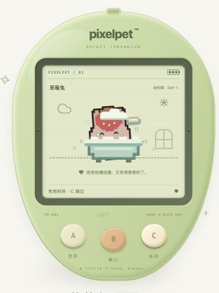
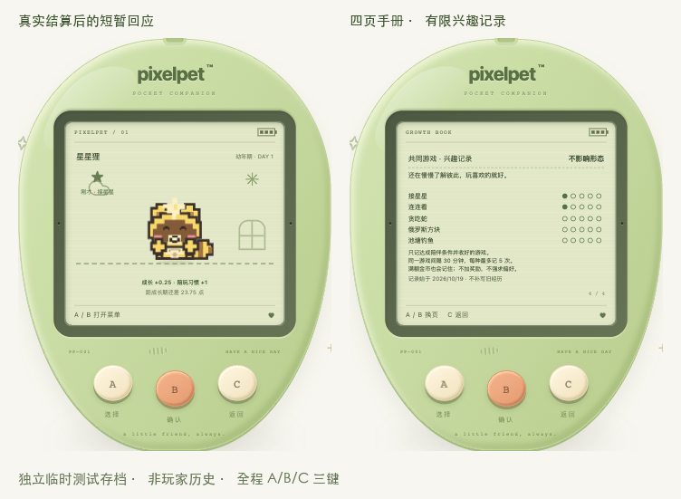
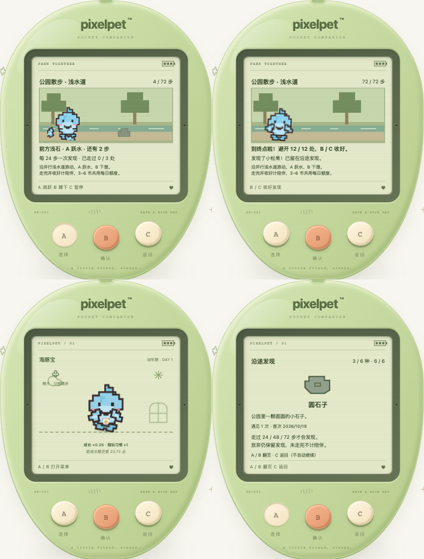
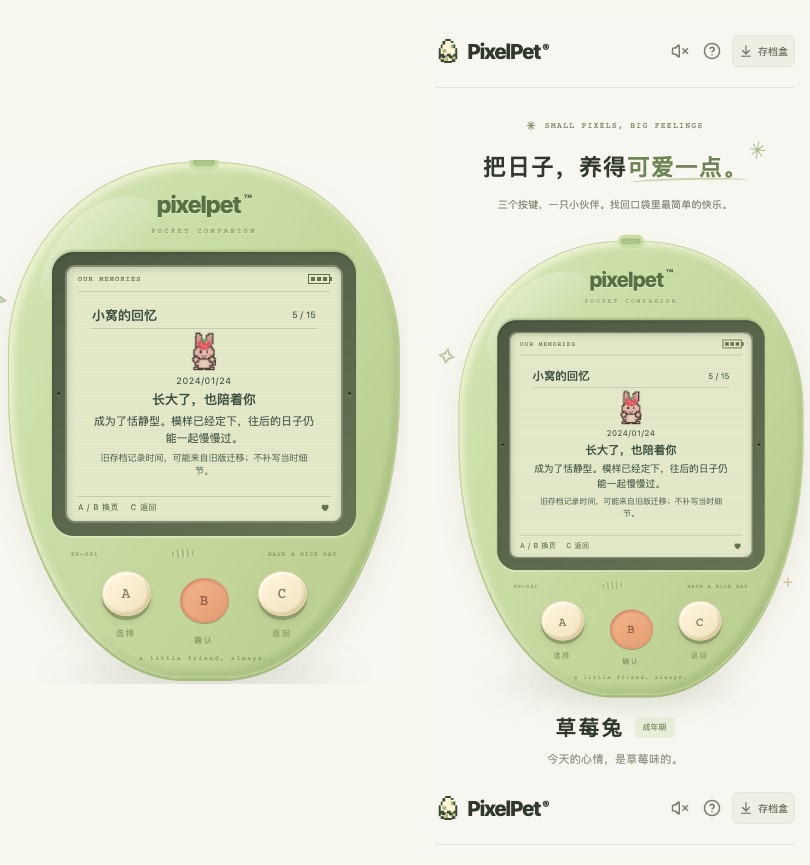
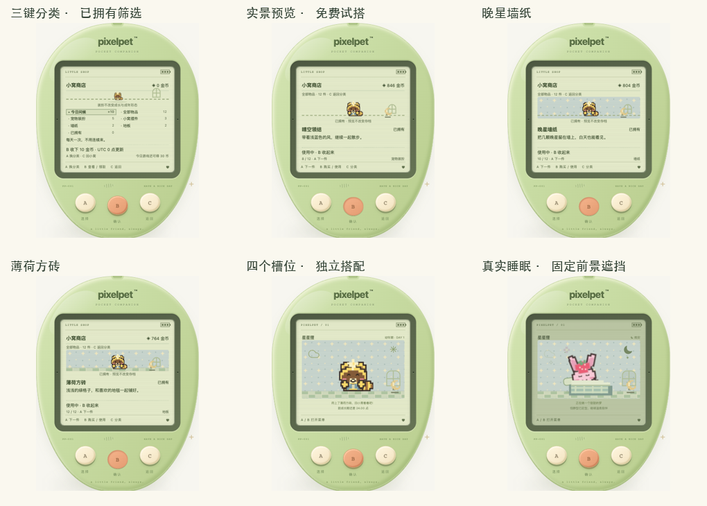
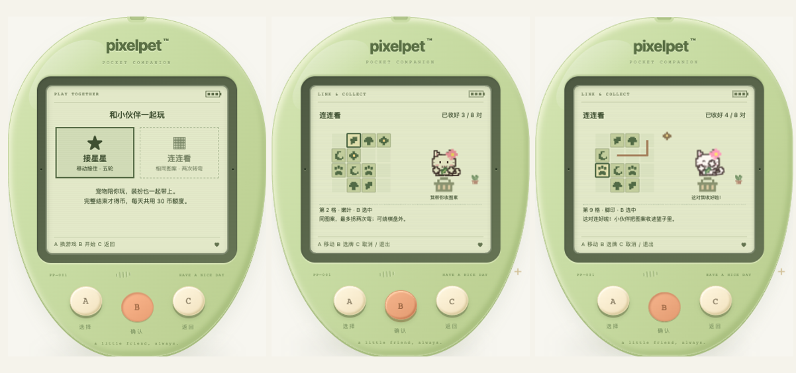
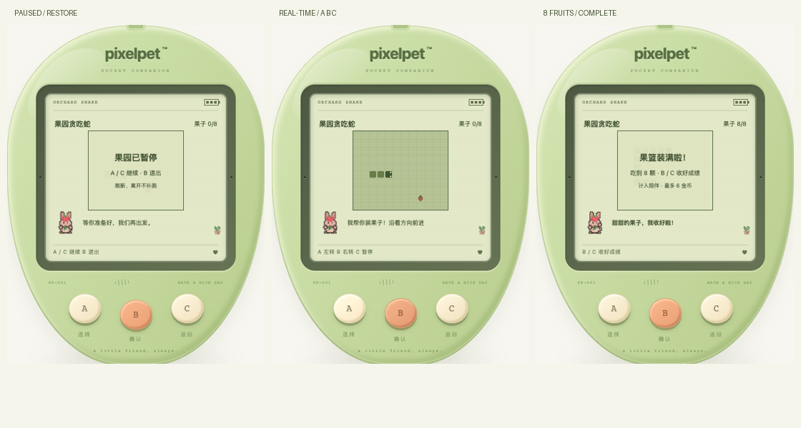
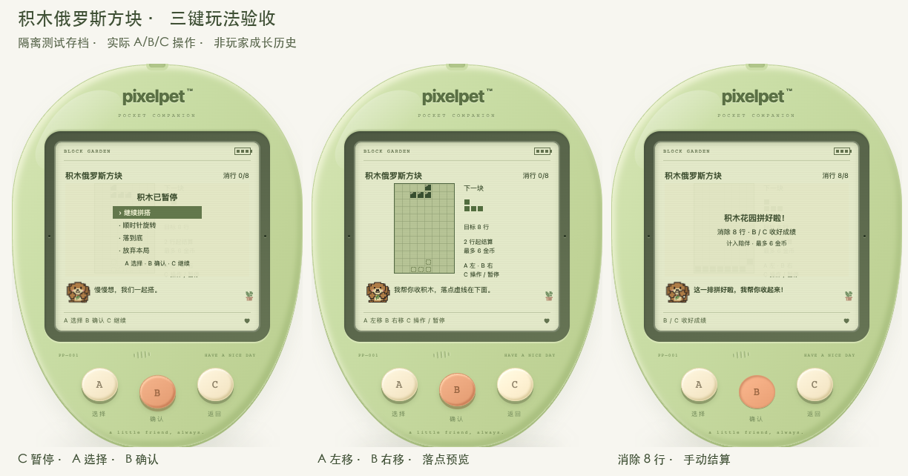

# PixelPet

一个用三个按键陪伴像素宠物长大的 Web 电子宠物。灵感来自经典 Tamagotchi，使用原创宠物角色。


## 第一版

- 本地运行，单玩家、一只宠物，无需账号。
- 屏幕只显示，所有游戏操作通过 A（选择）、B（确认）、C（返回）三个按键完成；支持键盘。
- 选择角色、孵化、喂食、清洁、睡眠、状态查看，以及按键小游戏。
- 饱食、心情、清洁、体力随时间变化；回来时结算离线状态，不做永久死亡。
- 有效照顾影响成长速度和成年形态；十只宠物均有三套独立阶段造型与肢体动作。 云朵雀的需求文字和场景描述对应翅膀/理羽动作，见 [鸟类需求表达](docs/BIRD_NEED_CUES.md)。
- 菜单先说明照顾效果与习惯条件，区分需求已满足、奖励间隔与成年不再长点；喂食/洗澡另显示服务端数值基准及封顶说明，不冒充最终结果预测。见 [照顾前提示](docs/CARE_PREVIEW.md)、[数值基准](docs/CARE_BASE_EFFECT.md)。整数读数恰好落在照顾门槛附近时，另说明实际值高于/低于门槛，避免误解习惯条件，见 [边界读数](docs/CARE_ROUNDING.md)。
- 照顾成功提示在可阅读的小窝保留完整 8 秒，被面板遮挡或切后台后返回重新计时，不重复操作或发奖；见 [照顾反馈阅读](docs/CARE_FEEDBACK_READING.md)。
- 成长手册说明服务端实际使用的自然/休息成长基准，区分成年后只记习惯，不预报长大时间；见 [成长基准](docs/GROWTH_BASIS.md)。微小但非零的习惯/定型依据显示 `<0.1`，不误显示为零，见 [习惯读数](docs/HABIT_PRECISION.md)。
- 回访小结、主动需求和永久纪念册，让变化与共同经历有迹可循。
- 接星星、连连看、贪吃蛇、俄罗斯方块、池塘钓鱼、公园散步；真实钓获与沿途发现分别留在图鉴，完成游戏获得金币，购买并穿戴装扮或布置小窝。
- Go 处理养成规则，SQLite 自动存档，支持 JSON 导出、预览并确认后导入。
- 保存响应丢失时先暂停操作，按 B 核对当前存档，不自动重试原操作或续跑游戏；见 [连接恢复](docs/SAVE_RECOVERY.md)；异常成功回复会先检查基础数据再进入核对，见 [响应保护](docs/RESPONSE_CORE_GUARD.md)；也检查已提供的成长习惯、定型记录与时间，缺失成长的旧服务仍兼容，见 [成长响应保护](docs/GROWTH_RESPONSE_GUARD.md)。 多页面睡眠操作会核对原状态，不把旧「入睡」变成叫醒或反过来；见 [睡眠意图保护](docs/SLEEP_INTENT.md)。
- 暂不包含 AI 对话、云存档、登录、联网社交。

## 技术栈

- 前端：React + TypeScript + Vite，CSS / SVG 像素画面。
- 后端：Go 标准库 `net/http`。
- 存储：SQLite（`modernc.org/sqlite`，无需 CGO）。

```text
cmd/pet/          HTTP 服务入口
internal/game/    养成规则与时间结算
internal/store/   SQLite 持久化
internal/httpapi/  JSON API 与静态文件服务
web/              React 前端
docs/             设计与开发记录
data/             本机存档（不提交）
```

## 开发运行

需要 Go 1.26+ 和 Node.js 24.15+（或 26+），前端使用 pnpm（依赖锁文件已提交）。

```sh
# 终端一：后端，默认 http://127.0.0.1:8080
go run ./cmd/pet

# 终端二：前端，默认 http://127.0.0.1:5173
cd web
pnpm install
pnpm dev
```

Vite 将 `/api` 代理到 Go。开发与构建后运行共用 `data/pixelpet.db`，浏览器刷新、换浏览器、服务重启都可以续玩。

```sh
# 构建前端后，Go 同时提供网页和 API
cd web
pnpm build
cd ..
./scripts/run.sh

# 验证
go test ./...
cd web
pnpm test
pnpm build
```

服务默认只监听本机回环地址；第一版没有身份认证，请勿直接暴露到公网。`PIXELPET_ADDR`、`PIXELPET_DB`、`PIXELPET_WEB` 可分别配置监听地址、数据库路径、前端构建目录。

## 操作

| 按键 | 键盘 | 功能 |
| --- | --- | --- |
| A | A / → / ↓ | 下一项；小游戏移动 |
| B | B / Enter / 空格 | 确认；游戏内操作见各自说明 |
| C | C / Escape | 返回、暂停或放弃确认；游戏内以提示为准 |

屏幕内的菜单、角色和状态都通过这三个键操作，不使用屏幕触摸交互。外壳之外仅提供备份等工具功能。

组字标志/旧式 229 输入事件、可编辑区域及已被其他处理器消费的按键不会触发游戏快捷键；普通长按不重复操作。详见 [键盘输入安全与验收边界](docs/KEYBOARD_SAFETY.md)。可选三键提示音失败时静默降级，关声音或切后台不补播旧按键，见 [提示音容错](docs/AUDIO_SAFETY.md)。

贪吃蛇、积木、钓鱼和散步在窗口失焦时停止本地运行，回来后仍须三键明确继续；迟到的已保存结果保留，但不会自行续局。暂停阅读页随大字号展开，见 [窗口失焦暂停](docs/WINDOW_PAUSE.md)。

切回窗口立即同步当前宠物状态；若正在保存或读取，会在结束后补读，不重放照顾或自动续局，见 [回窗状态同步](docs/WINDOW_RETURN_SYNC.md)。

合法长名字完整保留，伙伴标题和阶段标签可自然换行，避免小屏或桌面横向溢出；可重复 Chrome 回归见 [长名字布局](docs/NAME_LAYOUT.md)。

## 动作动画

十只角色共享照顾场景与需求规则。十只宠物均使用各自三套独立绘制的阶段造型和按角色解剖分开活动的肢体、身体与头部或菌盖；原始角色合图保留作设计参考与兼容回退，不做修改。

| 状态 | 表现 | 操作 |
| --- | --- | --- |
| 待机 | 轻微呼吸、左右摇晃、间歇眨眼 | A / B 打开菜单 |
| 吃饭 | 饭团送到嘴边、逐次咬掉、咀嚼表情、米粒和满足爱心，约 3 秒 | C 跳过 |
| 洗澡 | 浴盆、搓洗、泡沫、漂浮泡泡和洗净闪光，约 4 秒 | C 跳过 |
| 睡觉 | 闭眼、枕头和格纹被子、同步呼吸、梦境和 Z 字 | 用菜单中的「起床啦」唤醒 |
| 起床 | 睁眼、伸懒腰，再回到待机 | C 跳过 |

照顾操作先由后端确认并保存，再播放动作；动画期间 A / B 暂停，C 只跳过画面，不撤销已保存的照顾。动画结束自动回到待机，睡眠则随存档持续。系统设置减少动态效果时保留静态状态提示。

`PetScene.tsx` 负责场景与像素道具，`PetArt.tsx` 统一选择阶段素材，`RabbitRig.tsx` 是草莓兔的独立成长动作样板，`Sprite.tsx` 保留其他角色的原始表情，`needs.ts` 选择主动需求，`motion.ts` 定义动作时长，CSS 定义分部位动画。前端回归测试覆盖动作完成、跳过、计时器清理、睡眠恢复、保存失败和小游戏控制。



## 共同游戏与兴趣

真正完成并收好游戏后，小窝会出现对应的短暂回应；刷新、离线和放弃不会编造经历。成长手册第四页可查看六种游戏的有限兴趣记录：每种最多 5 次，同种间隔 30 分钟；没有额外奖励，不要求玩指定游戏，也不改成年形态。见 [陪伴规则](docs/COMPANION.md)。



## 公园散步

自动前进，A 跳过石块、B 低头躲枝、C 暂停；海豚沿浅水道跃水/下潜。72 步短路线约 1–1.5 分钟（不含暂停），每 24 步记录一次真实发现，六种小纪念可在菜单「沿途发现」查看。到终点 B/C 收好才计陪伴及 3–6 游戏币；绊到不额外扣状态。刷新、离开暂停，不补跑离线路线，放弃保留已发现的小物但不发完成奖励。见 [散步规则](docs/WALK.md)。



## 存档设计

- 数据库保存当前状态、时间戳、存档格式版本、最近 30 条日记和独立的永久纪念册。当前 schema 12，兼容 schema 1–11 存档；包含钱包、库存、四槽布置、小游戏续局、真实鱼类及公园发现。升级保留原五种兴趣，新增散步兴趣从零开始，不补造旧经历。今后成年定型时保存当时的舒适度和照顾习惯，成长手册可回看；旧成年存档未记录的依据不倒填。见 [定型依据](docs/FORM_RECORD.md)。
- 操作由后端校验并事务提交，页面收到成功响应后才确认保存。
- 时间使用后端 UTC；离线影响最多结算 12 小时，宠物不会永久死亡。
- 服务时间早于一份内部校验有效的存档时，暂停写入并提示校准服务电脑时间；按 B 只读检查，不误报损坏或引导重置。见 [时间保护](docs/CLOCK_RECOVERY.md)。
- JSON 备份用于手动迁移；选中文件先预览，B 确认整份替换，A/C 取消，确认前不发送导入请求。仍由服务端严格校验，替换前保留恢复快照；导入会清理未完成对局，不发完成奖励。见 [备份确认](docs/BACKUP_CONFIRMATION.md)。
- 服务明确诊断存档内容损坏时，可在存档盒预览备份并三键确认修复，或单独确认新蛋重置；不自动覆盖，替换前保留原始快照。普通断线仍禁止写入。见 [损坏存档修复](docs/CORRUPT_SAVE_RECOVERY.md)。
- 玩法与存储分离；未来增加账号、云存档时，在存档上关联用户身份。

## 成长与进化

从新蛋实际照顾到成年、跨阶段备份恢复与重启的 40 条模拟旅程见 [完整成长回归](docs/GROWTH_JOURNEYS.md)；这是受控时间的存储层回归，不代替真人多日试玩。

幼年累计 24 点成长值进入成长期，累计 72 点进入成年期。状态舒适时成长更快，适时喂食、需要时洗澡、完成陪玩和有效休息会获得额外成长；同类操作奖励有间隔，不能靠反复点按刷取。

成年有均衡、活力、恬静、自在四种形态，按照顾习惯确定并保存。菜单中的「成长手册」用 A/B 循环查看阶段外观预览、照顾习惯、形态依据、共同游戏兴趣、离线与成长、三阶段外观说明六页，C 返回。成年前的外观只是当前倾向预览，不提前锁定；成年后保留已确定的形态。旧存档自动升级，角色与已有阶段保留。形态依据会按未四舍五入的记录标明条件是否满足和前项优先，避免把相同显示值误作相同判定；见 [形态条件核对](docs/FORM_CONDITIONS.md)。

小窝常驻下一阶段目标；照顾保存成功后显示实际成长奖励与习惯变化。未满足条件或仍在奖励间隔内时说明原因，成年后不再显示成长加点。反馈在照顾及进化动画结束后保留 8 秒，C 只跳过动画，刷新不重播。

宠物会依据真实状态摸肚子、揉眼、挠头、推球或微笑挥手，紧急身体需求优先。成功照顾后重新判断，睡眠、小游戏与进化不被需求打断，无新增玩法按钮。

草莓兔、樱花喵、星星狸、云朵雀、海豚宝、蘑菇菇、蜜桃熊、柠檬蛙、银河龙与焦糖犬已使用各自的三套独立像素造型，按各自解剖分别活动，不以缩放原图代替成长。樱花喵从团坐探爪、侧耳试步长成端坐理毛；星星狸从团坐抱尾、探头踏步长成竖尾望星，保留金黄毛色、棕色眼罩、奶油围胸和额头星星。云朵雀从绒团收翼、探脚试翼长成停栖梳羽，保留白色云团、浅蓝翅膀、额前蓝星和橙色鸟喙。海豚宝从团身拢鳍、扬鳍试游长成舒身摆尾，使用独立双胸鳍、背鳍与水平尾鳍，保留浅蓝皮肤、浅色口鼻和粉颊。蘑菇菇从裹盖团坐、歪盖探步长成展盖轻摇，菌盖、菌柄、小手和脚独立活动，脸部位于菌柄上。蜜桃熊从桃团抱爪、探身踏步长成挺身揉颊，头、圆耳、嫩芽、身体、双爪和脚分开活动，保留蜜桃色皮肤与奶油口鼻。柠檬蛙从团蹲拢蹼、探身试跃长成舒蹼鸣唱，眼丘、头身、前蹼、后腿和蹼足分开活动，保留绿色皮肤、白色凸眼、柠檬黄眼斑与浅色肚皮。银河龙从抱尾拢翼、探身试翼长成展翼望星，星角、头身、双翼、双爪、脚和尾独立活动，保留淡紫皮肤、浅色口鼻、金黄额冠与星形角尖。焦糖犬从趴团抱爪、侧耳探步长成坐稳摇尾，垂耳、头身、双爪、脚与尾独立活动，保留焦糖毛色、奶油口鼻、红项圈与金黄名牌。十只均拥有照顾动作和四种成年小习惯，独立三阶段累计完成 10/10。

完整计算、形态规则与升级说明见 [docs/GROWTH.md](docs/GROWTH.md)。


## 永久纪念册

菜单中的「永久纪念册」先进入分类目录：A 换分类、B 进入、C 回小窝；分类内 A / B 翻页、C 回目录。包含全部回忆、长大时光、日常照顾、一起玩过、小窝装扮、相识日子；每次重开回到目录，进入分类从封面开始。只展示已经记录的回忆，空分类不倒填故事，不自动弹窗、不设待解锁清单，也没有额外奖励。操作与验收见 `docs/ALBUM_BROWSING.md`。

相遇、首次成长与成年、第一顿饭、泡泡澡、晚安、完整接星星、首次满分和首次完成连连看、符合条件的贪吃蛇、俄罗斯方块与钓鱼会独立保存，不随日记的 30 条上限淘汰。零分完整接星星也值得纪念；游戏开始、取消和失败的照顾不会补写经历。相识天数按孵化日期计算，1 / 7 / 30 / 100 / 365 / 1000 天留下时间纪念，不表示连续登录，不需补签。

旧存档只沿用可核对的相遇和成长记录时间；旧版成长时间可能来自迁移，会明确注明，不编造过去的照顾。新共同经历从纪念册开启后开始记录，成年形态不因此改写。金币、每日问候、商城与穿戴已接通；连连看、贪吃蛇、俄罗斯方块与池塘钓鱼均已加入，见 `docs/ROADMAP.md`。



## 金币与小窝商店

菜单的「小窝商店」仍只用 A / B / C：先选每日问候、全部物品、装扮、摆件、墙纸、地板或已拥有；A 切换，B 查看/领取，C 返回。进入分类后 A 下一件、B 购买/使用、C 回原分类。实景预览不写存档，购买需再次 B 确认，A / C 取消；购买不自动装备，拥有后可以免费使用、替换或收起。

- 每个服务端 UTC 日可手动领取 10 金币，北京时间早上 8 点更新；不连续签到、不补签、不惩罚断签，刷新不会自动领取。
- 完整玩完五轮接星星获得 3–8 金币，完成连连看八对获得 6 金币；贪吃蛇吃到至少三颗后完成可得 3–6 金币，俄罗斯方块消除至少两行后结束可得 2–6 金币，钓鱼三竿完成且至少钓到一条可得 3–6 金币；五者共用每天最多 30 金币。开始、取消、重复请求不重复发币。
- 当前 12 件，价格 12–26 金币：保留原六件，新增向日葵胸针、晴空领结、小叶/晚星墙纸、蜂蜜木地板与薄荷方砖。装扮、摆件、墙纸、地板各有独立槽位，可同时布置；一次购买永久拥有。
- 宠物装扮在小窝、状态、接星星和连连看中保留；首次使用饰品、摆件、墙纸与地板分别留下永久纪念，保存当时物品而非后来替换的物品。纯外观，不改变状态、成长速度、游戏成绩或锁定的成年形态。
- 服务端掌管目录、价格、钱包、会话和结算，事务防止重复扣币、超支和旧局操作影响新局。仍是可导入本地备份的单机存档，不宣称防篡改在线经济。

规则与存档说明见 [docs/ECONOMY.md](docs/ECONOMY.md)。贪吃蛇与俄罗斯方块已加入，规则分别见 [docs/SNAKE.md](docs/SNAKE.md) 与 [docs/TETRIS.md](docs/TETRIS.md)。



## 宠物连连看

菜单「一起玩耍」可选接星星、连连看、贪吃蛇、俄罗斯方块、池塘钓鱼、公园散步：A 切换，B 看说明，C 返回。入口展示操作、预计时长、领奖条件与 UTC 当日共享剩余额度；说明页 A 翻页、B 跳过并开始、C 返回选择，每次都能重看。详见 [docs/ARCADE.md](docs/ARCADE.md)。

4×4 棋盘中相同图案最多拐两次弯连接，可绕棋盘外一格。A 循环到下一张未消除图案，B 选中/配对；C 先清除选择，无选择时打开放弃确认，B 再确认才丢弃本局；A/C 取消确认。无路可连会免费重排，不另设收费提示或玩法按钮。刷新保留棋盘、选牌和本局进度。

宠物在旁边收好真正连上的图案，带着已经装备的饰品和小窝装饰；完整结束才结算奖励与首次共同纪念。详细规则见 [docs/TILE_MATCH.md](docs/TILE_MATCH.md)。



## 果园贪吃蛇

A 左转、B 右转、C 暂停，自动前进；暂停时 A/C 继续、B 打开放弃确认，再按 B 才放弃。吃齐八颗果子获胜，撞墙/身体结束，B/C 收好成绩。刷新、后台和网络中断后不自动补跑。

宠物穿着装扮帮你收好果子；吃到至少三颗后完成才计入陪玩成长、3–6 金币与首次永久纪念。仍与其他小游戏共用每日 30 金币额度。详见 [docs/SNAKE.md](docs/SNAKE.md)。



## 原创角色

星星狸、云朵雀、草莓兔、海豚宝、蘑菇菇、蜜桃熊、柠檬蛙、樱花喵、银河龙、焦糖犬。

角色设计由项目作者提供。原始角色合图保留在 `web/public/pets/characters.png`，原图供设计参考与兼容回退，十只角色均使用独立阶段 SVG；素材未授权为公共素材，不附加开放许可。

## 开发流程

按完整功能阶段提交：项目说明 → 本地养成与存档 → 三按键界面与角色 → 验证与修复。保持源码、依赖锁文件和测试入库，排除数据库、构建输出、工具与私密配置。

回访小结两页的三键操作与验证见 [docs/RETURN_NAVIGATION.md](docs/RETURN_NAVIGATION.md)。 小结同时保留离开时与结算结束时的历史睡眠状态，旧记录不倒推；见 [历史睡眠状态](docs/RETURN_SLEEP.md)。第二页也会区分历史与最近读取的状态，提供不自动执行的 [当前照顾建议](docs/RETURN_CARE.md)。

进度见 [docs/PROGRESS.md](docs/PROGRESS.md)。手机阅读改进、试玩反馈与下一款游戏评估见 [docs/PLAYTEST.md](docs/PLAYTEST.md)。

按用户授权，每批功能测试通过后及时提交并推送 GitHub，不重写历史。

每次 push / pull request 会自动执行 Go 竞态测试、后端构建和前端类型检查与构建。Git 提交使用草莓小熊的 GitHub 身份。


## 积木俄罗斯方块

一起玩耍的第四项：A 左移、B 右移，每秒自动落一格；C 打开暂停操作，A 选择「继续 / 顺时针旋转 / 落到底 / 放弃」，B 确认（放弃需再按 B 确认），C 直接继续。下方虚线表示落点，旁边预览下一块，不需要长按或组合键。

8×12 棋盘，消除 8 行完成；叠满也可收好已有成绩。消除至少 2 行并结束后手动收好成绩，才记录陪伴与 `min(消行数, 6)` 金币，六种游戏共用每日 30 金币额度；中途放弃不结算。刷新、切后台或断线后暂停，不补跑、不自动领币；首次符合条件的完成留下永久纪念。




## 池塘钓鱼与鱼图鉴

A 在收竿后换钓点，B 抛竿 / 提竿，C 暂停菜单。每局三竿，每竿等 32–40 秒后给出明确的 10 秒咬钩提示，不依赖声音或动画；一局约 2–3 分钟。离开、刷新或打开说明后暂停，回来手动继续，不离线钓鱼或补耗机会。

六种不同外形的小鱼、三个钓点；真实提竿成功才记入永久图鉴，可从小窝或暂停菜单查看初次日期和遇见次数。放弃不发奖励，但保留已钓到的鱼。十只宠物沿用各自三阶段造型和真实爪 / 翅膀 / 鳍动作，鸟、海豚与蘑菇用竿架辅助。三竿完成且至少一条鱼后 B / C 收好，才计陪伴、沿用成长间隔、共享金币与首次纪念，不改写成年形态。详见 [docs/FISHING.md](docs/FISHING.md)。


