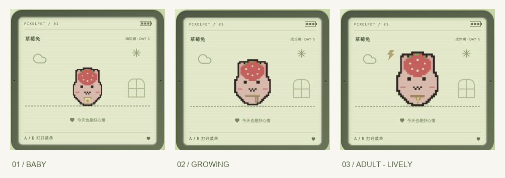

# PixelPet

一个用三个按键陪伴像素宠物长大的 Web 电子宠物。灵感来自经典 Tamagotchi，使用原创宠物角色。


## 第一版

- 本地运行，单玩家、一只宠物，无需账号。
- 屏幕只显示，所有游戏操作通过 A（选择）、B（确认）、C（返回）三个按键完成；支持键盘。
- 选择角色、孵化、喂食、清洁、睡眠、状态查看，以及按键小游戏。
- 饱食、心情、清洁、体力随时间变化；回来时结算离线状态，不做永久死亡。
- 幼年、成长、成年三个阶段有不同体型与配饰；有效照顾影响成长速度和成年形态。
- Go 处理养成规则，SQLite 自动存档，支持 JSON 导出、校验后导入。
- 暂不包含 AI 对话、云存档、登录、联网社交。

## 技术栈

- 前端：React + TypeScript + Vite，CSS / SVG 像素画面。
- 后端：Go 标准库 `net/http`。
- 存储：SQLite（`modernc.org/sqlite`，无需 CGO）。

```text
cmd/pet/          HTTP 服务入口
internal/game/    养成规则与时间结算
internal/store/   SQLite 持久化
internal/httpapi/  JSON API 与静态文件服务
web/              React 前端
docs/             设计与开发记录
data/             本机存档（不提交）
```

## 开发运行

需要 Go 1.26+ 和 Node.js 24.15+（或 26+），前端使用 pnpm（依赖锁文件已提交）。

```sh
# 终端一：后端，默认 http://127.0.0.1:8080
go run ./cmd/pet

# 终端二：前端，默认 http://127.0.0.1:5173
cd web
pnpm install
pnpm dev
```

Vite 将 `/api` 代理到 Go。开发与构建后运行共用 `data/pixelpet.db`，浏览器刷新、换浏览器、服务重启都可以续玩。

```sh
# 构建前端后，Go 同时提供网页和 API
cd web
pnpm build
cd ..
./scripts/run.sh

# 验证
go test ./...
cd web
pnpm test
pnpm build
```

服务默认只监听本机回环地址；第一版没有身份认证，请勿直接暴露到公网。`PIXELPET_ADDR`、`PIXELPET_DB`、`PIXELPET_WEB` 可分别配置监听地址、数据库路径、前端构建目录。

## 操作

| 按键 | 键盘 | 功能 |
| --- | --- | --- |
| A | A / → / ↓ | 下一项；小游戏移动 |
| B | B / Enter / 空格 | 确认；小游戏接星星 |
| C | C / Escape | 返回；小游戏退出 |

屏幕内的菜单、角色和状态都通过这三个键操作，不使用屏幕触摸交互。外壳之外仅提供备份等工具功能。

## 动作动画

十只角色共享动作系统，并使用各自的眼睛位置和脸部颜色；原始角色合图不做修改。

| 状态 | 表现 | 操作 |
| --- | --- | --- |
| 待机 | 轻微呼吸、左右摇晃、间歇眨眼 | A / B 打开菜单 |
| 吃饭 | 饭团送到嘴边、逐次咬掉、咀嚼表情、米粒和满足爱心，约 3 秒 | C 跳过 |
| 洗澡 | 浴盆、搓洗、泡沫、漂浮泡泡和洗净闪光，约 4 秒 | C 跳过 |
| 睡觉 | 闭眼、枕头和格纹被子、同步呼吸、梦境和 Z 字 | 用菜单中的「起床啦」唤醒 |
| 起床 | 睁眼、伸懒腰，再回到待机 | C 跳过 |

照顾操作先由后端确认并保存，再播放动作；动画期间 A / B 暂停，C 只跳过画面，不撤销已保存的照顾。动画结束自动回到待机，睡眠则随存档持续。系统设置减少动态效果时保留静态状态提示。

`PetScene.tsx` 负责场景与像素道具，`Sprite.tsx` 负责角色表情，`motion.ts` 定义动作时长，`pet-motion.css` 定义分段动画。前端回归测试覆盖动作完成、跳过、计时器清理、睡眠恢复、保存失败和小游戏控制。


## 存档设计

- 数据库保存当前状态、时间戳、存档格式版本和最近的生活记录。
- 操作由后端校验并事务提交，页面收到成功响应后才确认保存。
- 时间使用后端 UTC；离线影响最多结算 12 小时，宠物不会永久死亡。
- JSON 备份用于手动迁移；导入前校验格式，导入前的状态保留为恢复快照。
- 玩法与存储分离；未来增加账号、云存档时，在存档上关联用户身份。

## 成长与进化

幼年累计 24 点成长值进入成长期，累计 72 点进入成年期。状态舒适时成长更快，适时喂食、需要时洗澡、完成陪玩和有效休息会获得额外成长；同类操作奖励有间隔，不能靠反复点按刷取。

成年有均衡、活力、恬静、自在四种形态，按照顾习惯确定并保存。菜单中的「成长手册」可以用 A/B 查看阶段进度和照顾倾向，C 返回。旧存档自动升级，角色与已有阶段保留。

小窝常驻下一阶段目标；照顾保存成功后显示实际成长奖励与习惯变化。未满足条件或仍在奖励间隔内时说明原因，成年后不再显示成长加点。反馈在照顾及进化动画结束后保留 8 秒，C 只跳过动画，刷新不重播。

完整计算、形态规则与升级说明见 [docs/GROWTH.md](docs/GROWTH.md)。



## 原创角色

星星狸、云朵雀、草莓兔、海豚宝、蘑菇菇、蜜桃熊、柠檬蛙、樱花喵、银河龙、焦糖犬。

角色设计由项目作者提供。原始角色合图保留在 `web/public/pets/characters.png`，前端通过 SVG 视窗显示各角色，保留原图像素；素材未授权为公共素材，不附加开放许可。

## 开发流程

按完整功能阶段提交：项目说明 → 本地养成与存档 → 三按键界面与角色 → 验证与修复。保持源码、依赖锁文件和测试入库，排除数据库、构建输出、工具与私密配置。

进度见 [docs/PROGRESS.md](docs/PROGRESS.md)。

每次 push / pull request 会自动执行 Go 竞态测试、后端构建和前端类型检查与构建。Git 提交使用草莓小熊的 GitHub 身份。
