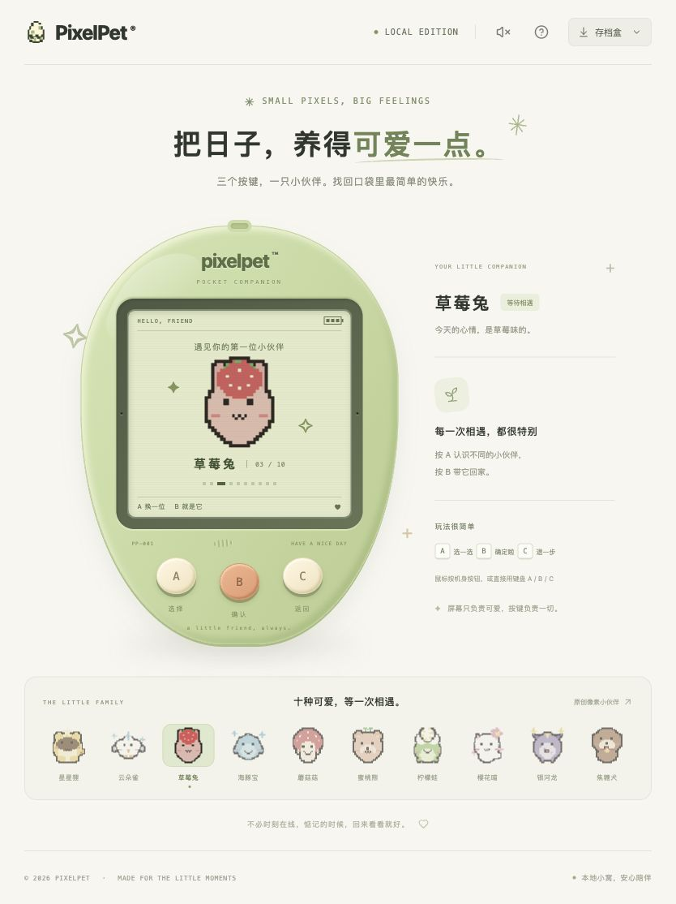

# PixelPet

**只用 A / B / C 三个按键，陪一只像素宠物慢慢长大。**

灵感来自经典 Tamagotchi 的本地 Web 电子宠物：照顾、成长、一起玩耍，把共同经历留在小窝里。无需账号，不做永久死亡，也不要求连续打卡。

[快速开始](#快速开始) · [三键操作](#三键操作) · [内置小游戏](#内置小游戏) · [文档导航](docs/README.md) · [后续计划](docs/NEXT_STEPS.md)



## 可以做什么

- **养一位原创伙伴**：十只角色可选，每只都有幼年、成长期、成年期三套独立造型和照顾动作。
- **让照顾影响成长**：喂食、洗澡、睡眠、陪玩影响状态与习惯，成年时形成均衡、活力、恬静或自在形态。
- **一起玩七款小游戏**：从接星星、拼图到钓鱼、散步和寻宝，全部只用三键。
- **留下共同经历**：成长日记、永久纪念册、鱼图鉴和沿途发现；虚构天气、季节与晨昏带来风景对白，不绑定现实天气。
- **装扮自己的小窝**：用游戏金币购买饰品、摆件、墙纸和地板，纯外观，不影响养成数值。
- **安心离开再回来**：SQLite 自动存档、离开后的状态结算、回访小结，以及可预览确认的 JSON 备份恢复。

当前为**本地单玩家、一只宠物**；没有 AI 对话、登录、云存档或联网社交。节奏拍手仍是[独立实验原型](prototypes/rhythm/README.md)，不在正式游戏菜单中。

## 快速开始

需要 **Go 1.26+**、**Node.js 24.15+（24.x）或 26+**、**pnpm 11.25.0**。版本依据见 [go.mod](go.mod) 和 [web/package.json](web/package.json)。

```sh
git clone https://github.com/strawberry-little-bear/PixelPet.git
cd PixelPet

# 安装依赖并构建网页
cd web
pnpm install --frozen-lockfile
pnpm build
cd ..

# Go 同时提供网页和 API
./scripts/run.sh
```

浏览器打开 **http://127.0.0.1:8080**。首次选择角色并孵化；以后刷新浏览器或重启服务都能续玩。

> 存档默认在 `data/pixelpet.db`，不是浏览器本地存储。请先在存档盒导出备份，再迁移或替换存档。服务没有身份认证，**不要直接暴露到公网**。

需要前后端热更新、自定义端口或隔离测试？见[开发与运行说明](docs/DEVELOPMENT.md)。

## 三键操作

| 机身按键 | 键盘快捷键 | 常用操作 |
| --- | --- | --- |
| A | A / → / ↓ | 下一项、选择或移动 |
| B | B / Enter / 空格 | 确认、照顾或游戏动作 |
| C | C / Escape | 返回、暂停或打开放弃确认 |

小游戏以各自屏幕提示为准。LCD 内没有可点击的玩法控件；手机点击机身 A / B / C，键盘也能完成全部玩法。备份等工具位于外壳之外。

成长手册用 A 上一页、B 下一页；日记用 A 看较早记录、B 看较新记录；纪念册分类内 A 上一页、B 下一页，封面也参与首尾循环，C 返回分类（从暂停进入风景手记则返回本局暂停）。阅读页可聚焦后使用原生滚动，短屏允许整页上下滚动。实时小游戏离开或刷新后不补跑，回来需明确继续；**暂停不等于放弃**，也不会自动收好成绩或重复领奖。

## 内置小游戏

从菜单「一起玩耍」进入。首次可看完整说明，成功开局后记住本浏览器偏好；下次 A 重看规则，B 按各游戏提示进入开始、准备或暂停，C 返回。

| 游戏 | 玩法与三键 | 一局参考 |
| --- | --- | --- |
| 接星星 | A 换位置，B 接住，C 放弃确认 | 五轮，约 15–30 秒 |
| [连连看](docs/TILE_MATCH.md) | A 选牌，B 配对，C 撤选 / 放弃确认 | 八对，约 1–3 分钟 |
| [贪吃蛇](docs/SNAKE.md) | A 左转，B 右转，C 暂停 | 八颗果子，约 1–2 分钟 |
| [俄罗斯方块](docs/TETRIS.md) | A 左移，B 右移，C 打开旋转、落底等菜单 | 消除八行，约 2–5 分钟 |
| [池塘钓鱼](docs/FISHING.md) | A 换钓点，B 抛竿 / 提竿，C 暂停 | 三竿，约 2–3 分钟 |
| [公园散步](docs/WALK.md) | A 跳跃，B 蹲下，C 暂停 | 72 步，约 1–1.5 分钟 |
| [森林寻宝](docs/TREASURE_RULES.md) | A 选格，B 探索，C 暂停 | 九格、最多六次探索，不限时 |

以上为预计时长，不含暂停，不是统一的限时要求。具体完成与收好条件见[游戏说明](docs/ARCADE.md)。

七款共用**每日 30 游戏金币额度**；额度用完仍可陪玩，只是不再产币。另有可手动领取的每日 10 金币问候，不连续签到、不补签。日界按服务端 UTC（北京时间早上 8 点）更新，详见[金币与小窝商店](docs/ECONOMY.md)。

## 成长、离开与存档

- **成长不是简单等计时器**：累计 24 点进入成长期，72 点进入成年期；舒适状态与有效照顾影响进度。同类照顾奖励有间隔，不能反复按键刷成长。成年形态确定后保留，不因后来习惯改变而重选。
- **离开也会有变化**：饱食、心情、清洁和体力随服务端时间结算。每次结算最多计入 12 小时，超出该次上限不补算；后台分段读取可能累计超过 12 小时，不是整个离开期间的总上限。
- **经历分开保存**：日记保留最近 30 条，永久纪念不随日记淘汰；成长手册可以回看阶段、习惯、定型依据和有限的共同游戏兴趣。
- **存档以服务端确认为准**：操作成功保存后才播放照顾动画；连接异常时先核对，不盲目重发。JSON 导入需预览和三键确认，替换前留恢复快照，未完成的对局不会通过导入发奖。
- **兼容旧存档**：旧档自动迁移；没有记录的历史不会补造。当前格式和恢复边界见[开发说明](docs/DEVELOPMENT.md#存档与安全边界)。

详细规则：[成长与形态](docs/GROWTH.md) · [回访结算](docs/RETURN_SETTLEMENT.md) · [照顾日记](docs/CARE_DIARY.md) · [备份确认](docs/BACKUP_CONFIRMATION.md)

## 开发与文档

前端 **React + TypeScript + Vite**，后端 **Go `net/http`**，存储 **SQLite**（无需 CGO）；使用 CSS / SVG 绘制像素画面与动作。

| 想了解什么 | 从这里开始 |
| --- | --- |
| 本地开发、配置、构建与测试 | [开发说明](docs/DEVELOPMENT.md) |
| 十只角色、阶段造型与动作截图 | [原创角色图集](docs/CHARACTERS.md) |
| 玩法规则、存档保护、专项验证 | [按主题浏览文档](docs/README.md) |
| 提交试玩反馈、查看已处理建议 | [试玩反馈与当前状态](docs/PLAYTEST_FEEDBACK.md) |
| 接下来做什么 | [下一步计划](docs/NEXT_STEPS.md) |
| 已做了什么、历史验收记录 | [开发进度](docs/PROGRESS.md) |

自动检查见 [GitHub Actions 配置](.github/workflows/ci.yml)。受控时钟、模拟视口与自动化测试不等同于自然多日养成、实体手机或真人长玩验收；历史文档中的阶段状态以当前导航和最新记录为准。

## 原创素材

角色设计由项目作者提供，原始角色合图与阶段素材的说明见[角色与素材使用](docs/CHARACTERS.md#角色与素材使用)。**角色素材未授权为公共素材，不附加开放许可。**
