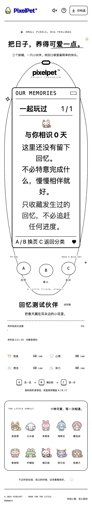

# 纪念册三键分类浏览（2026-10-19）

> 下方历史记录保留最初分类交付范围，玩法小节按当前版本更新。当前目录为七类（含风景手记）、正式小游戏为七款；schema18 另加入[睡饱后的日常照顾纪念](RESTED_MEMORY.md)。当前文档入口见[导航](README.md)。

## 当前玩法（更新于2026-10-21）

菜单中的「永久纪念册」现在先打开回忆分类：

- **目录：** A 依次选择七类，B 进入，C 回小窝。
- **分类内：** A 上一页、B 下一页，封面和已有卡片首尾循环，C 返回目录并保留所选分类；重开纪念册回到「全部回忆」目录。
- 七类为全部回忆、长大时光、日常照顾、一起玩过、小窝装扮、相识日子、风景手记。七款游戏的已有纪念归入一起玩过；真实发现留下的虚构风景归入风景手记。
- 空分类明确显示尚无回忆，不列待解锁目标，不补写过去，也没有额外奖励。相识日子不是签到。

## 初次分类交付的数据边界（2026-10-19）

仅在前端对已有记录的副本分类、排序和翻页；覆盖所有现有事件种类，以及同种类的多个相识日期。全部回忆保留原来的时间排序。没有新增字段、事件、迁移、服务端接口或写操作，schema 仍是 11。

旧存档相遇/成长时间的「沿用旧存档」提示、迁移来源提示和现实相识日子的说明保留。未升级服务仍提示纪念册尚未开启。成年形态保持锁定，不会因看相册而重算。

## 初次分类交付验收（2026-10-19）

- 前端 628 项 / 28 文件、TypeScript、生产构建，以及 Go race / vet / 构建通过。
- 独立临时数据库、真实 Chrome：少量记录、旧档迁移、全部 23 张记录三组合成存档均先通过真实服务端导入校验。合成数据仅用于覆盖测试，不是玩家故事或用户试玩反馈。
- 三组存档分别在 320 / 390 / 1200px、正常 / 200% 根字号、普通色+正常动态 / 高对比度+减少动态共 12 种组合下，用 A/B/C 遍历六个目录项、所有分类封面和每张卡，共 1068 个布局/卡片检查。检查日期、来源、成长阶段图、循环翻页及两级返回，核对不裁切、无横向溢出、三键尺寸与 LCD 无可点击控件。
- 刷新不自动打开相册；真实服务进程停止并重启后，23 张卡、钱包和成年形态一致。翻页没有新增写请求，记录、照顾次数和成年形态不变。
- 另做 192 个阅读与四种暂停页布局回归，覆盖键盘长按、弹层焦点返回、触摸与键盘切换。最后补齐高对比度 B 键按下态的系统配色优先级，并单独核对三键聚焦/按下态无装饰阴影或位移。不是所有浏览器或读屏器认证；未重跑六款游戏完整通关。

玩家 `data/pixelpet.db` 未被测试导入、重置或代操作，内容哈希与测试前一致。

## 2026-10-21 · 双向翻页

- A 向前一页，B 向后一页；封面索引为0。封面按 A 到最后一张，最后一张按 B 回封面；第一张按 A 回封面。空分类仍只显示封面，不创造回忆。目录 A 换分类／B 进入／C 回窝的操作不变。
- 七分类共用同一游标；从钓鱼／散步暂停进入风景手记也按相同方向翻页，C 只返回原暂停且保留所选菜单项，不继续、不放弃、不收好或领奖。重新进入从封面开始。
- 同步按记忆 kind（相识日子还包括 days）保持身份定位，不用旧页码。原记录消失先退到带解释的封面，明确翻页后才清除解释；不会继续显示被删记录或偷偷切成旧邻页。普通同步不移动原生滚动或物理键焦点。
- 本批仅改前端阅读，不改 schema18、后端、成长、奖励或存档；没有新增 LCD 玩法控件，也不新增本地偏好。
- 验收范围与结果见[最新开发记录](PROGRESS.md)。专项浏览器入口 `scripts/check-album-reading.mjs` 要求显式独立二进制与前端构建，自动分配端口并创建临时数据库；合成照顾／风景记录用于布局，不冒称自然多日经历。
