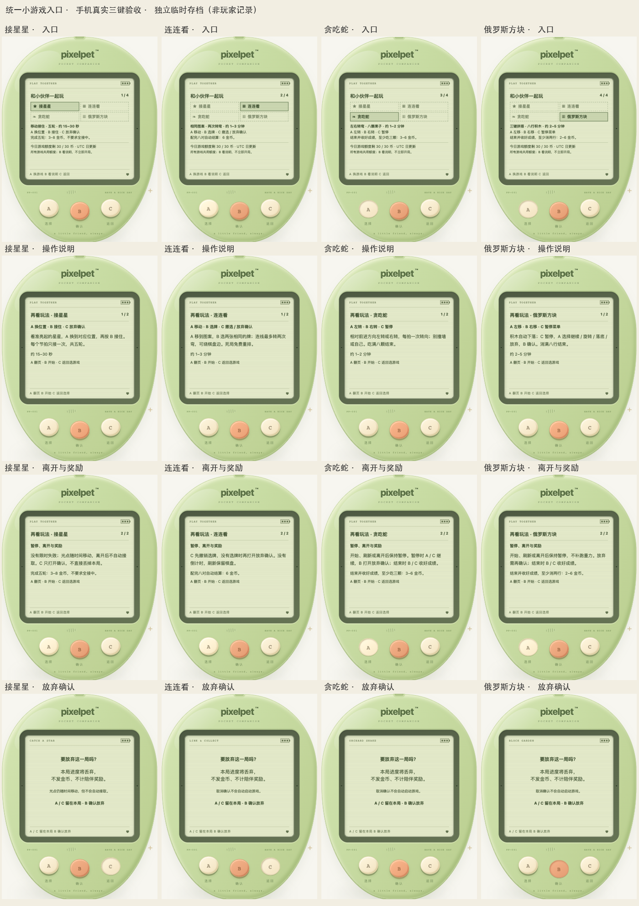

# 统一小游戏入口与三键说明

## 已交付（更新于2026-10-20）

现有接星星、连连看、贪吃蛇、俄罗斯方块、池塘钓鱼、公园散步、森林寻宝。目录、名称、开始动作、预计时长、教学与领奖条件集中在 `web/src/games.ts`，游戏自身的棋盘、节奏和服务端成绩仍各自负责。

- 选择页 A 换游戏、B 进入、C 返回。显示选中游戏的三键操作、预计时长、实际领奖门槛及今日共享剩余额度。
- 同一网页、同一宠物下，退出目录、放弃或收好后再次进入，保留上次选择；不会自动开局或继续。普通同步、改名和成长不重置选择。刷新网页、导入成功、重新开始或换存档则从接星星开始；这是本页浏览位置，不写入存档或本地偏好。
- 首次说明页 A 在两页间循环、B 开始（可跳过教学）、C 回到同一游戏选择。成功开局后才在本浏览器记住偏好；下次显示简洁开始卡，A 重看两页规则、B 开始、C 返回同选择。目录 B 仍先进入卡片，不是直接开局；存储失败不影响游戏保存。
- 贪吃蛇、方块、散步、寻宝开局保持暂停，手动继续；钓鱼先等待手动抛竿，不自动开钓。
- 已有进行中的游戏直接续局，不强制插入教学，也不重复开局。
- 屏幕没有按钮、链接或其他可点击玩法控件，仍只有机身 A / B / C。

| 游戏 | 大致时长 | 领取条件与未触及额度时的奖励 |
| --- | --- | --- |
| 接星星 | 15–30 秒 | 完成五轮自动结算，3–8 金币；不要求全接中 |
| 连连看 | 1–3 分钟 | 配完八对自动结算，6 金币 |
| 贪吃蛇 | 1–2 分钟 | 结束且吃到至少三颗，再手动收好成绩，3–6 金币 |
| 俄罗斯方块 | 2–5 分钟 | 结束且消除至少两行，再手动收好成绩，2–6 金币 |
| 池塘钓鱼 | 2–3 分钟 | 三竿完成且至少一条鱼，再手动收好，3–6 金币 |
| 公园散步 | 1–1.5 分钟（不含暂停） | 走完 72 步并手动收好，3–6 金币；不要求全避开 |
| 森林寻宝 | 不限时 | 六次探索或找齐三件，再手动收好，3–6金币；揭示不算实际找到 |

预计时间不是倒计时，不以超时处罚。散步规则见 `WALK.md`。钓鱼的 10 秒反应窗只在前台确认的节拍中计时，漏过一竿不影响下一次机会。

## 暂停不等于放弃

- 接星星 C 打开放弃确认；光点仍随墙上时钟变化，但不自动接取、没有限时失败。取消确认后继续选位置，不宣称为服务端暂停。
- 连连看 C 先撤销选牌；没有选牌时再打开放弃确认，没有倒计时。
- 贪吃蛇 C 暂停，暂停时 A/C 继续、B 打开放弃确认。
- 俄罗斯方块 C 暂停，在菜单选放弃再打开确认；旋转/落底/继续的原有操作不变。
- 池塘钓鱼 C 暂停，A 选「继续 / 看鱼图鉴 / 放弃」、B 确认、C 继续；图鉴返回及取消放弃均留在暂停。已真实钓到的鱼保留，未完成不发奖励。
- 公园散步 C 暂停，A 选「继续 / 沿途发现 / 放弃」、B 确认、C 继续；图鉴返回及取消放弃均留在暂停。第 24/48/72 步的真实发现保留，未走完并收好不计陪伴或发币。
- 森林寻宝 C 暂停，A选「继续 / 规则 / 放弃确认」、B确认、C继续。规则返回和刷新需手动继续，无离线探索；详见 `TREASURE_RULES.md`。
- 确认页 B 才发送原会话 ID 的取消操作，A/C 返回本局；实时游戏不因此自动继续。保存失败保留确认和会话，可重试。进行中的取消、暂停、刷新均不计陪伴/成长/金币。
- 正常结束后的 B/C 仍是「收好成绩」，不是放弃确认。旧局确认不能跨到另一标签页开始的新局；多次按键在保存中不会重复发送。
- 打开帮助/存档盒、离开或刷新后，实时游戏需手动继续；不追补离线移动或重力。瞬间已发出的请求可能完成，不承诺撤销在途请求。

## 接星星：看懂轮次与当前位置

- 游戏中直接显示中文轮次、已接住数量和伙伴所在的左／中／右位置；A 仍依次换位，B 仍向服务端提交当前位置，C 仍只打开放弃确认。
- 亮星出现后即可移到下面按 B，不必等待动画落到底。每个节拍只接一次，接空也计入五轮；单纯等待、切窗或停在确认页不会自动消耗轮次。
- 轮次、说明与反馈跟随字号放大；接星星允许内容自然增高，短屏通过原生页面滚动阅读，不把新增说明塞进固定高度后裁掉。读图文本包含星星与伙伴的位置，不每 900ms 主动播报一次；这不是完整读屏操作验收。
- 刷新保留服务端轮次和成绩，伙伴选择位置回到中间；星星仍按接受的服务端时钟变化。五轮结束自动结算，刷新不重发奖励，不引入新的暂停或收好按键。

## 每日额度与钱包

所有游戏共用服务端 `gameDailyLimit`（目前 30）及 `maxCoins`（目前 1,000,000）。响应公布实际钱包上限，前端不另造钱包常数。统一入口本身不改存档；钓鱼在 schema 8 增加真实发现，见 `FISHING.md`。当前 schema16兼容1–15，包含七游戏有限兴趣、公园发现与小窝回应（`COMPANION.md`）；schema15升级仅追加零值寻宝兴趣，原会话与历史保留，不改变奖励条件或每日额度。

- 日界以服务端时间偏移后的 UTC 日为准，同日扣除已获游戏币；跨日恢复额度；时钟倒退至历史日则显示零额度，和服务端奖励保护一致。
- 额度耗尽仍可玩、仍可记录符合条件的真实陪伴，提前说明本局不会再得币。没有强制任务或断签惩罚。
- 钱包满则提前提示零币；接近满时显示最多还能装多少。日额度与钱包容量分开解释，不把「每日还剩 30」误报为保证能得 30。
- 缺少旧版经济数据/服务端规则时显示待同步，不假造余额；旧服务端没有公布钱包上限时不推算容量。最终奖励始终由服务端结算。

## 统一入口首批验收（四游戏版本）

- 前端全量 440 项 / 22 文件（其中本批新增 30 项）、类型检查/生产构建、Go 全量竞态与 vet 通过。
- 实际 Chrome、独立临时 SQLite：四游戏×桌面/390px×正常/减少动态效果共 16 套完整入口、两页说明及放弃流程，67 项布局检查，零运行错误、零 LCD 点击控件。检查说明浏览不提前开局、撤销选牌、取消确认保留本局、确认放弃不发奖励、实时游戏取消确认不恢复及刷新续局不强制教学。
- 额外核验额度耗尽仍能开局、钱包已满/接近满的真实响应与提示。UTC 日界/时钟倒退、存储失败、取消失败重试、在途重复键、无 ID 旧会话及多标签页换局由回归测试覆盖。
- 验收截图是临时存档，不是玩家经历。未访问、导入、重置或代玩 `data/pixelpet.db`；无存档迁移。

钓鱼扩展验收：前端 488 项 / 23 文件与 Go 全量竞态、vet、构建通过；真实独立存档三竿、奖励、暂停/刷新及图鉴通过，135 项布局、120 组角色布局及额外 480 组解剖动作验收见 `FISHING.md`。原四款游戏历史证据如上保留。

## 小屏阅读迭代

手机不再缩小整台机器；说明分句列出，翻页/开始/返回规则不变。散步暂停在手机竖排显示。测量与验收、尚待用户反馈和后续候选见 [PLAYTEST.md](PLAYTEST.md)。

## 用户试玩反馈迭代

钓鱼/散步符号区分、重复开始卡、提前提竿消耗说明及方块「消除」文案已交付；前端 2504 项、独立库 Chrome 24 组验收见 [PLAYTEST_FEEDBACK.md](PLAYTEST_FEEDBACK.md)。等待氛围及天气/稀有内容仍是下一批候选，不改变本批概率或奖励。
