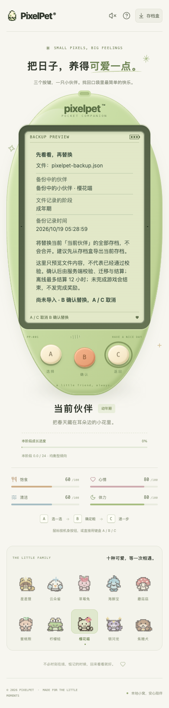

# 备份预览与三键确认（2026-10-19）

## 玩家流程

1. 从外壳外的「存档盒」选择 JSON 文件，不再选中即覆盖。
2. LCD 先展示文件名、备份伙伴/种类、文件记录的成长阶段和最后结算时间；不是提前结算后的状态，也不是备份文件的导出时间。
3. **B 确认替换；A / C 取消。**整份存档替换，不合并。建议先用存档盒导出当前存档；LCD 不增加按钮、链接或输入框。
4. 读取中或本地读取/格式错误时 B 不会导入，A/C 可返回。确认请求发送后暂时锁住三键，不能用「取消」暗示撤销已经提交的导入。
5. 服务端明确拒绝时保留预览和错误，可以取消或了解原因后重新确认。网络结果未知时丢弃待确认数据，进入既有 B 核对流程，不自动重发导入。

取消只意味着没有执行备份替换，**正常时间流逝和现有轮询并不会冻结**。从小游戏进入预览会停止本地自动步骤；取消后原局需手动继续。真正确认导入则沿用服务端既有规则：**清除未完成的游戏会话，不发完成奖励**；已保存的图鉴和纪念依照备份内容恢复。这与普通刷新保留对局不同。

## 数据与兼容边界

- 前端最多读取 64 KiB，先检查大小。读取完成前不发送 `/api/import`；取消、换文件和连接中断均使旧读取失效，迟到结果不能重新打开确认页。
- 仅检查能安全显示摘要的 JSON 信封（对象、版本号、名字、种类、日期范围）。它不是完整存档校验；不认识的旧阶段显示「由服务端校验与迁移」，不在浏览器推算成长或成年形态。
- 原始解析对象包含未知字段，原样交给服务端严格校验，不能剔除异常字段后伪装成合法存档。未来版本能显示摘要也不表示可导入。
- 不新增后端接口、schema 或成长规则。沿用服务端校验、旧档升级、离线最多 12 小时结算、替换前快照与事务保护；成年形态不在前端重算。
- 成功后使用服务端返回的存档，不把文件预览直接当已保存状态，也不播放从旧伙伴到新伙伴的虚假进化。导入后旧轮询响应不能覆盖新结果。

## 验证

前端 673 项 / 30 文件、TypeScript/构建、Go race/vet/构建通过；独立 Chrome 156 个预览布局/状态检查加 3 条故障/对局/重启链路，以及另外 192 个阅读/暂停布局回归通过。详细边界见 [开发记录](PROGRESS.md)。所有初始化、导入、网络故障与重启均使用独立 `/tmp` SQLite；不导入、重置或代玩玩家存档。测试合成数据和开发自测不是用户试玩反馈；本批也不宣称所有浏览器/读屏器或六款游戏完整通关认证。

复测：`pnpm --dir web test`、`pnpm --dir web build`、Go 的 race/vet/构建。真实浏览器还要验证：选择不导入、A/C 取消、B 单次确认、读取中取消/重选、服务端拒绝、已提交响应丢失后只读核对，以及未完成对局的取消保留/确认导入清理边界；不能只测试截图。
