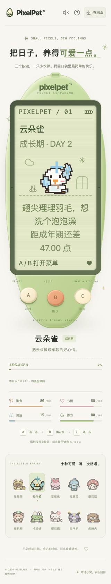

# 云朵雀的需求表达

日期：2026-10-19。本批修正既有角色的文字与场景描述，不新增角色、造型或动作。

## 问题与修改

云朵雀三阶段已经有独立的翅膀、羽毛、鸟喙及需求动作，但小窝需求文字仍使用通用的「挥挥手」「挠挠小脑袋」；场景的辅助技术描述也仍是「微笑挥手」等通用表达。

现在两处都使用鸟类表达，对应现有动作：

| 需求 | 小窝文字 |
| --- | --- |
| 饥饿 | 小翅贴贴肚子，想吃点东西 |
| 疲倦 | 小翅揉揉眼睛，想收翅休息 |
| 清洁 | 翅尖理理羽毛，想洗个泡泡澡 |
| 玩耍 | 扬起小翅，一起推推球？ |
| 舒适 | 眯眯眼、轻轻动动翅膀，有你在真好 |
| 安静 | 收拢小翅，想和你安静待一会儿 |

场景 aria-label 同步采用贴肚、揉眼、理羽、扬翅、轻动翅膀、收翅的简短描述。不添加手爪叠图，不改 SVG 或 CSS；现有减少动态效果的静态翼姿保留。

只为 species 1 / bird rig 选择对应文字。需求阈值、身体需求优先级、紧急程度、睡眠/未孵化/游戏中的需求抑制、照顾和成长规则、schema 12 均不变。其他角色保留原文案，旧档不新增字段，仍仅 A/B/C 操作。

## 验证

- 新增 `web/src/BirdNeeds.test.tsx` **27 项**：六种需求的确定性/优先级/不修改存档，三阶段 × 六种小窝表达与场景描述，三阶段的需求抑制、紧急优先和缺失 growth 的旧式夹具。最终专项在原两个源文件下 **27 项失败**，修复后通过。
- 与既有需求和鸟类骨架测试合跑 **66 项**通过；全量前端 **1640 项 / 74 文件**、TypeScript、生产构建，以及 Go 无缓存 race/vet/构建、既有节奏算术 **6 项**通过。未新增节奏游戏。
- 独立 SQLite + 真实 Chrome **36 组**：三阶段 × 六需求 × 普通动态/减少动态。减少动态组同时使用双倍根字号；视口按需求交替 1200/390/320px，并非全部字号/视口组合。
- 通过 schema 1 导入独立测试快照后检查真实 API 返回的阶段、小窝文本、场景描述、两片翅膀且无叠加手爪、文字在 LCD 内及无横向溢出；键盘/触摸用原 A 进菜单、C 回小窝，未发送照顾或游戏操作，照顾计数保持 0。不是自然成长旅程或人工试玩。
- 320px、双倍根字号、减少动态效果的成长期清洁需求截图已查看，文字和原三键可达；完整长页仍需滚动。

## 数据与运行

浏览器临时库 `/tmp/pixelpet-bird-needs-70cXsl/test.db`，临时脚本 `/tmp/pixelpet-bird-needs-browser.mjs`，结果 `/tmp/pet-bird-needs-browser-results.json`。永久回归在前端测试文件。

仅启停自己的 18137 测试服务。未修改玩家库或重启原服务；玩家库 SHA256 保持 `a8b712d5419fe6227b255f4d63869612e451da7abddffd60124de8ee65c23eee`，原进程 38015 / 39567 保留。构建更新忽略的 web/dist，原服务若共用该目录，后续重载可能看到新前端；没有主动刷新玩家页面或部署后端。

持续迭代目标保留；真实人工试玩、系统输入法/系统切换与自然长时间体验仍待验收，候选新游戏未开发。
