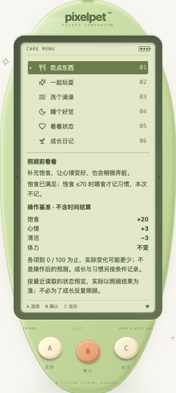
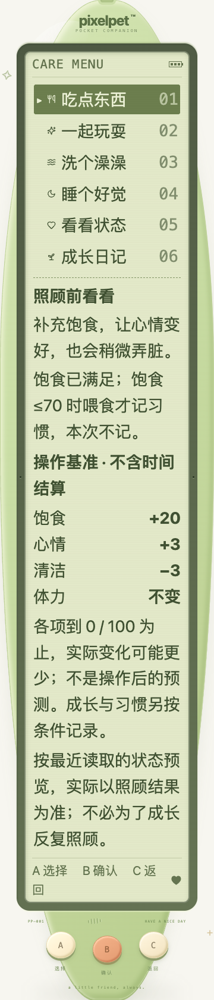

# 照顾前的数值基准（2026-10-19）

## 做了什么

喂食和洗澡菜单在原有「照顾前看看」下，显示服务端提供的四项操作基准：

| 操作 | 饱食 | 心情 | 清洁 | 体力 |
| --- | --- | --- | --- | --- |
| 喂食 | +20 | +3 | −3 | 不变 |
| 洗澡 | 不变 | +4 | +35 | 不变 |

- 基准来自响应 `careRules.actions`，与实际操作共用服务端数值来源，不在客户端另写一份数值表。
- 标明「不含时间结算」、0 / 100 封顶与「不是操作后的预测」。例如饱食 95 时基准仍为 +20，实际操作最多补到 100；照顾后仍由服务端保存的实际结果回执说明，不用基准覆盖回执。
- 成长与习惯继续按原条件判定，不把改善需求等同于增加习惯或成长。旧的说明、30 分钟间隔与成年定型行为保持不变。
- 最近快照为蛋、睡眠、游戏中或对应需求已满时不显示数值；这只是显示条件，不用旧快照禁用 B，也不以本地时钟决定服务端是否可照顾。
- `actions` 是可选响应元数据；旧服务端缺失或所选操作存在非数值、非有限值、越出 ±100 或字段不全时只保留原文字说明。不影响独立的时间变化说明，不编造默认数值。另一个操作字段缺失不抹掉当前有效操作。
- 刷新/前台读取可更新基准，过时响应不回滚；读取失败时原恢复界面接管，不拿缓存数值继续照顾。没有后台自动操作。

仍仅 A / B / C，LCD 无新增可点击控件。不改养成数值、六游戏、奖励、schema 12、SQLite 结构或备份格式；旧存档兼容。

## 持久回归

- 新增前端 **34 项**：`CareBaseEffect.test.tsx` 29 项、`CareBaseEffectFlow.test.tsx` 5 项。覆盖三阶段两操作、权威元数据、只读/无新控件、上下限说明、不可用状态、缺失/异常降级、习惯间隔、旧成长记录、新旧响应、显式 B、连接恢复。
- Go 新增两个测试函数：实际操作/元数据/原有独立数值预期/结果回执一致性（2 操作 × 11 起始需求 × 4 心情，共 88 次循环，不冒充命名子测试）；以及幂等旧缓存的缺失/异常元数据更新但不重做操作、不改缓存或存档。已有 HTTP/存储测试继续核对各响应规则一致、客户端不可覆盖、备份不携带规则。
- 全量前端 **1477 项 / 70 文件**、TypeScript、生产构建通过；Go 无缓存 `test -race -count=1 ./...`、`vet ./...` 与构建通过。既有节奏算术 6 项通过，不代表新节奏游戏已开发。

## 浏览器与截图

独立临时库 + 真实 Chrome **24 组**通过：

- 三阶段 × 喂食/洗澡 6 组：菜单只读，B 才保存一次；按实际回执的 before 值与元数据核对封顶结果，再到状态页核对历史回执。
- 320 / 390 / 1200px × 普通/双倍字号 × 默认/强制配色 12 组，均为 568px 短视口与减少动态；核对 LCD 内容边界、无横向溢出、标签和值不拆行、字号和 44px 触摸目标，移动端机身三键触摸、C 返回无照顾写入。
- 旧/异常元数据 2 组：数字隐藏但旧文字与四项时间变化说明保留。
- 睡眠/饱食满/清洁满 3 组：不显示不可用数值，无自动喂食、洗澡或叫醒。
- schema 与便携备份 1 组：仍为 12，响应元数据不混入备份。

最终两张截图已实际查看，普通与双倍字号均完整呈现；大字号沿用原有纵向阅读方式，不缩字或缩触摸目标：

本机记录：`/tmp/pet-care-base-{web,go}-final.log`、`/tmp/pet-care-base-browser{.log,-results.json}`；浏览器脚本 `/tmp/pixelpet-care-base-browser.mjs`，临时库 `/tmp/pixelpet-care-base-wdpboL/test.db`。临时脚本不是仓库持久回归入口；以上两个前端文件及 Go 测试才是持久回归。合成三阶段夹具和自动化触摸不当作自然养成或真实用户反馈。

## 玩家数据与未完成事项

未重置、导入、代操作玩家 `data/pixelpet.db`，SHA-256 保持 `a8b712d5419fe6227b255f4d63869612e451da7abddffd60124de8ee65c23eee`；原服务进程保留，自己的 18131 测试服务已停止。未主动刷新玩家页面、重启或部署后端；本地构建更新 `web/dist`，使用此目录的服务在页面重载时可能读取新前端，不等于整套服务已部署。

持续目标保留。真实人工试玩、自然长时间成长的体验验收仍待进行；候选节奏拍手/森林寻宝尚未开发。下一批继续优先可复现的照顾、成长与离开恢复问题，不扩充按键或伪造反馈。
