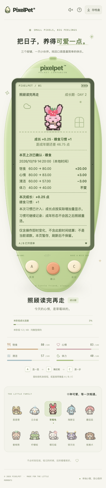
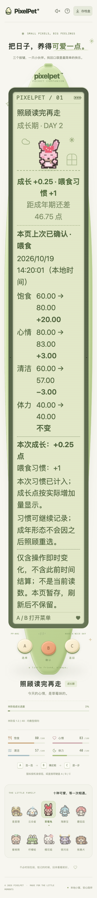

# 照顾成功提示的阅读时间

日期：2026-10-19。只调整本次照顾成功提示的消失时机，不修改养成、奖励或存档规则。

## 复现与行为

独立临时库 + 真实 Chrome 中，用三键确认一次喂食，等吃饭动画结束，打开玩法说明并实际等待 9 秒。修改前返回小窝时，短时成功提示已消失；**操作前后对比回执仍在，并非存档或回执丢失**。修复后同样实际等待，成功提示仍在，照顾请求始终只有一次。

现在只有在可见、未被帮助/存档盒/重新开始确认面板遮挡的小窝，且照顾动画和成长展示均已结束时，才启动 8 秒阅读计时。离开后回来重新获得完整 8 秒，与既有菜单往返行为一致，**不是累计剩余时间的冻结**。

- 不重播普通照顾动画、不重做操作、不重发奖励。动画仍可在遮挡期间结束；成长庆祝另沿用既有中断恢复机制。
- 切入隐藏页会取消计时；单纯窗口失焦但页面仍可见，不暂停。返回焦点的普通读取和轮询不重置正在进行的计时。
- 已过期提示不复活；换档、读取失败的安全清理及刷新后不补造旧成功。
- 短提示过期后仍可查看本次操作对比，但它不是跨刷新的永久记录。
- 无新增控件，仍仅 A/B/C 执行玩法；不改变 schema 12 或旧档兼容性。

## 自动回归

新增持久测试 `web/src/CareFeedbackReading.test.tsx` **25 项**：三阶段 × 四类遮挡、遮挡期间动画结束/迟到响应、入睡、反复遮挡、菜单往返、可见失焦/轮询、过期、换档、断线恢复和刷新。最终夹具在旧 App 下 **19 失败 / 6 通过**；修复后专项 **93 项 / 5 文件**通过。组件 mock 只验证界面及派发次数，不冒充真实服务端奖励验证。

全量前端 **1700 项 / 76 文件**、TypeScript 与生产构建通过。首次并发验证有测试超时及新夹具的 React 批处理问题；分开打开存档盒/重置确认、分段推进动画与阅读时间后，串行 `--maxWorkers=1` 全量通过，未提高测试超时或删除测试。Go 无缓存 `test -race -count=1 ./...`、`vet ./...`、构建及既有节奏算术 **6 项**通过。

## 真实浏览器检查

独立 SQLite + 真实 Chrome **22 组**通过：三阶段各测试帮助/存档盒/重置确认/隐藏页共 12 组，成年洗澡/叫醒/入睡 3 组，迟到响应 2 组，以及换档/断线恢复/刷新/过期/可见失焦 5 组。实际 API 验证每组只有一次正确照顾请求、金币不变、有效喂食/洗澡只计一次习惯，入睡/叫醒不送操作成长。

时间边界使用暂停的前端受控时钟推进（7999ms 仍显示、8000ms 消失），服务器仍按真实时间结算；隐藏/焦点使用事件注入，不冒充操作系统原生切换或自然长时间离开。初次脚本未暂停自动前进的时钟，测 7999ms 时混入脚本执行耗时；修正测试时钟后 22 组通过，生产代码未因此改动。另有上述不加速的实际 9 秒遮挡前后对照。

普通字号 390×844、双倍根字号 28px 的 320×568 下，检查回执和提示在 LCD 内容边界内、无横向溢出、三键至少 44px、无 LCD 可点击玩法控件及页面错误。这不是所有视口的完整矩阵；大字号长页需要滚动至三键，不宣称一屏可见。两张截图已查看：

## 隔离及后续

22 组临时库 `/tmp/pixelpet-care-reading-BeLi0b/test.db`；脚本 `/tmp/pixelpet-care-reading-browser.mjs`，结果 `/tmp/pet-care-reading-browser-results.json`，验证日志 `/tmp/pet-care-reading-{corrected-baseline,focused-final,frontend-final,go,browser}.log`。实际 9 秒修复前后日志 `/tmp/pet-care-reading-probe-{baseline,fixed}.log`，修复后独立库 `/tmp/pixelpet-care-reading-probe-HJOike/test.db`。临时脚本不是仓库持久测试入口。

仅启停自己的 18140/18141 服务。玩家库 SHA256 仍为 `a8b712d5419fe6227b255f4d63869612e451da7abddffd60124de8ee65c23eee`，原进程 38015/39567 保留；没有重置、导入或修改玩家库，没有主动刷新玩家页面或重启其服务。构建会更新忽略的 `web/dist`，共用目录的原服务后续重载可能看到新前端，不宣称运行时完全隔离或后端已部署。

持续目标保留，下一批继续处理可复现的照顾、成长与恢复问题；真人试玩、自然长时间养成和系统输入/切换仍待验收，不将候选新小游戏算作已开发。
