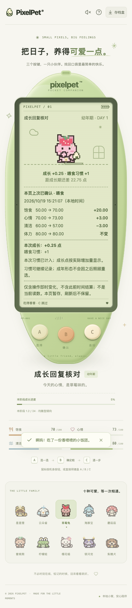
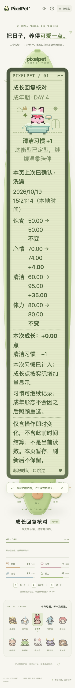

# 照顾反馈安全与单次习惯显示（2026-10-19）

## 本批修复

成功 HTTP 回复不保证可选反馈能安全显示。此前即使基础存档、成长字段都通过检查，`careFeedback.points` 如果是字符串仍会在短提示的 `toFixed` 处出错，错误类型的习惯或原因也可能误导成功提示。

现在仅在 **careFeedback 存在** 时检查已支持的动作/原因/习惯、有限非负且不超过 72 的积分、单次习惯奖励及可显示的可选重试时间。缺失/null 反馈继续兼容旧服务，不补造成功反馈或操作回执；合法回复和未知附加字段不被改写。

- 异常照顾写回复仍表示「可能已保存、结果未知」，先暂停操作，B 通过 GET `/api/state` 核对。不得重发照顾、重发奖励或恢复时补播成功；反复读到异常也不解锁。
- 初始/普通轮询异常仍沿用连接恢复的 `/api/visit` 结算。GET 解析错误是 `unavailable`，写回复解析错误是 `unknown`，不推断存档已经损坏。
- 可选 `effect` 前后对比仍使用回执组件自己的检查：坏/缺失 effect 仅不显示回执，不使其他合法反馈或存档不可用。不把所有可选对象升级为必填，不更改 schema 12、养成门槛、三键或成年冻结规则。
- 这是显示安全检查，不是完整的服务端业务一致性校验；动作与原因、习惯之间的组合含义仍由服务端规则及已有回执检查负责。

另一个问题来自**合法旧档的小数习惯累计值**。服务端照顾增加 1 后，回复用前后差得到单次奖励，浮点运算可能出现：

```text
1.4 - 0.4 = 0.9999999999999999
2.2 - 1.2 = 1.0000000000000002
```

此前短提示直接显示长小数，成长回执又要求严格整数而漏掉真正的一次奖励。现在共享一个仅作用于响应判断/显示的计数函数：精确 0 仍为 0；距 1 不超过 `1e-8` 的有限值显示为 1；其他分数不四舍五入为奖励。短提示与成长回执一致显示 `+1`。**不修改收到的对象、不舍入保存的累计习惯、不改变服务端原始差值或成长点**。容差覆盖现有合法累计量级的运算误差，不用于休息累计值或形态判定。

## 验证方法

- 请求解析新增 82 项：23 种异常 × GET/写入 46 项；缺失/null、成年零积分、浮点差、睡眠、六游戏、未知字段和独立 effect 降级等 18 种兼容数据 × 两路径 36 项。检查每次只请求一次，无隐式重试。
- 短提示/成长回执新增 9 项：喂食、清洁、陪玩 × 小于 1/大于 1 的误差及精确 1，并检查输入不变。修改前两文件合计 **52 失败 / 39 通过**，修复后 91 项通过。
- 计数函数边界新增 22 项，含非数字、非有限值、真正分数、小正数与误差容限两侧。App 连续异常恢复新增 8 项；原专项 272 项通过。
- Go 新增 1 个测试、9 个子场景，用真实喂食/清洁/接星星完成流程确认累计值仍为原值加 1、反馈保留原始差值及实际积分；未改服务端实现。
- 浏览器复用永久入口 `scripts/check-growth-response.mjs`：原 20 组保留，新增反馈异常 8 组、三阶段 × 喂食/清洁 × 两种小数累计值 12 组、缺失/null 反馈写回复 2 组。小数差来自真实后端，不由浏览器伪造；异常字段与旧式回复通过网络拦截注入。
- 异常场景核对已保存/未转发动作、反复失败读取及正常恢复；精确验证照顾次数、金币、成年记录冻结、无重复写入及页面无异常。成年仍 72 点，后续仅加习惯。A/B/C 可滚动到达且至少 44px，LCD 不增可点击玩法控件。
- 390px 普通根字号和 320px 双倍根字号按场景分配，并非所有字号/数据的笛卡尔积。浏览器时钟仅为受控轮询，不能代替自然长时、系统切换或真人试玩认证。

## 重复运行

先构建前端和独立测试二进制，再运行（要求本机 Chrome 和 Playwright）：

```sh
./.tools/go/bin/go build -o /tmp/pixelpet-care-feedback-response ./cmd/pet
PIXELPET_TEST_BINARY=/tmp/pixelpet-care-feedback-response \
PIXELPET_PLAYWRIGHT_MODULE=/absolute/path/to/playwright/index.mjs \
node scripts/check-growth-response.mjs
```

脚本自动选择空闲端口、创建自己的临时库并关闭自己的服务，不接受玩家服务 URL。临时结果 JSON 记录逐组场景与原始单次差值。

未重置、导入覆盖玩家数据库，也未刷新玩家页面或重启原后端。前端构建会更新忽略的 `web/dist`；共用该目录的原服务可能在用户后续刷新时读取新前端，不能称为完整运行环境隔离或后端已部署。

## 最终结果与画面

前端全量 **1956 项 / 82 文件**、TypeScript 与生产构建通过；Go 全量无缓存 race、vet、独立构建及既有节奏算术 6 项通过。独立库真实 Chrome **42 组全部通过**，正常与大字号两张最终截图已查看。





本次最终临时库为 `/var/folders/12/7y0bpzpj5055788qjjnq3c9c0000gn/T/pixelpet-growth-response-dG4kOd/test.db`；同目录有截图、逐组 JSON，自己的测试端口已确认关闭（端口见 JSON）。玩家库 SHA256 保持 `a8b712d5419fe6227b255f4d63869612e451da7abddffd60124de8ee65c23eee`，原进程 38015 / 39567 保留。

持续目标继续，下一批仍以可复现的照顾/成长/恢复问题与真实试玩反馈为优先，不把候选新游戏或长时人工验收记成已完成。
