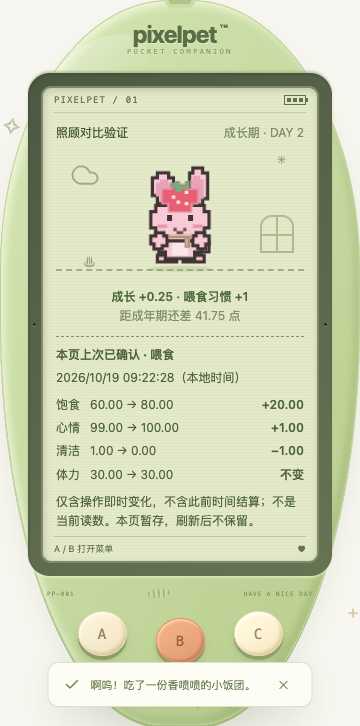
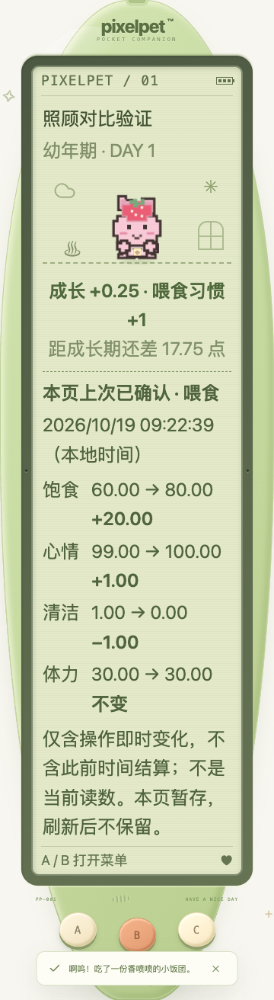

# 照顾后的即时状态对比 · 2026-10-19

## 为什么补这一块

照顾前已有菜单预览，照顾后已有实际成长/习惯反馈，但小窝没有四项需求的操作前后读数。只到状态页看新值，很难分清「刚才按键改变了多少」「此前离线结算改变了多少」，也容易把满值截断前的名义效果当成实际效果。

本批新增的是**本页收到的上次已确认操作回执**，不是新成长规则、照顾奖励、当前预测或永久照顾历史。

## 交付

- `careFeedback.effect` 是可选响应元数据：原操作时间 `at`，服务端时间结算后、执行操作前的四项 `before`，以及执行后的 `after`。直接复制真实状态值，不用前端缓存、名义 +20 / +35 或当前时钟重算。
- 喂食、洗澡及六款现有游戏符合原陪伴结算条件的完成操作显示四项读数和实际正/负变化；到 0 / 100 时按实际截断结果显示。变化小于显示精度时说明 `<0.01`，不写成正负零或「不变」。
- 入睡/起床的即时对比保持不变，并说明睡着期间才逐步恢复体力。操作前已经结算的休息/成长不归到入睡或叫醒按键上。
- 回执显示原操作的本地日期和秒，明确「不是当前读数」「不含此前时间结算」。小窝可直接读；菜单进入状态第一页也能重看，无需赶在八秒成长提示消失前读完。
- 只有 A/B/C。没有新按钮、自动重试、照顾请求、菜单项或 LCD 内可点玩法控件；C 仍仅跳过动画，不撤回已保存的照顾。

## 生命周期与兼容

- 普通轮询可以更新当前读数，但不会改写回执读数/时间，也不会把回执当当前状态。原成长提示仍按既有八秒规则消失，回执本页暂存至下一次操作或清理。
- 下一次写操作开始时清掉旧回执，成功后只接纳收到的新回执。没有反馈、被拒绝、未知结果、断线恢复、时钟/损坏诊断、换存档/新游戏等不继承旧成功；读取恢复不能编造未收到的回执。
- 刷新/服务重启不恢复这份页内回执；实际照顾效果仍持久保存。明确不新增永久历史表或倒填旧照顾经历。
- 幂等请求缓存保留原操作回执与时间，晚到的重复请求不多执行、不以重发时间伪装新操作。旧缓存/旧服务没有可选字段时不编造对比；无效的可选数字只隐藏对比，不把成功保存误报成失败。
- 元数据不进入可携带的玩家状态；schema 仍为 11。没有更改成长、离线、需求速率、习惯、奖励、价格、成年形态或游戏门槛。

## 验证

- 新组件 19 项、应用三键流程 14 项；全量前端 **1121 项 / 50 文件**，TypeScript 与生产构建通过。
- 新增 Go 七组顶层回归（含子用例）：实际截断、幼年/成长期/成年与习惯资格独立、睡眠结算、失败/未完成/取消无回执、六款完成结算、确定性时间参数下的两小时服务端结算与幂等重放、旧缓存兼容；Go 全量 race、vet、构建通过。旧回执一致性断言改为结构深比较，仍核对所有字段，不依赖新指针地址相同。
- 单元中的贪吃蛇/方块结束态使用既有规则测试的终局夹具；不是声称浏览器真实通玩了所有棋盘。连连看/钓鱼/散步使用现有操作辅助完成。
- 既有节奏算术 6 项通过，仅为候选玩法评估，不计成新游戏。

- 独立临时库真实 Chrome **74 项**：320 / 390 / 1200px × 正常 / 双倍根字号 × 普通 / 高对比度并减少动态效果，共 12 组；每组核对喂食、小窝回执、状态页重看、洗澡、入睡、起床与刷新不造历史。计数为五种回执/布局 60 项、刷新 12 项；另有丢失真实已保存响应后的只读恢复 1 项、真实服务重启 1 项。
- 每组校验四项读数/差值与真实响应完全对应、原操作时间一致、同记录轮询不改回执、到边界按实际效果、睡/醒无即时体力奖励；只有三实体键且至少 44px，无 LCD 内控件、横向溢出或内部文字滚动陷阱。320 / 390px 实际触摸，1200px 键盘。各组轮换覆盖幼年/成长期/成年，不是每个阶段与全部布局的完整笛卡尔积，也不是全部成年形态浏览器认证。
- 各组仅发喂食/洗澡/入睡/起床四个明确操作；照顾次数恰好 +2、金币不增加。未发生自动重试、导入/重置或回访认领。独立的丢响应专项先让服务端保存再断开响应，B 读取确认，不重发照顾、不凭新读数生成回执。无浏览器异常。
- 脚本 `/tmp/pixelpet-care-effect-browser.mjs`，结果 `/tmp/pet-care-effect-browser-results.json`，临时库 `/tmp/pixelpet-care-effect-eYp2YB/test.db`；仅启停自己的 18114 测试服务，结束后已停止。旧格式导入用于准备临时角色，不是修改玩家存档；时间积分的长间隔由 Go 确定性时间参数验证，没有自然等待两小时。这些是自测，不是用户试玩反馈或真实手机后台验收。
- 玩家库 SHA256 仍为 `a8b712d5419fe6227b255f4d63869612e451da7abddffd60124de8ee65c23eee`，原进程 38015 / 39567 未重启。

玩家库不作为任何测试输入或导入目标；测试只用新临时数据库。构建不代表原运行服务已重启部署。

持续目标保持；下一批继续从可验证的照顾与恢复问题入手，不把候选节奏拍手/森林寻宝算作已交付。
