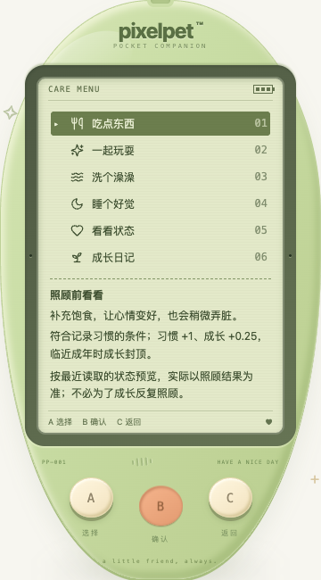

# 照顾前提示（2026-10-19）

## 本批解决什么

菜单原先只有动作名称，已有的短说明没有显示；是否满足习惯条件，要做完之后才知道。本批将所选项说明放进菜单，照顾动作另外显示按最近服务端状态计算的预览：

- **喂食 / 洗澡**：说明需求变化，区分已满不能操作、需求已满足不记习惯、同类 30 分钟间隔、满足记录条件。判定顺序与后端一致：需求优先于间隔，饱食 ≤70 / 清洁 ≤65 包含边界；饱食 ≥96 / 清洁 ≥99 则提示暂时不需要。
- **睡觉 / 起床**：睡眠中先提示叫醒；体力满时说明不会再增加休息习惯。休息只按实际恢复量记录，不因反复切换多记；幼年/成长期与成年分开说明。
- **成年**：只记习惯，不再承诺成长点或重新决定形态。临近成年时额外成长受原有封顶限制。
- **其他菜单**：展示原有说明，十二个选项仍由 A 循环选择、B 执行原操作、C 返回。没有新菜单层、确认步骤或 LCD 点击控件。

这是**只读预览，不是客户端发奖或拒绝操作的依据**。使用 `lastTick` 与对应上次习惯时间判断间隔，不让本机时钟或本地倒计时自行宣布缓存间隔结束；拿到新的权威状态后才更新。实际提交前服务端仍会结算时间、校验并返回真实反馈，因此保留「按最近读取状态预览，实际以照顾结果为准」。不禁用 B，不因旧预览阻止服务端可以接受的操作。

未读到旧版成长记录时不捏造奖励；断线、存档损坏或时间保护页不展示缓存提示。没有 `aria-live` 倒计时报读，也没有新增奖励、任务、存档字段、数值或迁移。schema 仍为 11；长期目标和未实现的候选小游戏不因本批变成已完成。

## 验证与边界

- 前端纯函数与应用回归覆盖阈值两侧、30 分钟前 1ms / 精确边界、需求与间隔优先级、三阶段、成年定型、旧版缺少成长记录、睡眠/叫醒/满体力、只读浏览、十二项循环、单次 B 提交，以及失败轮询后隐藏说明。
- 后端新增 42 个合成子场景校验实际规则：两种动作 × 三阶段 × 七种边界；夹具先通过完整存档校验，不因预览更改服务端规则。
- 阅读沿用正常文档流，允许短屏上下滚动，不缩小字体或按键，也不保证 200% 字号能与三键同时塞进一屏。

本批自测不是用户试玩反馈，不声称重新完成了六游戏通关或全部角色解剖矩阵。复测要指定新的 `/tmp` 数据库，绝不导入、重置或代操作 `data/pixelpet.db`。

## 本次实测结果

- 前端 **748 项 / 34 文件**、TypeScript / 生产构建、Go 全量 `test -race -count=1 ./...` / vet / 构建通过。既有节奏离线算术脚本另 6 项通过，不代表新增节奏游戏。
- 独立 SQLite + 真实 Chrome **537 项检查**：320/390/1200px × 普通/200% 根字号 × 普通色/强制高对比并减少动态，覆盖三阶段 × 可记习惯/间隔中/睡眠，共 108 个组合；逐组检查前四项，幼年可记组再走完十二项，合计 528 项菜单文字边界、最小字号、三键尺寸与无写入检查。
- 另 9 项：320px 真触摸分别完成喂食/洗澡的有效、需求已满足、间隔中六条链路，B 前无 action、B 后恰好一次，实际反馈与预览条件一致；成年真实照顾及服务重启保留形态；真实睡满后的叫醒响应提供满体力快照并检查阅读边界；再次睡下/叫醒不即时奖励，休息只随少量实际恢复增加。
- 初次满体力脚本错误假设清醒的 100 会保持到下一次读取，服务端正确结算了小量衰减；改用真实「睡满→叫醒」响应获得满体力快照后通过。没有为让夹具通过而放松产品规则。
- 玩家 `data/pixelpet.db` SHA-256 前后保持 `a8b712d5419fe6227b255f4d63869612e451da7abddffd60124de8ee65c23eee`；未导入、重置、代玩或停止玩家服务。测试库 `/tmp/pixelpet-care-preview-1Bj4nD/test.db`，自己的测试服务已停止。

本机复测脚本及逐项结果：`/tmp/pixelpet-care-preview-browser.mjs`、`/tmp/pet-care-preview-browser-results.json`。基础回归入口为 `pnpm --dir web test`、`pnpm --dir web build` 及 Go race/vet/build；重跑浏览器脚本前先确认端口 18107 空闲，只使用脚本新建的临时数据库。
