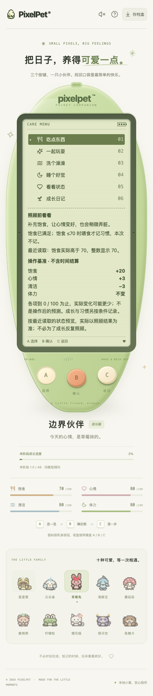
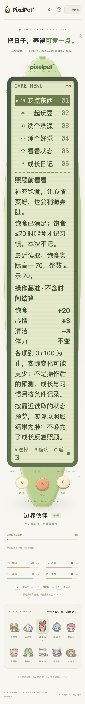

# 照顾门槛附近的整数读数

日期：2026-10-19。本批只完善照顾菜单解释，不调整养成参数。

## 问题与处理

状态条使用四舍五入的整数，服务端习惯和可照顾条件使用实际小数。因此实际饱食 70.4 会显示 70，但不满足「饱食 ≤70 才记习惯」。修改前已用独立临时库、真实 Chrome 复现：状态显示 `70/100`，菜单只说本次不记习惯，没有说明读数差异。

现在在原「照顾前看看」内，只有实际小数四舍五入到相关门槛时，增加只读说明，例如：

> 最近读取：饱食实际高于 70，整数显示 70。

涉及喂食的 70 / 96、洗澡的 65 / 99，以及睡眠的体力 100。略低于门槛也会解释「实际低于」；恰好等于门槛及普通小数不增加这一段。睡眠中喂食/洗澡、未孵化、游戏中和非照顾菜单不显示无关边界说明；睡眠菜单仍可说明体力接近满值。

- 只比较最近权威快照，不用本地时钟模拟新读数，不在客户端把小数当整数决定资格。
- 沿用原来的效果、习惯间隔、数值基准和最终回执，不以解释禁用 B，不新增轮询或自动操作。
- 喂食/洗澡门槛集中为组件内共用常量，原比较条件保持不变；不改服务端数值、奖励、三阶段成长或成年定型。
- 仍仅 A/B/C，LCD 没有新增可点击玩法控件或 live announcement。沿用原阅读布局，不缩字；大字号长页需要滚动才能到机身三键。
- schema 12、存档和备份结构不变；缺失成长记录的旧式快照仍保留原说明。

## 验证

持久回归 `web/src/CareRoundedReading.test.tsx` **35 项**：五处门槛下侧/等值、四处上侧、普通/旧式快照、抑制条件，以及三阶段 × 五条三键照顾流程。最终测试在原组件下 **25 失败 / 10 通过**，修复后通过。流程 mock 检查操作派发，不冒充实际奖励验收。

与既有照顾说明/基准/菜单/睡眠测试合跑 **131 项**通过；全量前端 **1675 项 / 75 文件**、TypeScript、生产构建通过。首次默认高并发运行出现既有测试超时，且新流程夹具误把洗澡/睡眠放在第 2/3 项（实际第 2 项是游戏目录）；修正夹具并以 `--maxWorkers=2` 重跑，未提高超时或删测试。Go 无缓存 `test -race -count=1 ./...`、`vet ./...`、构建及既有节奏算术 **6 项**通过；不代表开发了节奏游戏。

独立 SQLite + 真实 Chrome **30 组**通过：三阶段 × 五种初始值（饱食 70.4/95.6、清洁 65.4/98.6、体力 99.6）× 两种显示：

- 普通字号：390 × 844；双倍根字号 28px：320 × 568。不是任意视口/字号的完整矩阵。
- schema 1 导入测试快照，真实 API 迁移为 schema 12，并检查真实阶段、整数状态条及小数在门槛哪一侧；自然时间会有轻微结算，不伪造冻结快照。
- 用机身 A 浏览到对应菜单，照顾计数仍为 0、未入睡、未发送照顾 action。只有机身 B 才发送一次正确 action，并实际保存。
- 喂食/洗澡四组均改善实际需求、计数 +1，服务端回执为 `not-needed`、习惯/操作成长增量 0；睡眠只切入休息，回执 `resting`、不立即赠送体力或休息习惯。资格仍取实际值而非整数显示。
- 检查预览全部文字在 LCD 内容边界内、无页面横向溢出、三键至少 44px、无 LCD 可点击玩法控件、无页面错误。自动化滚动/触摸不是人工可用性认证。

两张成长期喂食门槛截图均已实际查看：

## 数据保护与未完成事项

浏览器临时库 `/tmp/pixelpet-rounded-care-s685ft/test.db`；临时脚本 `/tmp/pixelpet-rounded-care-browser.mjs`，结果 `/tmp/pet-rounded-care-browser-results.json`。日志 `/tmp/pet-rounded-care-{focused,corrected-baseline,frontend-final,build,go,browser}.log`。临时脚本不作为仓库持久测试入口，持久回归为前端测试文件。

仅启停自己的 18139 测试服务；复现用的 18138 也已停止。不修改、重置或导入玩家 `data/pixelpet.db`。玩家库 SHA256 保持 `a8b712d5419fe6227b255f4d63869612e451da7abddffd60124de8ee65c23eee`，原进程 38015 / 39567 保留。未主动刷新玩家页面或重启/部署后端；构建更新忽略的 web/dist，原服务若共用该目录，后续重载可能看到新前端。

持续迭代目标保留。真人试玩、自然长时间养成与系统输入/切换验收仍待进行；候选新游戏未开发。下一批继续依据可复现的照顾、成长和恢复问题推进。
