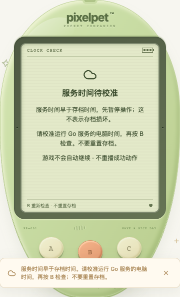

# 服务时间回拨保护（2026-10-19）

## 修复的问题

可复现的旧行为：一份能通过规则校验的存档，在服务电脑时间回拨到 `lastTick` 之前时，被归为 `save_corrupt`。前端因而提示导入或重新开始，容易让玩家误把时间问题当成存档损坏。

现在只在当前存档满足以下两个条件时返回 HTTP409 / `clock_ahead`：

1. `lastTick` 晚于服务端当前时间，当前时间下的校验失败；
2. 同一份原始状态在 `lastTick` 时刻能通过全部既有校验。

第二次校验**只用于分类**，不授权使用未来时间结算、迁移或执行动作；无法解析或在该时刻仍不合法的内容，继续走原有损坏存档诊断。导入的备份仍严格按服务端当前时间校验，不接受未来备份。

## 玩家可见行为

- LCD 显示「服务时间待校准」，说明先校准**运行 Go 服务的电脑**时间，再按 B 重新检查；不提示用重置修复时间。
- A/C 暂不操作，B 与后续定时检查只 GET 当前状态。暂停照顾、游戏、回访小结领取、导入、重置；存档盒不提供假的可导出链接。
- 服务端也阻止所有写入口，包括显式导入/重置和已有 requestId 缓存回放。阻止期间不改存档、revision、快照、访问基线、待读小结或请求记录。
- 丢弃待确认文件和过时确认状态，关闭旧帮助弹层，不显示可能过时的伙伴需求/成长；不自动替换存档。
- 时间恢复且读到有效状态后，展示当前伙伴；不重播进化/照顾动画，不自动续局，不重发之前操作。若上次写入结果未知，时间诊断本身不会把它当成已确认；仍需取得有效状态。
- 暂时失联后不把旧诊断当成新的服务响应，但仍保留只读核对路径。旧轮询不能覆盖新操作，时间恢复也不能用较低 revision 静默回退之前已知状态。

## 不改变的规则与边界

schema 仍为 11；成年形态、成长数值、最多 12 小时离线结算、睡眠规则和共享奖励额度均不改。校时后只从已保存的 `lastTick` 继续结算，不补算回拨期间的额外照顾或游戏奖励。已锁定成年形态不重选。

这是**未来时间存档的保守保护**，并非证明机器一定发生了回拨，也不是反作弊或整个 SQLite 文件修复功能。不会自动移动已有时间戳，不能判断原写入电脑和当前电脑哪一方的时间正确；若存档原先由错误的未来时间写入，需先查明时间来源，不应为了继续游戏盲目把电脑时间改到未来。没有新增时间强制覆盖/一键修复按钮。单独改变浏览器时间不能解除服务端保护。

## 验证

- 先添加失败用例复现正常未来状态被错误归为损坏，再修复。
- Go 独立临时数据库覆盖蛋、幼年、成年、睡眠、六类未完成游戏和 schema1；所有入口及旧 requestId 均受保护，原内容与其他表不变，重启仍受保护，精确追平不重复结算；另验证 1ms/1s/1h/48h 回拨、追平后 48 小时仍只结算最多 12 小时、无效未来状态仍归损坏、未来备份仍拒绝。
- 前端 **716 项 / 32 文件**、TypeScript/构建、Go 全量 race/vet/构建通过。新增分类、三键禁写/只读核对、未知结果、迟到文件、导入/重置/小结拒绝、断网再连、旧轮询、重复 B 和帮助弹层测试。
- 独立 SQLite + 真实 Chrome 的布局、响应丢失、暂停和重启证据见 [开发记录](PROGRESS.md)。只在测试库注入合法的未来状态，不更改系统时间，也不加载或代玩玩家存档。

复测：`pnpm --dir web test`、`pnpm --dir web build`、Go race/vet/build。浏览器故障注入必须使用新建的临时数据库；不得在 `data/pixelpet.db` 上修改时间或导入测试文件。本批不是六游戏完整通关或全部浏览器认证。
