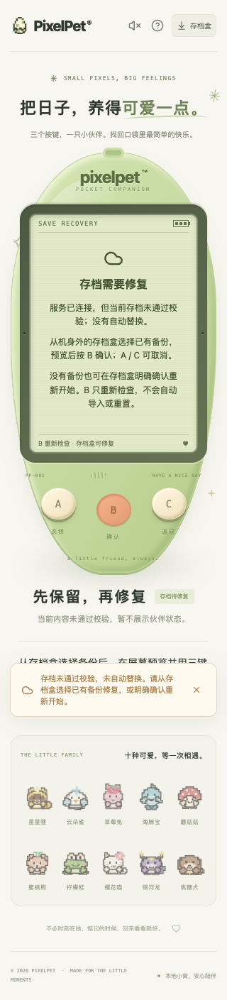

# 损坏存档的明确修复（2026-10-19）

## 修复的是哪一层

本批补上一个实际缺口：服务端原本允许用有效备份替换损坏的存档内容，但前端把校验失败当成普通断线，反而禁用了修复入口。

现在只在服务端明确返回 **HTTP 409 + `code: save_corrupt`** 时，显示「存档需要修复」，开放机身外存档盒的导入与重新开始。普通网络失败、5xx、其他错误码、错误文字相似都不能开放修复。修复权限不是根据浏览器缓存推断的；连接再次失败就收回，并丢弃未确认的备份。

这里的损坏指 **SQLite 可读、`saves.body` 中的当前存档 JSON 无法解析或无法通过规则校验**，包括不支持的版本。不是整个 SQLite 文件损坏、丢失表、磁盘权限或硬盘故障的自动恢复工具。不猜测应该恢复哪个快照，不自动覆盖现有数据。

## 玩家如何操作

- **A / C 不照顾、不孵化、不重置。B 只重新检查当前存档。**修复页不会谎报已保存，也不会把最后一次读到的宠物当成当前有效状态。
- 有备份：从外壳外的存档盒选择文件；LCD 仍只读预览，**B 确认整份替换，A / C 取消**。当前存档无法正常导出时，会明确说明，不再给出无法完成的「先导出」建议。
- 没有备份：存档盒中的「重新开始」仍需单独确认；确认前说明会用新蛋替换无法读取的存档。取消不产生重置。
- 有效导入或确认重置前，事务保存原始损坏内容快照；校验失败则不替换、不创建伪成功。快照沿用最近 10 份保留规则，不是永久归档，也没有新增快照浏览/一键回滚界面。
- 重复的损坏诊断不会关闭存档盒、重置弹层或备份预览。其他页面/窗口完成有效修复后，B 重新读取可回到正常状态，不重播进化、不自动照顾或续跑游戏。

## 不确定请求与旧档边界

导入/重置响应丢失时，仍进入「先核对，再继续」，禁用工具写入口、丢弃原待确认文件，**不自动重发**。B 读取有效状态则展示当前存档；若此次只读核对明确诊断当前内容损坏，则转为手动修复，必须重新选文件、预览并确认，不能复用上次待发送内容。

核对是当前状态快照，**不证明任何其他在途写请求已经取消或绝不执行**，不是跨网络 exactly-once 保证。

修复可能重新建立 revision；明确诊断后不再用上一代健康存档的 revision 拒绝有效修复结果。写入前已启动的旧轮询依然通过 epoch 作废，不能覆盖修复后的状态。普通健康存档与未知写结果的旧 revision 防护不变。

存档 schema 仍为 11，旧备份仍由服务端严格校验、迁移、最多 12 小时离线结算；成年形态不在前端重算。确认导入仍会清理未完成游戏、不发完成奖励。当前存档无效时，不对不可信的已解析游戏字段执行实际游戏结算；原始内容单独用于快照。

## 验证

前端 695 项 / 31 文件、TypeScript/构建、Go race/vet/构建通过。独立 SQLite + 真实 Chrome 完成 108 个损坏/预览/取消/拒绝/提交中布局状态检查，以及 5 条网络故障、外部修复与轮询/重启链路；另有 192 个阅读/暂停布局和焦点/长按/触摸回归。还实际修复了手机确认弹层越界导致关闭按钮不可点的问题，弹层与修复标题支持根字号放大。细分证据与未覆盖边界见 [开发记录](PROGRESS.md)。所有破坏性测试只修改新建的 `/tmp` 测试数据库；玩家存档校验和不变，不修改或代玩。开发自测不等于用户反馈或所有浏览器/辅助技术认证。

复测：`pnpm --dir web test`、`pnpm --dir web build`、Go 的 race/vet/构建。真实浏览器需实际损坏独立数据库中的存档内容，验证预览/取消、明确导入/重置、原始快照、服务端拒绝、请求前阻断/提交后丢响应、断线收回权限、其他窗口修复和重启；不能只模拟一张成功截图。
