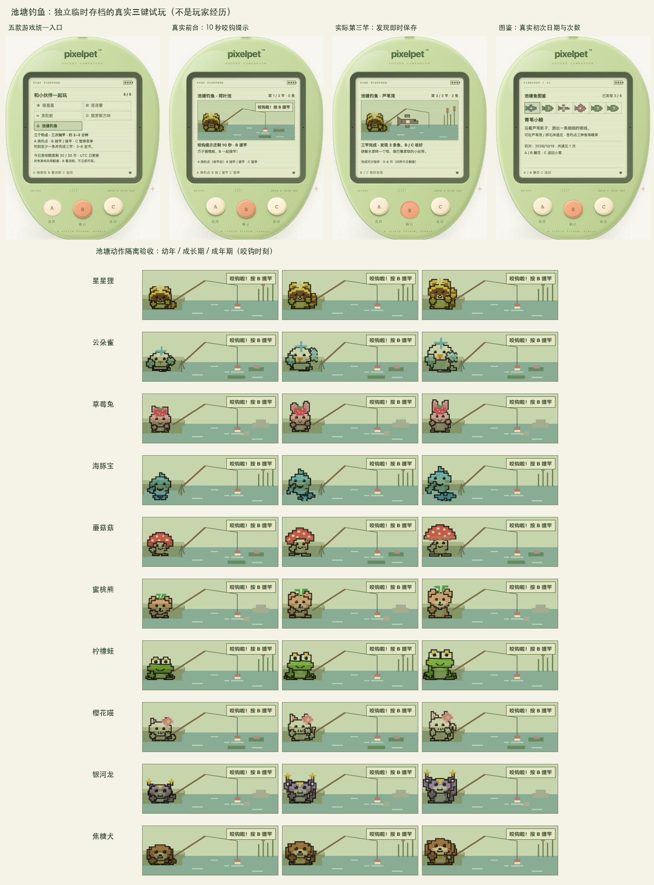

# 池塘钓鱼与真实鱼图鉴

## 三键慢慢玩

「一起玩耍」第五项，可随时重看两页说明，不提前开始会话。

- **A 换钓点**：未抛竿或上一竿收好后，在芦苇湾 / 荷叶池 / 卵石岸之间循环；鱼竿在水里时不换。
- **B 抛竿 / 提竿**：每局三次机会。新抛竿等待 18–26 秒；已有进行中旧局会保留原定等待时间（旧规则最长 40 秒）。出现「咬钩啦！按 B 提竿」后有 10 秒反应窗，文字与剩余秒数常显，不必须开声音或动画。提早或错过只消耗当前竿，不增加额外状态惩罚。
- **C 暂停菜单**：A 选继续 / 看看鱼图鉴 / 放弃本局 / 风景手记 / 玩法说明，B 确认，C 直接继续。图鉴 A 上一页、B 下一页、C 返回暂停菜单，不自动恢复。放弃有二次确认，取消确认仍暂停。
- 三竿结束后 **B/C 收好发现**，不自动领币、不再抛竿；约 1–2 分钟，暂停不算倒计时。

页面离开、后台、刷新或打开工具/说明后不自动继续；回来手动继续。前台约每 1,050ms 发送一次已确认节拍，服务端至少相隔 1,000ms、一次最多记 1,500ms。超过 3,500ms 没有节拍会持久化暂停，不按墙上时间补跑、不离线耗尽反应窗。刚离开时已发出的一个请求可能正常完成，不承诺撤销在途请求。

## 暂停时看懂所选操作

暂停菜单统一是 **A 选择、B 确认、C 直接继续**。下方不再沿用运行中的「B 抛竿 / 提竿、C 暂停」，而是随所选项解释后果：

- **继续钓鱼**：未抛／收竿后不会自动抛下一竿；等待中接着等咬钩，提前提竿仍消耗机会；咬钩阶段继续后按 B 提竿，不重抛、不补跑。
- **看看鱼图鉴／风景手记／玩法说明**：只读回看，C 返回暂停，不自动继续。
- **放弃本局**：先打开确认页，确认才放弃；不计陪伴或金币，实际钓获仍在累计图鉴。

暂停菜单下方会用动态播报重复当前选项的后果；切换 A 选项时，屏幕阅读器可以直接听到新的说明。它只是说明当前三键行为，不增加按键、缩短等待或改变奖励；三竿完成仍显示原有收好提示和结算条件。真实浏览器回归沿用 `scripts/check-fishing-casts.mjs` 的独立构建／随机端口／临时数据库保护，不访问玩家服务。

## 看懂三竿机会

顶部显示「已抛 0 / 3 竿」到「已抛 3 / 3 竿」，表示本局已用掉的抛竿次数，不是当前竿的序号或钓获数。只有未暂停、可抛下一竿时，下方才显示「还可抛 N 竿」和换钓点／抛竿操作。

抛竿就占用一次机会，提前提竿也不会退回；暂停、继续和刷新不恢复次数。第三竿正在等待或咬钩时仍可按 B 提竿，不显示「剩余 0 次」来打断当前竿的提示；三竿结束后改为收好及陪伴／金币条件，不再邀请抛竿。不改变等待时长、概率或奖励，也不提前透露鱼种或咬钩时间。

## 八种鱼、三个地方

| 钓点 | 可遇见鱼 |
| --- | --- |
| 芦苇湾 | 青苇小鲦、暖阳小鲤、丝带泥鳅、柳影小鳉 |
| 荷叶池 | 暖阳小鲤、荷花小鱼、月纹小鲈 |
| 卵石岸 | 青苇小鲦、月纹小鲈、石斑虾虎 |

八种鱼有独立模样和故事。schema 20 以前的存档仍显示原有六种普通鱼和雨珠小鲤；升级到 schema 20 后，芦苇湾的晴 / 云景会把柳影小鳉加入四种等概率池，虚构雨景继续只使用雨珠小鲤规则（每竿 1/8，普通鱼各 7/24），新鱼不会在雨景出现。柳影小鳉只在芦苇湾出现，不增加奖励，也不要求按现实天气或时间上线。详见 [RAIN_FISH.md](RAIN_FISH.md)。没有付费鱼饵、按现实时间刷新的稀有度或打卡条件。鱼类由服务端随机决定，不接受客户端提交钓获。

**成功提竿时即时保存**鱼 ID、首次日期、最近日期及遇见次数（最多 9,999）。未发现时仅剪影和可遇见地点，不编造旧存档经历；重复鱼更新次数。小窝末项「池塘鱼图鉴」可随时查看；没有鱼也可以看。放弃保留实际发现，但不会获得陪伴、成长、金币或首次完成纪念。

## 本次钓获回看（2026-10-20）

暂停和三竿结束未收好时，可以阅读「本次钓到的小鱼」：按实际钓到的先后，显示名字、模样和短描述。重复鱼保留各自一行；编号是**第几条鱼，不是第几竿**，最后一竿提前提竿或错过也不会遮掉前面的钓获。

- 只使用服务端已保存的本局 `catches`，不从候选鱼、上一竿或累计图鉴推测；零钓获、旧 null／缺省清单显示空态。
- Tab 进入后用方向键／空格原生滚动；聚焦清单时 Enter 不继续或收好，明确 A/B/C 和机身三键保持原规则。运行中隐藏清单，不遮挡鱼漂和咬钩提示。
- 刷新后仍可回看本局保存的钓获，返回累计鱼图鉴仍暂停。读清单不续玩、不结算、不重复更新图鉴。
- 鱼在钓到时已经记入累计图鉴，放弃也保留；本局清单随收好／放弃结束，不是新的永久收藏。陪伴和金币仍要求三竿完成、至少一条并手动收好。

独立构建后可运行 `scripts/check-fishing-catches.mjs`，需设置绝对路径 `PIXELPET_TEST_BINARY`、`PIXELPET_TEST_WEB` 和可选 `PIXELPET_PLAYWRIGHT_MODULE`；脚本拒绝共享 bin／dist，使用自己的临时数据库和随机端口。真实时钟钓获与布局响应夹具分别记录，不能把后者当成真实随机钓鱼证据。

## 自动步进时也能按 C 暂停（2026-10-21）

等待／咬钩时约每秒的自动步进正在保存，C 仍可请求暂停：先停止本地运行，当前步进成功后再使用服务端确认的新步数保存一次暂停。不让 C 静默丢失，也不并发发送旧步数。

- 仅对钓鱼自动 `fish-step` 开放 C；A／B、主动抛竿／提竿／收好等请求仍锁定，不是通用操作队列。已请求暂停后，重复 C 不会继续或追加请求。
- 请求失败、回复未知、会话／存档代际变化、帮助／失焦／后台／卸载都会放弃待保存意图；保持本地停止，按既有流程核对和明确继续，不补发或重放。
- 不改变等待、咬钩反应窗、鱼种、图鉴、成长或奖励，不新增第四个按键。

隔离 Chrome 回归 `scripts/check-fishing-pulse-pause.mjs` 使用与上节相同的构建环境变量，主动暂扣真实 HTTP 步进响应，检查成功后串行暂停、未知／已拒绝响应不重放，以及帮助／模拟失焦撤销。受控响应与模拟视口不冒称自然网络故障或实体手机验收。

## 宠物不是装饰

十只宠物沿用各自幼年 / 成长 / 成年 SVG 骨架与已穿饰品。星星狸、兔、熊、蛙、猫、龙、犬用自己的爪 / 蹼掌；鸟、海豚与蘑菇使用竿架，分别由翅尖、胸鳍和短臂参与，不添加通用手臂。等候时有尾、耳、头、翅或菌盖小动作；咬钩时真实肢体回应，成功后显示实际钓获。

独立 `fishing` 动作模式隔离小窝待机动画，避免成年/幼年待机抢走钓竿姿势。减少动态效果下关闭持续动画，保留静态姿势、咬钩文字、秒数及结果。

## 等待氛围补充（2026-10-19）

等待时浮漂缓慢横向轻漂，水面有像素环；与真实咬钩时快速下沉及「咬钩啦！按 B 提竿」明确区分。原有陪伴文案每 8 秒按服务端已确认等待进度轮换，不添加本地倒计时、不提前透露鱼种。固定提示仍提醒尚未咬钩。

暂停时池塘全部动画（含宠物眨眼）停止，刷新保持暂停；减少动态效果下全程静态，文字与操作信息保留。新抛竿等待 18–26 秒；已有旧局保留保存的等待时间。不改变 10 秒反应窗、概率或奖励，不加音效。验收与独立复跑方式见 [FISHING_ATMOSPHERE.md](FISHING_ATMOSPHERE.md)。

## 陪伴、金币、成长与纪念

必须三竿完成、至少钓到一条后手动收好：心情 +12、体力 -4、饱食 -2，记录一次有效陪伴；成长沿用原陪玩 30 分钟奖励间隔，不靠反复抛竿刷成长，不改变已锁定成年形态。第一次符合条件的完成留下「池塘边的一起等待」永久纪念。

金币 `max(3, 2 × 钓到数)`，即一 / 二 / 三条为 3 / 4 / 6 币，与其他六款游戏共享每日 30 及钱包容量限制。额度耗尽或钱包满仍可玩、发现鱼和记录真实陪伴。三竿全空、暂停、刷新、放弃不结算；会话 ID、步数、请求 ID 与事务防止过时操作和重复领奖。

## 存档兼容与校验

schema 8 新增 `pond` 与 `game.fishing`。兼容 1–7：先按既有规则推进正常养成时间，新建空图鉴，保留原物种、成长、钱包、装备、纪念和旧游戏会话，迁移前保存原始快照，不补造鱼类历史。钓鱼暂停与续局由服务端存档保存，导出保留发现；恢复备份仍清除进行中游戏，不能导入重复领成绩。

严格校验鱼 ID / 唯一性 / 次数 / 日期、钓点与候选鱼、阶段 / 三竿 / 钓获 / 时间窗口 / 结果关系以及图鉴交叉引用；错误导入不替换当前数据。它仍是可导入本地备份的单机游戏，不宣称联网防作弊经济。

## 验收（2026-10-19）

- 前端全量 **488 项 / 23 文件**、类型检查与生产构建；Go 全量竞态测试、vet 与构建通过。覆盖早提 / 漏提、服务端节奏、暂停 / 超时租约 / 重启、错误会话及步数、并发幂等、发现持久化 / 次数上限、额度 / 钱包 / 成长、旧档迁移、严格 HTTP 输入和导入回滚。
- 真实 Chrome、独立临时 SQLite：**真实时钟三竿成功**，中途暂停、未知 / 已知图鉴、收好前不发币、结束一次性 6 币 / 一次陪伴 / 首次纪念；刷新不补跑、放弃保留发现、零额度 / 满钱包仍能开局。共 **135 项布局检查**，其中十只 × 三阶段 × 桌面 / 390px × 正常 / 减少动态效果共 **120 组角色布局**，无运行错误或 LCD 点击控件。
- 另用无 API 的隔离组件验收十只 × 三阶段 × 四状态（准备 / 等待 / 咬钩 / 成功）× 两宽度 × 两动态设置，共 **480 组解剖动作**：真实阶段与肢体、钓鱼动作独占、无小窝待机动画覆盖、减少动态效果无持续动画。人工复核三阶段咬钩矩阵及真实游戏截图。
- 截图是临时存档的实际游玩和隔离角色预览，**不是玩家成长历史**；测试未访问、重置、导入或代操作 `data/pixelpet.db`。

## 后续氛围：虚构口袋风景

同一局从已保存会话 ID 选择天气/季节/晨昏背景，换钓点与刷新不变；明确标注为虚构，不新增现实天气限制、稀有鱼条件或资源。游玩中简短标记、真实咬钩时让位、暂停/完成时陪伴短句；不写入鱼图鉴。见 [OUTING_SCENERY.md](OUTING_SCENERY.md)。

## 可选声音反馈

默认静音。打开顶部原声音开关后，新发生且已确认的咬钩可有一次短提示音；已有咬钩继续、刷新和网络恢复不补播，浏览器未允许音频则静音。原文字和倒计时始终保留，不需要声音也能玩。音效只辅助提示，不改变等待、反应窗或概率，设计与验收见 [FISHING_ATMOSPHERE.md](FISHING_ATMOSPHERE.md)。

## 暂停菜单的大字号阅读

阅读模式中的四项暂停菜单使用原区域的可用宽度，不再固定为 120px，使 320px 屏幕和双倍字号下不因空置的左右空间而过早折行。保持自然换行、三键顺序及运行中的 102px 池塘高度；回归和限制见 [FISHING_PAUSE_LAYOUT.md](FISHING_PAUSE_LAYOUT.md)。

## 2026-10-25 · 咬钩提示使用预先存在的播报区

从准备／等待进入咬钩时，既有的「咬钩啦！按 B 提竿」现在放在预先保留的 `role="status"` 区域内；同一节点先为空，确认咬钩后才填入可见文字，不额外复制一份隐藏对白。逐秒倒计时仍在另一个 `aria-live="off"` 的区域，普通步进和同步不改写咬钩播报区。

本地或服务端暂停会清空这条运行提示；手动继续已保存的咬钩时重新给出当前 B 操作说明，收竿后清空，下一竿实际咬钩再显示。文字提示与短音采用各自原有规则：手动继续可以重新提示操作，但不会补播短音。等待时不提前揭示候选鱼或咬钩时间，三键、时长、奖励和存档字段均不变。

回归见 `web/src/FishingAnnouncements.test.tsx`、`web/src/FishingCue.test.tsx` 与 `scripts/check-fishing-cue.mjs`。组件／浏览器检查证明节点预先建立、保持身份、倒计时不重复写入、暂停边界和可见文字布局；没有据此宣称已复现或修复某款读屏器的实际漏读，真人读屏时序与舒适度仍待验证。

浏览器定向命令为 `node scripts/check-fishing-cue.mjs --fixtures-only`，仍须传入独立的 `PIXELPET_TEST_BINARY`、`PIXELPET_TEST_WEB` 和 `PIXELPET_PLAYWRIGHT_MODULE`。该模式只运行拦截响应的提示／声音边界与布局回归；省略参数才包含正常时钟的两竿钓鱼，不把响应夹具计为自然钓获。

## 图鉴翻页的位置播报

鱼图鉴沿用 A 上一页、B 下一页、C 返回。每页有一个稳定的读屏状态区，包含「第几页／总页数」、当前已发现鱼名及三键操作；未发现时只读「还未遇见的小鱼」。从钓鱼暂停菜单进入时明确返回暂停菜单，从小窝进入时返回小窝。

页数按当前存档协议显示：旧版 6 种、含雨景鱼的版本 7 种、含柳影小鳉的版本 8 种。普通状态同步、遇见次数或日期更新不会重复改写同页播报；详情仍可按原来的阅读顺序查看。没有增加玩法按钮或存档字段。

组件回归见 `CollectionSelectionStatus.test.tsx` 与 `CollectionDirection.test.tsx`；浏览器回归沿用 `scripts/check-collection-reading.mjs`，使用独立构建和临时存档，检查真实 HTTP 同步、双向翻页、原生按键焦点、刷新及 320px 双倍根字号。发现记录是明确导入的布局夹具，不代表自然钓获；DOM 状态检查也不替代真人读屏体验。实际结果见[开发进度](PROGRESS.md)。
