# 成长与进化规则

## 三个阶段

角色种类与名字保持不变，十只原创宠物共用成长规则。

| 阶段 | 累计成长值 | 画面 |
| --- | --- | --- |
| 幼年期 | 0–24 | 草莓兔短折耳团坐踢脚，樱花喵团坐探爪、短尾环抱，星星狸团坐抱尾，云朵雀绒团收翼，海豚宝团身拢鳍，蘑菇菇裹盖团坐，蜜桃熊桃团抱爪，柠檬蛙团蹲拢蹼，银河龙抱尾拢翼，焦糖犬趴团抱爪 |
| 成长期 | 24–72 | 草莓兔竖耳踏步，樱花喵侧耳观察、探脚试步，星星狸探头踏步，云朵雀探脚试翼，海豚宝扬鳍试游，蘑菇菇歪盖探步，蜜桃熊探身踏步，柠檬蛙探身试跃，银河龙探身试翼，焦糖犬侧耳探步 |
| 成年期 | 72 | 草莓兔舒展转头，樱花喵端坐理毛、卷尾摆动，星星狸竖尾望星，云朵雀停栖梳羽，海豚宝舒身摆尾，蘑菇菇展盖轻摇，蜜桃熊挺身揉颊，柠檬蛙舒蹼鸣唱，银河龙展翼望星，焦糖犬坐稳摇尾；共用成年配饰和固定形态标记 |

阶段由 Go 后端结算并保存，前端不再仅用出生时间判断。进化写入成长日记；在线跨阶段时，照顾动作结束后播放庆祝，C 可以跳过，不会撤销进化。睡眠中的在线进化会等到起床动作结束再庆祝，不打断睡眠。离线进化会保留新形态与日记，刷新不反复播放。

进度条显示**本阶段**：幼年为 0/24，成长期重新从 0/48 起算，达到成年后保持 100%。出生天数仍按真实时间显示。

## 照顾影响成长速度

每小时基础成长值 = `0.5 + 0.75 × 平均舒适度`，舒适度取饱食、心情、清洁、体力的平均值并除以 100。实际结算对状态随时间的变化积分，不用结算前后某一个瞬间代替整段时间。

- 状态越舒适，成长越快；基础速度范围为每小时 0.5–1.25 点。
- 单次离线状态与成长最多结算 12 小时，不永久死亡。
- 同一段不超过 12 小时的时间，频繁刷新与一次离线结算结果一致；刷新本身不奖励成长。
- 以下有效照顾另获得 0.25 点，喂食、洗澡、完成陪玩各自有 30 分钟奖励间隔。

| 行为 | 有效照顾记录 |
| --- | --- |
| 喂食 | 操作前饱食 ≤70；营养习惯 +1 |
| 洗澡 | 操作前清洁 ≤65；清洁习惯 +1 |
| 陪玩 | 完整五轮接星星、八对连连看，或贪吃蛇吃到至少三颗后完成；陪玩习惯 +1，开始或中途退出不计 |
| 睡觉 | 每恢复 28 点体力，休息习惯 +1，并获得 0.25 成长值；按实际恢复量连续计入 |

满体力睡眠不再积累休息奖励；不需要时的喂食、洗澡以及反复点按不会刷成长奖励。普通照顾仍按原规则改善当前状态，舒适状态也会帮助之后的成长。

## 成年形态

成年时按已经记录的照顾习惯确定一种形态，同一规则适用于十只宠物：

1. 已记录至少 12 小时且平均舒适度 <45%：**自在型**，叶子配饰；之后仍可继续照顾。
2. 陪玩习惯 ≥2，且大于恬静分数的 1.5 倍：**活力型**，闪电与小领巾，待机更活泼。
3. 恬静分数 ≥2，且大于陪玩习惯的 1.5 倍：**恬静型**，花朵胸针，待机更舒缓。
4. 其他情况：**均衡型**，星形领饰与小皇冠标记。

恬静分数 = `(清洁习惯 + 有效休息习惯) / 2`。适时喂食主要改善舒适度与成长速度。形态在实际达到成年门槛的时刻锁定，离线结算会先结算到进化时刻，再结算剩余时间；不会把成年后的状态和习惯用于选择形态。因此同一段时间的离线结算与频繁刷新会得到一致的阶段、进化时间和成年形态（时间精度为毫秒）。之后继续记录照顾，不因刷新或后来状态变化而改变成年形态。

## 三个按键

照顾菜单包含「成长手册」与「回访小结」，菜单最多显示六行并随 A 的选择移动。A 或 B 向后翻页，第三页后回到第一页；C 从任意页返回小窝。每次重新打开从第一页开始，翻阅不发送照顾操作、不奖励成长、不提前进化；屏幕没有可点击控件。

手册共有三页：

1. **成长路线**：同时预览同一只宠物的幼年、成长、成年外观，复用实际场景的角色素材与像素配饰（草莓兔、樱花喵、星星狸、云朵雀、海豚宝、蘑菇菇、蜜桃熊、柠檬蛙、银河龙与焦糖犬各为三套独立造型）；标出当前阶段并显示本阶段进度。成年外观按当前倾向预览，明确标注「尚未确定」；成年后使用已保存的固定形态。
2. **照顾习惯**：查看喂食、陪玩、清洁、有效休息与平均舒适度。成年前说明奖励条件，成年后明确不再加成长点；喂食/洗澡/完整陪玩有 30 分钟间隔，休息按实际体力恢复积累。
3. **形态依据**：显示当前陪玩、恬静分、记录时长与平均舒适度，以及恬静分公式；按舒适度优先、再比较习惯的判定顺序列出四种形态规则。成年前高亮当前倾向，成年后高亮已确定形态，并提醒当前习惯不是成年时的快照，不反推不存在的历史原因。

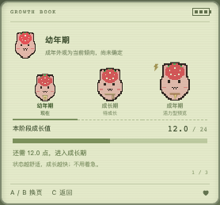
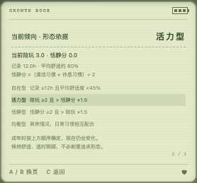

## 独立成长动作样板：草莓兔

草莓兔现有三套独立绘制的像素 SVG 造型，共用 **64×68 画布、104×110 的场景尺寸**，不是按阶段放大原始合图。幼年的头身比例、折耳和团坐脚，成长期的竖耳、身躯和交替步伐，成年的长耳、展开站姿与头部动作分别设计；耳、头、身体、尾巴、双手与双脚均为可独立活动的部件。保留粉色毛、草莓额饰和像素轮廓。

- 幼年：歪歪短耳、坐着踢脚；成长：侧耳倾听、交替踏步；成年：舒展耳朵、轻轻转头与挥手。
- 成年形态有轻动作差异：活力型交替小步、恬静型缓缓点头、自在型松松垂耳，均衡型保留舒展与观察；不会改写服务端保存的形态。
- 照顾动作使用真实手脚：吃饭把手送到嘴边，洗澡交替搓洗，睡觉垂耳与呼吸，醒来伸手，进化时挥手；需求动作让位于照顾/睡眠/庆祝。
- 小窝、选择预览、状态头像、成长手册和接星星中的草莓兔均使用同一套阶段素材。手册的三张预览统一缩小显示，不用不同缩放伪造阶段差异。
- 减少动态效果时停止动画，仍保留闭眼、垂耳、揉眼或摸肚等静态姿态；吃饭、浴盆和睡眠道具已做三阶段实测。

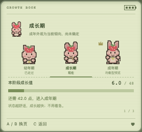
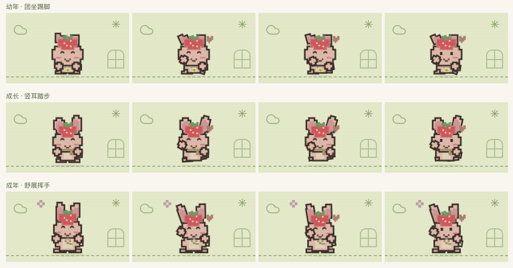

草莓兔是第一只完整动作样板，之后推广到樱花喵、星星狸、云朵雀、海豚宝、蘑菇菇、蜜桃熊、柠檬蛙、银河龙与焦糖犬。**当前独立三阶段造型与动作已完成 10 / 10。**十只均有各自的照顾、需求反馈和四种成年形态小习惯，不再以缩放原始角色图代替成长。原始角色合图保持不变。

## 首轮角色推广：樱花喵

保留原图的白色毛、粉色耳内、方形胡须与黄心樱花，另绘三套头、身躯、耳、手脚与尾巴，仍使用 **64×68 画布、104×110 场景尺寸**。并非复制兔子换色，也不是换围兜再缩放：

- 幼年团坐，短耳、大头、探爪与短尾环抱；成长期耳朵竖起，侧头观察、探脚试步，尾巴伸长；成年端坐理毛，尾尖卷曲，耳朵倾听并轻轻摆尾。
- 吃饭送爪与低头咀嚼，洗澡双爪搓洗、耳朵收拢，睡眠垂耳收爪、卷尾呼吸，起床双爪伸展，庆祝交替举爪。需求直接使用骨架手爪，不额外叠加第二双手。
- 成年均衡型保留理毛、招呼与倾听；活力型交替踩踏，恬静型缓缓点头，自在型慢慢摆尾。饥饿、疲惫、脏或想安静时不做兴奋小习惯；睡眠/照顾/进化优先。全是视觉表现，不改存档中的成年形态。
- 选择、小窝、状态、手册三阶段预览、接星星与纪念册共用 `PetArt` 的统一骨架注册表。纪念册的相遇/成长/成年卡使用当时阶段，不把所有卡都画成当前成猫。
- 兔子动作 CSS 限定在兔子骨架内，防止另一只动物沿用兔子耳朵和手爪动作。减少动态效果时停止动画，但保留闭眼、收耳与照顾姿势。

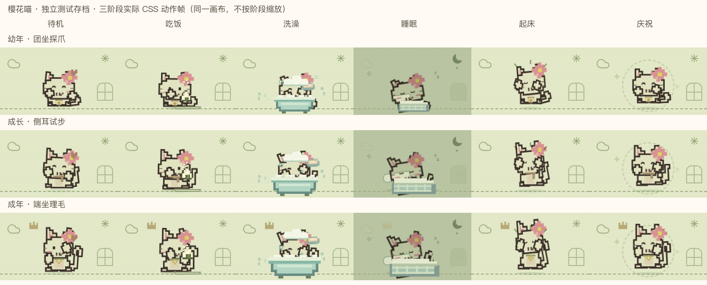

## 主动需求表达

需求来自后端已保存并结算的当前状态，不新增字段、不发送照顾请求、无额外奖励或随机/AI 判断。

1. 饱食、体力、清洁中存在 ≤25 的紧急项时，最低数值优先；平手固定依次为饱食、体力、清洁，不因轮询来回切换。
2. 没有紧急项时，饱食 ≤55、体力 ≤40、清洁 ≤45 各自表示需要照顾；有多个时比较数值/阈值的比例，较低者优先。
3. 身体需求满足后，心情 ≤60 且体力 ≥45 时推小球邀玩；体力在 40–45 之间时安静相伴，不催着游戏。其他情况微笑挥手表达满足。
4. 饥饿摸肚子、疲惫半睁眼揉眼/打哈欠、脏了挠头、想玩推球、满足眯眼挥手。睡眠、吃饭、洗澡、起床与进化优先，小游戏中不显示需求手势。
5. 喂食/清洁成功保存后立刻重新判断，已经吃饱不会继续喊饿；仍未吃饱则不虚报满足。失败不改变状态或表情，刷新只是恢复当前表达，不重播奖励或弹窗。

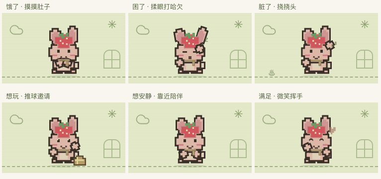

玩法仍只使用 A / B / C；需求只是一种持续表达，不会强制玩家操作或阻塞进程。

## 看得见的照顾结果

- 小窝下方两行展示宠物心情与下一阶段还差多少成长点；成年后提示已固定的形态。
- 喂食、洗澡或完整陪玩保存成功后，显示本次实际获得的成长点与习惯。例如「成长 +0.25 · 喂食习惯 +1」。不把操作前结算的自然成长算作按键奖励。
- 达到成年上限的最后一笔奖励按实际差值显示；成年后仍可积累照顾习惯，但不显示不存在的成长加点。
- 不满足饱食/清洁条件时说明条件；同类奖励尚在 30 分钟间隔内时显示剩余分钟。此时状态改善与额外成长奖励分开说明。
- 睡觉只解释体力恢复与休息习惯的关系，不把按下睡眠键算成即时奖励；体力已满时不会凭空累计休息。
- 反馈在照顾及进化动画完成后保留 8 秒；C 跳过画面不撤销保存，也不立即清除反馈。下一次操作会替换旧反馈，失败不会显示成功结果。
- 响应增加可选的 `careFeedback`，来自事务内实际操作前后的差值；幂等重试返回同一反馈，不重复奖励。反馈不写入宠物 JSON 存档，普通刷新与轮询不重播，不新增存档字段或改变现有奖励规则。
- 仍只有 A / B / C 三个玩法按键，没有新增可点击的屏幕控件。

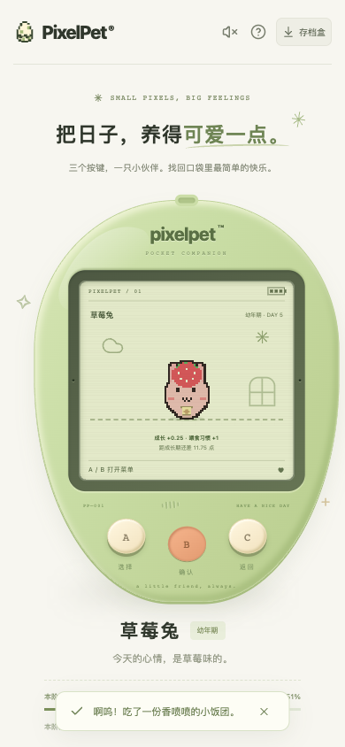

## 存档升级

- 纪念册初版格式为 `schema: 3`（当前完整存档为 schema 7），保留 `growth`，新增独立的 `album` 对象。读取或导入 schema 1 / 2 时先严格校验，再原子升级；数据库升级前保留原始 JSON 快照。
- schema 1 按真实年龄保留原有阶段和对应成长值，成年旧宠物默认均衡型；schema 2 原有成长与固定形态原样保留。不会倒退或重置角色、名字、照顾次数。
- 先结算旧版本剩余时间，再开启纪念册；过去未记录的习惯与共同经历不推测。旧版成长时间可能是先前迁移时生成，只标为「旧存档记录时间」，不冒充亲历日期。
- `album.since` 是本册开启时间，`legacy` 表示是否在已孵化后补开；结构化 `entries` 独立于最近 30 条日记。`source` 区分真实记录 (`shared`)、旧存档沿用 (`saved`) 和自然经过时间 (`elapsed`)。
- 无效成长值、非法阶段、未来里程碑、重复/未知回忆、非法来源、错误分数/天数/成年形态会拒绝导入，当前存档不受影响。幂等请求不会重复奖励、进化或记忆。
- 导出包含完整纪念册；导入深拷贝成长、回忆和日记，不改写调用者的备份对象；重置新宠物会开启新的空纪念册。

## 回访小结

- 页面可见时每 15 秒通过 `POST /api/visit` 记录前台访问；隐藏页面不发送心跳。普通状态读取和导出备份仍会结算，但不代表玩家回来。
- 两次前台活动间隔至少 15 分钟后，比较上次活动后的快照与本次操作前已结算的状态，记录真实饱食、心情、清洁、体力、成长、有效休息及阶段变化。立即喂食不会混进离开期间的变化。
- 两页通过 A 循环翻页、B 继续/完成、C 返回；阶段跨越明确标出。离开时长与真实结算时长分开，仍遵守每次离线最多结算 12 小时，不额外送奖励。
- 小结与待展示标记保存在独立 SQLite 表，与宠物 JSON 的成长、纪念册分开保存。首次使用旧存档仅建立基线，不伪造此前的回访历史；导入/重置清掉当前安装的小结。
- 自动展示只在小窝、醒着、无游戏且照顾与进化动画结束后，通过 `POST /api/recap/read` 原子认领。同一小结只有一个标签页能认领；认领后刷新和服务重启不自动重播。若认领响应丢失，仍可通过菜单主动重看最近小结。
- 睡眠/小游戏不会消费待展示小结，醒来或退出游戏后再看；手动阅读没有成长或金币奖励。后台读取不让真实离开被轮询误算成在线。

## 永久纪念册

- 菜单中的「永久纪念册」进入；封面显示实际相识天数，A / B 循环查看封面和已有卡片，C 返回，重新打开回到封面。屏幕无新增可点击玩法控件，无解锁清单、任务进度或奖励。
- 每类真实经历记录一次：相遇、首次成长期、首次成年、第一次保存成功的饭/澡/晚安、完整接星星、首次五颗全中。零分也保留温柔的共同游戏回忆；开始/取消小游戏、无效操作不记忆。
- 成长期/成年卡使用后端实际阈值时间，成年卡保存已确定的形态，不反向影响成长、照顾奖励或成年形态。后续更高分不覆盖第一场的分数。
- 相识 1 / 7 / 30 / 100 / 369 / 1000 天保留自然时间纪念，日期为孵化时间加对应天数，和最多 12 小时的状态结算分开；它不是连续登录或实际陪玩时长，不必每天来。
- 旧存档不从照顾次数或日记文字猜测历史。沿用相遇日期、成长记录及成年形态，可能来自旧版迁移的日期有明确说明。旧宠物后续的「第一顿」指纪念册开启后首次记下，不声称是一生第一次。
- 仅手动打开，没有自动纪念弹窗；睡眠中翻阅不会唤醒，新的回访小结等回到小窝再展示。轮询、刷新、备份导出与服务重启不重复记忆、不额外送奖励。

## 外观商店与成长隔离

- 当前存档 schema 7（新增俄罗斯方块会话与纪念，保留旧版贪吃蛇、连连看及钱包/穿戴）；schema 1/2 先按原规则迁移成长和纪念册，schema 3 保留原成长与纪念册，再创建零金币、空库存的钱包。不会补发旧签到、游戏收益或猜测旧穿戴经历，升级前保存原始快照。
- 饰品和小窝装饰只影响外观，不改状态、成长积分、照顾习惯、进化时间或已锁定成年形态；饰品替代同位置的默认成长配饰，收起后恢复默认配饰。
- 第一次实际穿戴、第一次摆放各保留一条永久记忆，并保存物品 ID；购买和试穿本身不产生共同经历。卸下、换装、刷新不重复记录。
- 具体日常金币、游戏结算、目录和旧存档兼容见 [ECONOMY.md](ECONOMY.md)。

## 独立成长动作推广：星星狸

- 与前两只共用 64×68 画布和 104×110 场景尺寸，但头身、耳、口鼻、围胸、四肢与条纹尾分别按阶段独立绘制，保留原角色的金黄毛色、棕色眼罩、奶油围胸与额头星。
- 幼年团坐抱尾，成长期探头踏步，成年竖尾望星；耳、头、爪、脚、身体和尾巴分别活动。吃饭用真爪送食并咀嚼，洗澡搓爪甩尾，睡眠闭眼呼吸，起床伸展，游戏后挥爪庆祝。
- 四种成年形态分别有望星、点脚、点头、慢摆尾的小习惯，不改变已锁定形态。身体紧急需求和安静相伴时关闭待机习惯，照顾动作优先，不叠第二对手臂；减少动态效果时保留静态动作。
- 小窝、状态、成长手册、纪念卡及接星星/连连看共用角色入口；饰品依阶段佩戴，不影响成长、钱包或游戏结算。本批只有前端素材/动作更新，无存档迁移。
- 云朵雀、海豚宝、蘑菇菇、蜜桃熊及柠檬蛙的后续推广见下节；当前独立阶段素材累计完成 10/10，十只均已各自绘制。下图来自隔离临时预览存档及实际三键操作，不表示玩家的真实成长历史。

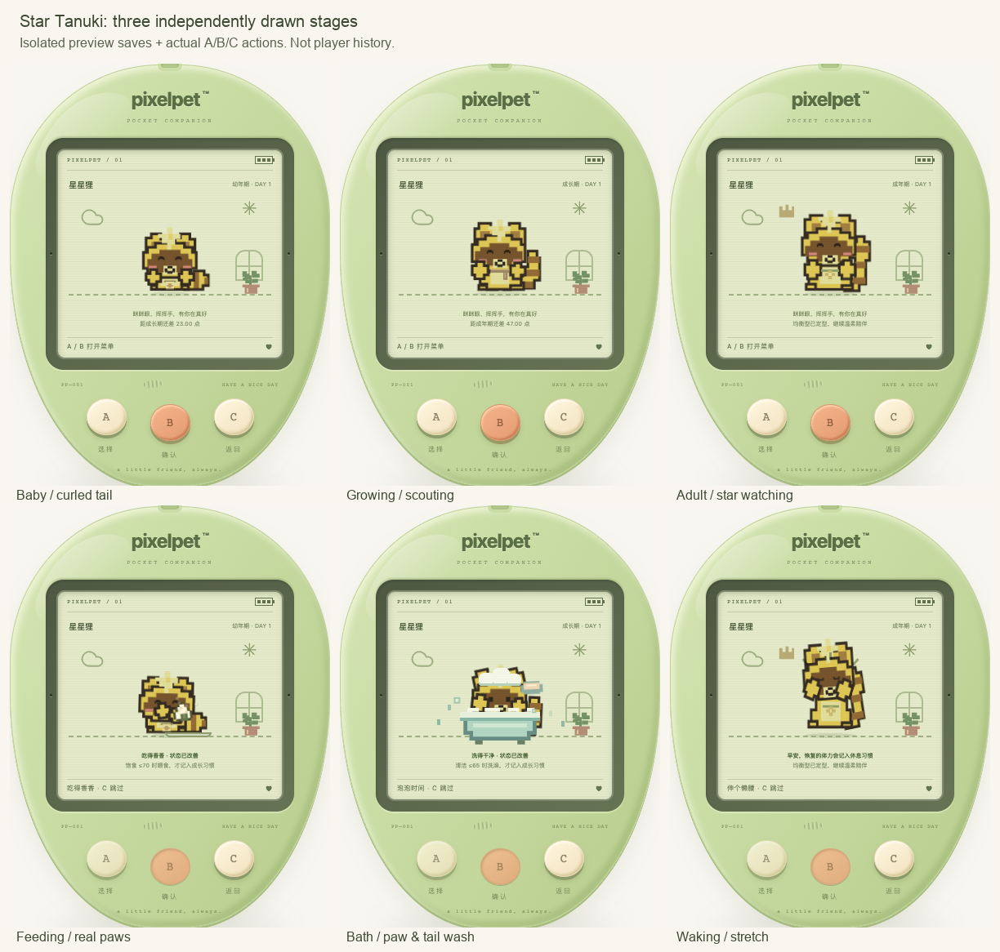

## 独立成长动作推广：云朵雀

- 三阶段仍使用 64×68 画布和 104×110 场景尺寸，云团头部、身体、胸羽、蓝星冠、鸟喙、双翼/翼羽、双脚、尾羽分别独立绘制。保留原始白色云团、浅蓝翅膀、粉颊、额前蓝星和橙色喙/脚，不给鸟套用猫兔的耳朵和手臂。
- 幼年绒团收翼，成长期抬脚试翼，成年停栖梳羽。进食用翅膀拢食、低头啄食，洗澡拍翼甩羽，睡觉闭眼收翼呼吸，醒来舒展双翼，庆祝拍翼摇尾。
- 六种需求由实际双翼表达，不额外叠手；紧急身体需求与安静相伴停止待机习惯。成年均衡型梳羽、活力型试飞、恬静型点头、自在型缓慢放松尾羽，既定形态不变；减少动态效果保留静态姿势。
- 共用注册入口覆盖选择、小窝、状态、手册/纪念及两个现有小游戏，饰品依阶段定位。纯前端更新，无存档迁移、奖励或照顾规则修改。
- 当前独立三阶段累计 10/10；十只均已各自绘制。下图来自隔离临时预览与实际 A/B/C 照顾操作，不是玩家历史。

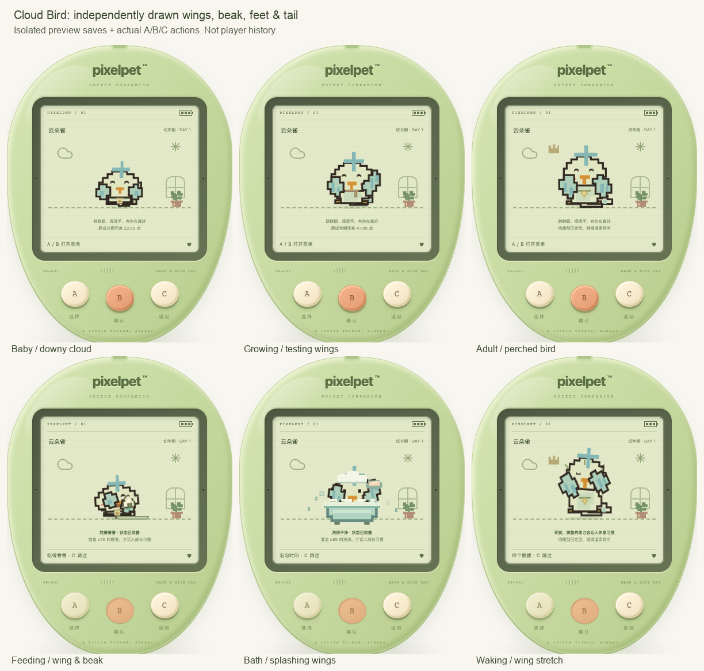

## 独立成长动作推广：海豚宝

- 共用 64×68 画布和 104×110 场景尺寸，三阶段头身、浅色口鼻/腹部、额头光斑、双胸鳍、背鳍、尾柄与水平尾鳍分别绘制；不放大原始合图，也不套用猫兔的耳、爪和脚。保留浅蓝色皮肤、浅色口鼻、粉颊与像素微笑。
- 幼年团身拢鳍，成长期扬鳍试游，成年舒身摆尾。吃饭低头并用胸鳍拢食，洗澡拍鳍摆尾，睡觉收鳍闭眼呼吸，醒来舒鳍抬头，游戏收集/庆祝时拍鳍摆尾。
- 六种需求使用真实胸鳍，文字与无障碍标签也改用鳍的动作；紧急身体需求和安静相伴抑制待机习惯，照顾动作优先。成年均衡型转头观察、活力型试游、恬静型点头、自在型慢摆尾，不改写既定形态。减少动态效果停止动画，保留可辨识的照顾/需求静态姿态。
- 选择、小窝、状态、成长手册、纪念册和接星星/连连看/贪吃蛇共用同一入口。三种饰品按阶段定位，不额外叠宠物；仍只有 A/B/C 三键。无后端、存档结构、照顾数值或奖励规则变更。
- 当前独立三阶段累计 **10/10**；十只阶段造型已齐，俄罗斯方块已接入，详见 `TETRIS.md`。下图是隔离临时预览与实际三键照顾动作，不表示玩家成长历史。

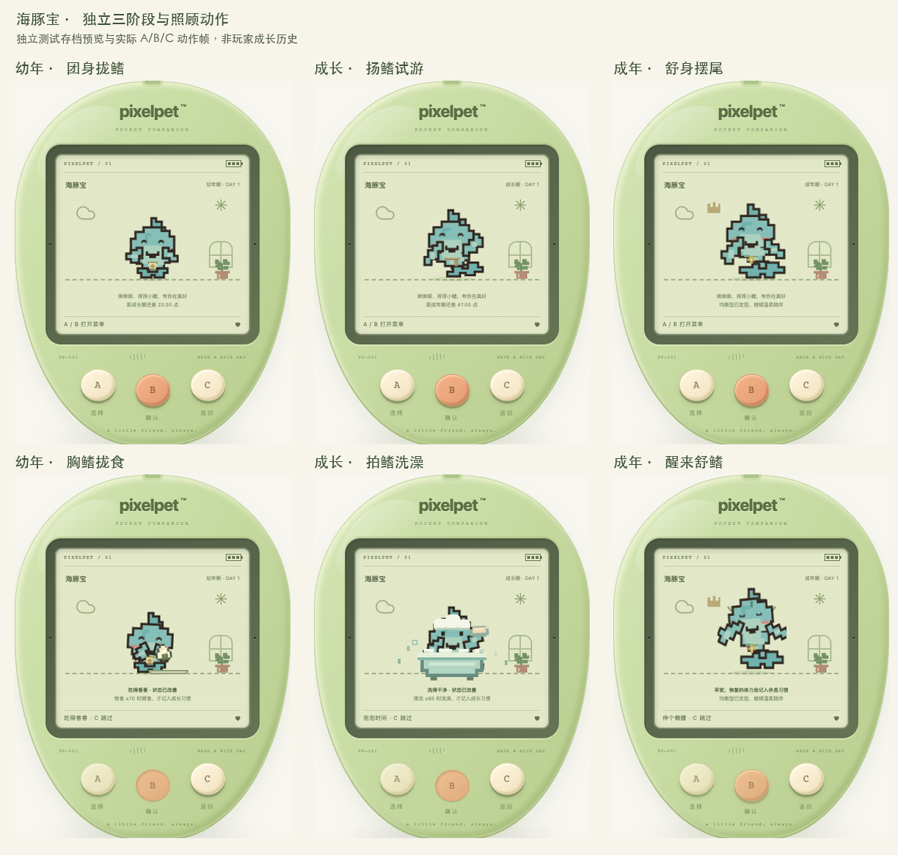

## 独立成长动作推广：蘑菇菇

- 幼年裹盖团坐、成长期歪盖探步、成年展盖轻摇，菌盖、边缘、斑点、菌褶、菌柄/阴影、双手与双脚共十个部件路径均按阶段独立绘制；同为 64×68 画布、104×110 场景尺寸，原始角色合图不变。保留红盖、奶油菌柄、白点与粉颊，不套动物耳尾，脸部跟随菌柄而非菌盖。
- 真手送食、洗菌柄/拂菌盖、睡眠垂盖呼吸、醒来伸展与举手庆祝；饥饿摸肚、疲惫垂盖、脏时拂盖、举手邀玩、微笑挥手和安静靠盖让位于照顾/睡眠/进化，不额外叠第二双手。提示及无障碍文字也使用蘑菇动作。
- 成年均衡型摇盖、活力型点脚、恬静型点头、自在型靠盖；紧急身体需求及安静相伴抑制习惯，不改写已锁定成年形态。减少动态效果停止动画，仍保留静态照顾与需求姿态。
- 选择、小窝、状态、手册、纪念册与三个现有小游戏共用注册入口，三种饰品依阶段定位于菌柄。仍只有 A/B/C，没有新增屏幕玩法控件；不修改成长数值、奖励或存档结构。
- 当前累计 **10/10**；俄罗斯方块已接入，详见 `TETRIS.md`。下图是隔离临时预览与实际三键照顾操作，不代表玩家成长历史。

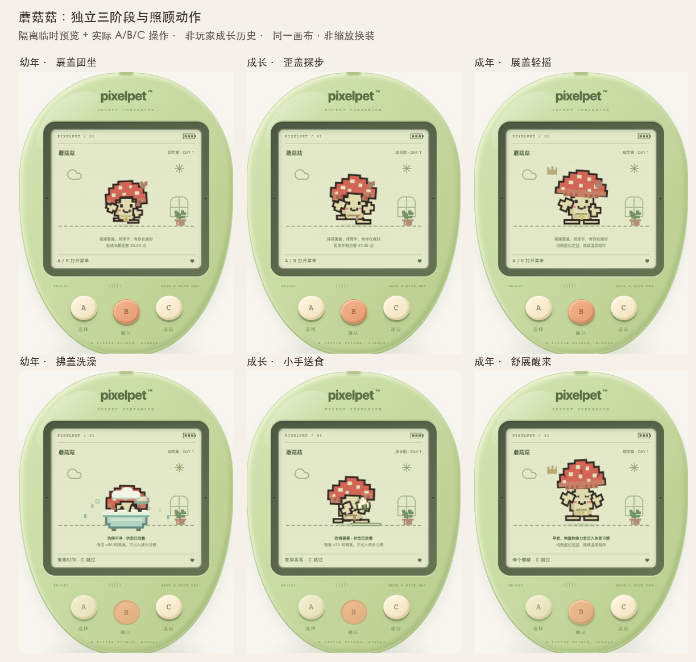

## 独立成长动作推广：蜜桃熊

- 幼年桃团抱爪、成长期探身踏步、成年挺身揉颊。头、身躯、圆耳/耳内、嫩芽茎叶、口鼻、腹部、双爪、脚与脚垫共十六个部件路径均按阶段另绘；同为 64×68 画布和 104×110 场景尺寸，不是缩放原图或给猫狸换色。保留原角色的蜜桃色皮肤、桃形脸、奶油口鼻、粉颊和头顶双叶嫩芽，不加猫胡须、尖耳或长尾。
- 真爪送食咀嚼、搓洗腹部/圆耳、甩动嫩芽、睡眠收爪垂耳呼吸、醒来伸展、举爪庆祝。六种需求使用摸肚、揉眼、挠圆耳、推球、招爪和抱爪安静相伴；提示与无障碍文字同步，照顾/睡眠/游戏/进化优先，不额外叠爪。熊爪使用独立类名，避免继承原始平面角色的通用手爪动画。
- 成年均衡型揉颊、活力型点脚、恬静型点头、自在型慢慢松耳；身体紧急需求及安静相伴时停止习惯，保存的成年形态不变。减少动态效果停止动画，保留静态照顾和需求姿态。
- 选择、小窝、状态、手册、历史纪念与接星星/连连看/贪吃蛇共用注册入口，三种饰品按阶段定位在身躯。仍只有 A/B/C，不新增 LCD 玩法控件，无后端、成长数值、奖励或存档结构变更。
- 当前累计 **10/10**；俄罗斯方块已接入，详见 `TETRIS.md`。下图来自隔离临时预览与实际三键照顾操作，不代表玩家的真实成长历史。

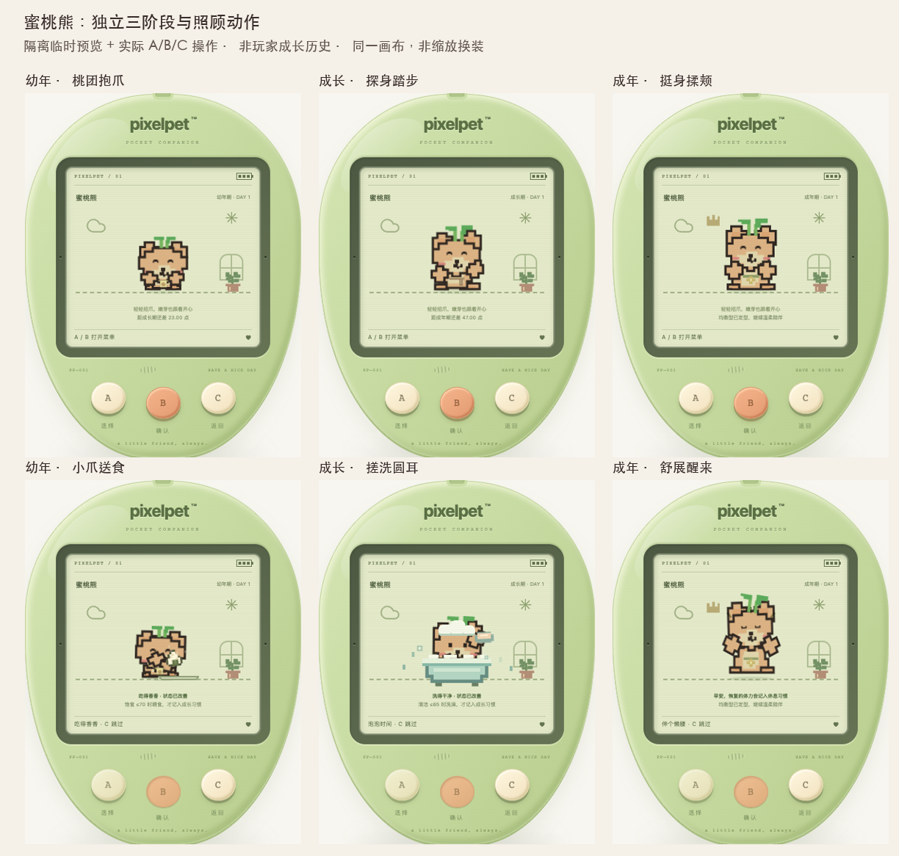

## 独立成长动作推广：柠檬蛙

- 团蹲拢蹼、探身试跃、舒蹼鸣唱三套独立像素解剖造型：头、身体、双眼丘、柠檬黄眼斑、肚皮、喉部、前蹼、后腿及后蹼共 14 处路径按阶段分别绘制。同为 64×68 画布和 104×110 场景尺寸；保留原始绿色皮肤、白色凸眼、黄斑、浅色肚皮和粉颊，不用缩放原图或哺乳动物耳爪。
- 前蹼送食、吞咽，搓肚擦脸、蹼足划水，收蹼闭眼呼吸，醒来展蹼和蹲腿庆祝；六种需求由真实前蹼完成，提示与无障碍文字同步。肢体全用独立类名，避免通用爪动作串入，不叠加第二双手。
- 幼年拢蹼轻吞、成长期探池试蹲，成年均衡型轻鼓喉/舒蹼、活力型蓄跃点趾、恬静型点头、自在型放松蹼足。紧急需求和安静相伴关闭所有待机习惯，照顾/睡眠/游戏优先；保存的成年形态不变。减少动态效果保留静态照顾与需求姿势。
- 角色选择、小窝、状态、手册、历史阶段纪念和三款现有小游戏使用共用注册入口，三种饰品按阶段定位。照顾、动作、游戏奖励与存档规则不变，仍只有 A/B/C，没有 LCD 可点击玩法控件。
- 当前独立三阶段累计 **10/10**；俄罗斯方块已接入，详见 `TETRIS.md`。下图来自隔离临时预览与实际三键照顾操作，不代表玩家成长历史。

## 独立成长动作推广：银河龙

- 幼年「抱尾拢翼」、成长期「探身试翼」、成年「展翼望星」为三套独立像素造型。头、身体、浅色口鼻和肚皮、双角/星尖、额冠、双翼/翼膜、尾/尾棘、双爪和双脚共 19 处路径分别绘制，不缩放原图；保留淡紫皮肤、浅色口鼻、金黄额冠与星尖。
- 捧食咀嚼、搓肚洗角与抖翼冲水、收翼闭眼睡眠、醒来展翼伸爪、挥爪摆尾庆祝；六种需求使用真实双爪、翅膀和尾部表达，不叠额外假手。需求及无障碍文字与龙的解剖一致。
- 幼年抱尾、成长试翼；成年均衡型望星摆尾/理翼、活力型试飞展翼、恬静型轻点头、自在型慢收尾。紧急需求和安静相伴关闭待机习惯；照顾/睡眠/游戏优先，不改写已锁定成年形态。
- 共用 64×68 画布与 104×110 场景尺寸。三种饰品按阶段定位，小窝、状态、成长手册、纪念册及三个现有小游戏共用注册入口。减少动态效果时停止动画并保留照顾和需求静态姿势。
- 当前累计 **10/10**，俄罗斯方块已接入，详见 `TETRIS.md`。下图来自隔离临时预览与实际 A/B/C 操作，不冒充玩家成长历史。

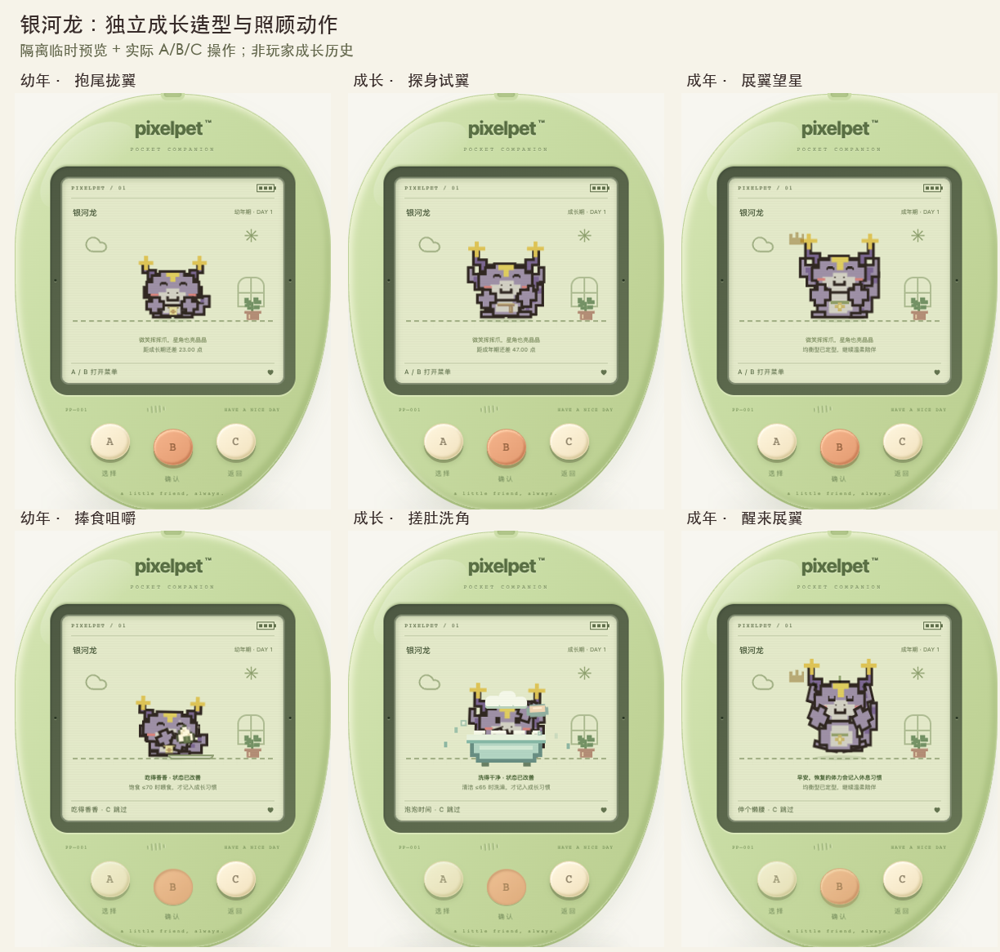

## 独立成长动作推广：焦糖犬

- 幼年「趴团抱爪」、成长期「侧耳探步」、成年「坐稳摇尾」各自独立绘制；头、身体、双垂耳/耳内、口鼻、围胸、项圈、名牌、尾/尾尖、双前爪、后脚与趾纹共 18 处路径各阶段不同。保留原图焦糖毛色、深棕耳影、奶油口鼻、红项圈、金黄名牌与粉颊，不套猫的尖耳、胡须或花朵。
- 前爪捧食咀嚼、搓肚洗耳和甩耳冲水、闭眼垂耳收爪睡眠、醒来伸爪舒脚、举爪踏脚摇尾庆祝；六种需求使用真实爪、耳和尾，提示与无障碍描述同步，不叠假手。
- 幼年抱爪轻摇尾、成长侧耳试步；成年均衡型迎接摇尾/听声垂耳、活力型快摇尾踏脚、恬静型信任点头/柔摆耳、自在型慢收尾。紧急需求及安静相伴关闭习惯，照顾/睡眠/游戏优先，已保存成年形态不变。
- 三阶段均在 64×68 画布、104×110 场景尺寸内绘制，饰品按阶段定位，选择/小窝/状态/成长手册/纪念册及三个现有小游戏共用入口。减少动态效果保留静态需求、洗澡和醒来姿势。
- 当前十只独立三阶段造型与动作累计 **10/10**；俄罗斯方块也已接入共用游戏与陪伴规则，详见 `TETRIS.md`。下图来自隔离临时预览与实际三键照顾，不代表玩家的成长历史。

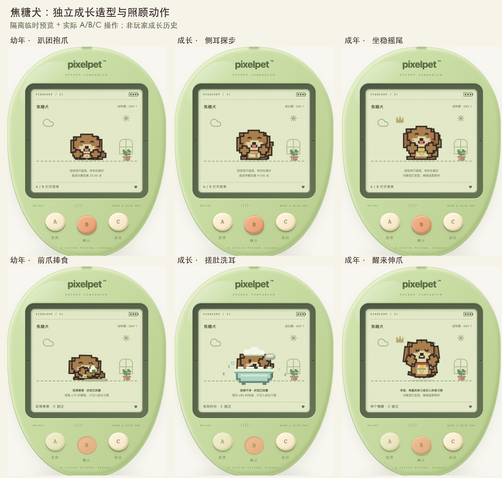
