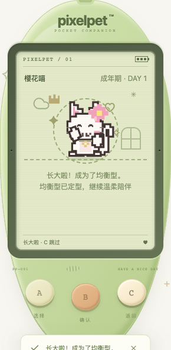

# 不再错过已开始的成长庆祝

日期：2026-10-19。接续 [成长与回访展示顺序](GROWTH_PRESENTATION.md)，补齐其中明确留下的「动画开始后再被遮挡」边界。

## 复现与调整

原来的 2.4 秒成长动画一旦开始，打开帮助、存档盒、重新开始确认框，或进入后台，仍会计时结束。回来后已经错过庆祝。专项测试先在旧实现复现：15 项新增测试中 10 项失败；再修复并回归。

- 正在播放的成长庆祝被遮挡，或伙伴在另一页进入睡眠时，停止本地片段并保留待展示阶段。
- 回到前台、清醒、无游戏与面板遮挡的小窝后，从头播放完整的短片段，并重新显示对应成长说明。这是**重新开始片段**，不是逐帧暂停 CSS 动画。
- A / B 仍等待片段结束；C 仍可明确跳过，跳过后不会因轮询或切后台重播。
- 等待期间又跨入成年，只展示最新接受的阶段。替换存档、新对局、连接异常或开始导入预览仍清除旧展示，不把旧庆祝带给新伙伴。
- 中断不会再次认领回访、恢复已取消的自动弹出、执行照顾或发奖；回访记录仍可主动从菜单查看。

## 不变与边界

仅前端临时展示状态，刷新会丢弃尚未展示完的片段；首次加载已有阶段不补播。没有新持久化字段，不改变成长门槛、速度、照顾影响、成年定型、奖励、schema 11 或旧备份。其他照顾动画仍按原规则结束，不宣称所有动画已经支持此行为。屏幕无新增玩法控件，玩法保持 A / B / C。

## 验证

- 新增 `GrowthInterruption.test.tsx` **15 项**，覆盖两阶段的后台/帮助/存档盒/重置框中断，完整重播/C 跳过，多次中断计时器、更新阶段、睡眠、换档/新游戏/断线清除及首次加载不补播。更新原有 3 个回访回归场景，确认重播后仍须主动打开已取消的自动小结。
- 全量前端 **1076 项 / 47 文件**、TypeScript、生产构建通过；Go 全量 race、vet、构建通过；既有节奏算术 **6 项**通过（不是新增节奏游戏）。
- 独立临时数据库真实 Chrome **18 场景**：两阶段 × 四种中断 × 自然结束/C 跳过（16），两阶段中断后刷新丢弃本地重播（2）。桌面键盘与 320px 触摸交替，核对小结仅认领一次、阶段纪念仅一张、没有照顾请求/额外金币，成年形态不变，三键且 LCD 内无按钮，无浏览器异常。
- 成长门槛前状态、访问基线和十分钟待结算时间使用合成准备，再由真实 Go 服务完成进化与纪念；后台使用可见性事件注入。这不是自然完整养成、真实手机后台或用户反馈，也不是额外布局矩阵验收。
- 脚本 `/tmp/pixelpet-growth-interruption-browser.mjs`；结果 `/tmp/pet-growth-interruption-browser-results.json`；临时库 `/tmp/pixelpet-growth-interruption-Fo9404/test.db`；测试日志 `/tmp/pet-growth-interruption-{red,focused,full-frontend,full-go,browser,rhythm}.log`。所有服务写入只发生在独立临时库；测试服务退出后已停止。
- 玩家库 SHA256 保持 `a8b712d5419fe6227b255f4d63869612e451da7abddffd60124de8ee65c23eee`；原玩家进程 38015 / 39567 未重启。构建与推送不代表原服务已部署新版本。

持续目标仍进行中；下一批继续以可复现照顾/恢复问题或真实试玩反馈为依据，不以随意调成长数值或重复交付维持迭代。
