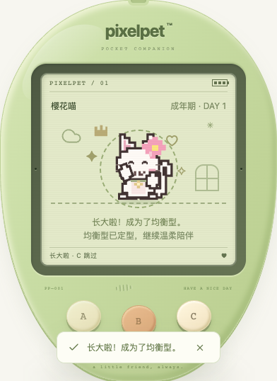

# 成长与回访的展示顺序

日期：2026-10-19。继续完善三阶段成长与离开后的回访，不改成长算法。

## 复现与修复

自动回访确认不是静态通知：服务处理请求时仍会结算时间。若这次回复恰好从幼年跨入成长期，或从成长期跨入成年，旧页面会立即打开回访小结，反而把已经排队的成长庆祝挡到返回小窝以后。另一个问题是等待回复时打开帮助/存档盒或切到后台，成长庆祝仍可能在看不见的地方开始。新增专项测试在修复前复现这两类问题。

本批调整：

- 服务已确认的小结先进入本地展示队列；若同次回复带来成长，先在小窝展示真实的新阶段，动画结束或按 C 跳过后，再打开小结第一页。不重新确认、不重复写入或发奖。
- 成长庆祝只在前台小窝、清醒、无游戏/帮助/存档盒/重置弹层且连接可信时开始。等待期间进一步成长时，只展示最新接受的阶段，而非过期形态。
- 等待回到前台需要可见性状态触发渲染，不能只读取 `document.hidden` 并期待相同阶段的轮询重新触发动画。
- 打开帮助/存档盒、进入后台或离开原页面，会取消本次自动小结展示；保存的数据仍保留，可从菜单主动重看。取消后关闭面板也不会突然再弹出小结。
- 存档替换、新对局或连接异常清除旧展示队列；旧阶段不会在恢复后伪装成新成功。新对局的手动续局边界沿用已有保护。
- 原本在轮询时成长的路径仍先庆祝、再发确认；睡眠挡住的成长仍等清醒后展示。首次加载一个已经成年的存档不凭空播放成长成功。

## 不变与未覆盖边界

仅调整前端展示调度。成长门槛、照顾积分/习惯、离线速率与 12 小时上限、奖励、固定成年形态、schema 11 和备份格式均未改变。仍只有 A / B / C 三个玩法键，屏幕内无新增玩法控件。

这是本地临时展示队列，不是新增持久化事件：刷新不会重放庆祝，已确认的小结仍可手动看。本批避免在遮挡/后台期间**开始**成长动画；动画已经开始后再切后台或打开面板，本批未新增冻结/重播机制，动画仍会按原计时结束。此历史边界已由后续 [成长庆祝中断恢复](GROWTH_INTERRUPTION.md) 补齐：返回后重新完整播放，而非逐帧冻结。这不代表所有异步展示竞争或真实设备后台行为均已解决。

原玩家服务未重启，玩家存档未被操作；提交/构建不能证明运行中的旧服务已加载新代码。

## 验证证据

- 新增前端 **19 项**：成长期/成年两阶段的正常计时、C 跳过、面板/后台延期及取消、队列中存档替换/游戏/睡眠/卡片清除、轮询先成长、睡眠延期、断线恢复、延迟期间再次成长与初始成年加载。
- 全量前端 **974 项 / 42 文件**、TypeScript 和生产构建通过；Go 全量 `test -race -count=1 ./...`、`vet ./...`、构建及既有节奏算术 **6 项**通过。没有新增节奏游戏。
- 独立临时库真实 Chrome **16 场景**通过：两阶段 × 动画自然结束/C 跳过（4）；两阶段 × 帮助/存档盒/后台在回复前打开（6）；两阶段 × 同三种情况在动画开始后打开（6）。桌面键盘与 320px 触摸交替；覆盖刷新不重播、主动重看、只确认一次、无玩法写入/额外照顾/金币，阶段纪念只记一次，成年形态保持。
- 成长使用合成的门槛前存档和回拨十分钟的 `lastTick`，再由真实服务在确认时结算、跨过门槛并记录纪念。不是完整自然养成；回访来自合成的一小时前访问基线，后台为可见性事件注入，不算真实设备切后台或用户反馈。
- 浏览器脚本：`/tmp/pixelpet-growth-presentation-browser.mjs`；结果：`/tmp/pet-growth-presentation-browser-results.json`；临时库：`/tmp/pixelpet-growth-presentation-eCw2ow/test.db`。上一批 19 个回访同步场景另行回归，脚本 `/tmp/pixelpet-growth-return-sync-regression.mjs`、结果 `/tmp/pet-growth-return-sync-regression-results.json`，临时库 `/tmp/pixelpet-return-sync-AWgxA4/test.db`；不重复计成新增场景。
- 玩家库 SHA256 保持 `a8b712d5419fe6227b255f4d63869612e451da7abddffd60124de8ee65c23eee`；原玩家进程 38015 / 39567 保留，只启停自己的临时验证服务。

持续目标继续；后续仍优先真实试玩中的养成/恢复与三键体验问题，不把候选小游戏或未验证能力算作交付。
