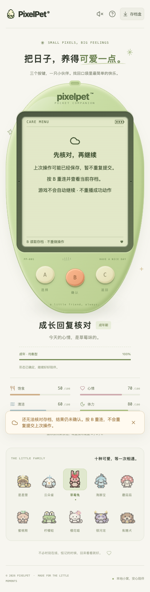
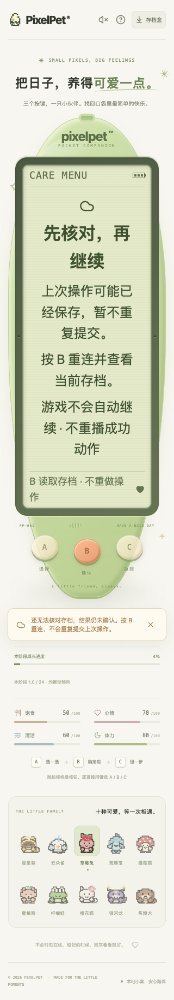

# 成长响应的显示安全保护

日期：2026-10-19。仅加强异常响应处理；不改成长规则、存档 schema 12 或三键操作。

## 修复内容

基础响应检查原本不检查可选 `growth` 的内部结构。HTTP 200 JSON 即使带着缺失的 `care`、字符串积分、数组定型记录或超出 Date 范围的成年时间，也可能进入场景/成长手册，导致读取嵌套字段、数字格式化或日期显示出错。

现在，**仅当成长对象存在时**，检查已支持的阶段/形态、非负有限且在当前服务端范围内的成长数量、可显示时间、习惯字段与可选定型记录的数量字段。

- `growth` 缺失/null 继续沿用已有旧服务兼容处理；定型记录缺失/null 继续表示没有历史依据，不补造零值记录。合法数据及未知新增字段原样保留。
- 照顾写请求返回异常数据时，仍是「可能已保存、结果未知」，不是认定保存失败。暂停操作，B 读取当前存档；不会重做照顾、重发奖励或补播成功动作。读取仍异常时继续保护，确认后才恢复操作。
- 初始连接/普通轮询异常沿用连接恢复入口。普通重连保留 `/api/visit` 的既有结算流程；结果未知的照顾用 `/api/state` 核对，不重发原写请求。API 普通 GET 读取异常是 `unavailable`，写回复异常是 `unknown`，不混为一类。
- 这不是第二套完整存档校验：积分与阶段的一致性、日期先后、形态选择和迁移由服务端负责，也未覆盖所有其他可选功能对象。异常回复不等于 SQLite 损坏，不自动重置或导入。

## 验证证据

- 新增请求层 **70 项**：26 种异常 × GET 读取/照顾写入共 52 项，以及 9 种兼容数据 × 两条路径共 18 项。在原响应检查代码下 52 失败 / 18 通过，修复后全部通过。
- 真实 API 解析器的 App 恢复回归新增 **8 项**，覆盖初始、轮询、已保存/未保存照顾；既有基础异常场景一同运行。还将该测试文件中过时的成功提示选择器改为实际 `.growth-feedback.has-feedback`，避免无效的空元素断言。
- 专项 **204 项**通过；前端全量 **1835 项 / 79 文件**、TypeScript、生产构建通过；Go 全量无缓存 race、vet、构建及既有节奏算术 6 项通过。
- 独立临时库真实 Chrome **20 组**：四种异常（幼年习惯、成长积分、成年定型记录、成年时间）× 初始/轮询/已保存照顾/未转发照顾 16 组；缺失/null 成长、null 定型记录和完整成年记录 4 组兼容检查。
- 已保存照顾先转发真实服务再只改浏览器收到的回复；未转发照顾只截取回复、不发送该动作。每组反复异常核对后再正常恢复，核对服务端实际 careCount、金币与冻结记录；写场景恢复后再明确喂食一次，确认仅新增一次保存。未读到正常状态前无成功反馈，恢复时无照顾/成长动作或回执补播，无页面异常。
- 390px 普通字号与 320px 双倍根字号按场景分配，检查文字边界、页面无横向溢出、三键至少 44px 并可滚动到达；LCD 不增可点击玩法控件。不是所有场景与字号的完整笛卡尔积，也不是全辅助技术认证。
- 轮询只用受控浏览器时间推进 15.010 秒。旧式响应是兼容夹具，异常通过浏览器网络拦截注入，不代表实际损坏玩家数据、运行历史服务版本、自然长时体验或真人试玩认证。
- 首次脚本错误地把普通重连也当成 GET state；另一次使用了不存在的旧成功提示类名。均已按实际路由/组件修正，最终脚本完整重跑通过，不据此前局部结果宣称验收。

普通字号异常恢复：



320px 双倍根字号（页面滚动可到三键）：



## 重复运行与数据边界

永久浏览器入口为 `scripts/check-growth-response.mjs`，自动选择空闲端口，创建自己的临时库/服务并在结束时关闭。先构建前端与测试后端，再运行，例如：

```sh
./.tools/go/bin/go build -o /tmp/pixelpet-growth-response ./cmd/pet
PIXELPET_TEST_BINARY=/tmp/pixelpet-growth-response \
PIXELPET_PLAYWRIGHT_MODULE=/absolute/path/to/playwright/index.mjs \
node scripts/check-growth-response.mjs
```

不配置模块路径时使用可解析的 `playwright`；要求本机可用 Chrome。输出包含临时库、端口、截图和逐组结果，不接受玩家服务 URL。

本次最终临时库：`/var/folders/12/7y0bpzpj5055788qjjnq3c9c0000gn/T/pixelpet-growth-response-lyQKrX/test.db`；同目录保存逐组 JSON 和截图，自己的测试服务已停止，两张最终截图已查看。

玩家库 SHA256 保持 `a8b712d5419fe6227b255f4d63869612e451da7abddffd60124de8ee65c23eee`，原进程 38015 / 39567 保留，没有刷新玩家页面、导入覆盖或重启原后端。构建会更新被忽略的 `web/dist`，原服务如果共用该目录，在后续重载时可能读取新前端；不能称为完整运行环境隔离或后端已部署。

持续迭代目标保留；下一批仍优先真实试玩反馈与可复现的照顾、成长、离开恢复问题，不将候选新游戏或未执行验收记为完成。

后续已补充 [照顾反馈保护与单次习惯显示](CARE_FEEDBACK_SAFETY.md)：检查已提供的短提示基础数据，并兼容合法旧档的小数累计运算误差；可选 effect 仍单独降级。成长浏览器脚本已扩展，本文的 20 组是本批历史证据，后续结果见新文档。
