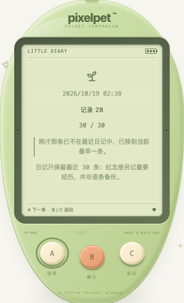

# 成长日记的稳定阅读

日期：2026-10-19。本批修复照顾记录的阅读问题，不新增游戏或改变成长数值。

## 改了什么

- 合法空历史显示「还没有日记」和「0 条记录」，不再出现空白、`1 / 0` 或用当前时间冒充事件时间。兼容空数组、旧响应的 null / 缺省历史。
- 使用记录保存的时间显示年月日和时分；语义化 `time` 保留完整时间。显示时区跟随浏览器，不伪造旧记录的发生地点或时区。
- 阅读某一条时，同步插入新照顾/成长记录不会把当前内容挤走；位置数字随当前存档更新。重新进入仍从最新一条开始。
- 如果正在阅读的一条已被最近 30 条上限淘汰，就显示当前最早的保留记录，并明确说明；后续同步保住这个新位置，按 A 后清除说明。不把已经删除的记录继续装作还在存档里。
- 明确最近日记与永久纪念册的区别：日记只留最近 30 条，纪念册另记重要经历，不是逐条备份。
- **A 下一条并循环，B / C 返回小窝**；修正原来未说明 B 也能返回的提示。没有屏幕内玩法按钮。长记录和提示使用正常文流，支持小屏与大字号。

## 保存和定位边界

不向旧存档加入事件 ID，不更改 schema 11、不迁移或改写历史文字。普通更新以原始时间戳和文字定位；完全相同的记录按其后相同项数量区分，因此重复条目仍能逐条浏览，前插相同记录也不会卡住翻页。若任意删除/重排不可区分的完全相同记录，其真实身份无法还原，不宣称跨所有重排精准追踪。

整份导入/重置仍沿用已有存档代际同步机制，离开旧阅读页；再次进入以新存档为准。只读浏览不提交照顾、导入、重置或回访确认操作；正常访问/时间结算仍可能保存状态，不宣称数据库零写入。旧格式首次升级可能合法产生「成长手册已开启」记录，这与空日记 UI 不应凭空创造事件是两回事。

## 验证

- 前端新增 **22 项**：11 项光标单元测试与 11 项 App 导航/同步测试。先复现空状态和索引跳动，再修复；另补重复条目卡住的回归。冻结输入测试读取不修改历史。
- 全量前端 **1045 项 / 45 文件**、TypeScript 与生产构建通过；Go 全量 `test -race -count=1 ./...`、`vet ./...` 和构建通过；既有节奏算术 **6 项**通过（不是新小游戏）。
- Go 临时数据库测试覆盖空数组/null 历史：读取、实际关库重开、访问不凭空产生照顾；实际喂食和同请求重试只产生一条日记及一次照顾/营养习惯。
- 独立临时库真实 Chrome **43 项检查**通过：空历史及第一笔真实照顾（1）、新旧两种所读位置在实际喂食前插后的稳定定位/重新进入（2）、真实喂食挤出第 30 条后的提示/循环（1）、完全重复条目的导航（1）、真实整份导入后的代际切换（1）、320 / 390 / 1200px × 普通 / 200% 根字号 × 普通 / 强制色与减少动态 × 空历史 / 200 字记录 / 淘汰提示（36）、320px 机身三键实际触摸（1）。
- 浏览器检查记录日期/ISO 时间、可滚动到达且至少 44px 的三个按键、文字边界/字号、无横向溢出或内部阅读滚动陷阱。读日记的浏览器上下文没有操作/导入/重置/回访确认请求，无 JS 错误。照顾与导入由独立 API 测试执行者发起，再注入可见性事件触发已有同步逻辑；这是自动自测，不是用户试玩或真实设备切后台验证。
- 合成记录在独立库构造，合法 schema 11 空历史由真实导入接受；不是自然积累 30 次照顾，也不把迁移时合法的手册开启事件算成 bug。200% 是根字号放大，不等于已覆盖所有系统辅助设置。
- 脚本 `/tmp/pixelpet-journal-browser.mjs`，结果 `/tmp/pet-journal-browser-results.json`，数据库 `/tmp/pixelpet-journal-icipow/test.db`。验证服务只使用独立的 18110 端口，验收后已停止。
- 玩家 `data/pixelpet.db` SHA256 仍为 `a8b712d5419fe6227b255f4d63869612e451da7abddffd60124de8ee65c23eee`；原进程 38015 / 39567 未重启或操作。生产构建不代表既有进程已部署新代码。

[200% 根字号截图](journal-reading-large-text.png)

持续目标保留；下一批优先实际试玩和照顾/恢复的可复现问题，不为迭代随意增加奖励、惩罚或菜单。
