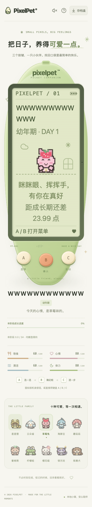

# 合法长名字的标题布局

日期：2026-10-19。修正伙伴侧栏/下方标题，不新增改名界面或游戏控件。

## 复现与修正

服务端既有的改名和存档校验允许 1–12 个 Unicode 码点。`WWWWWWWWWWWW` 是合法名字，但原先的伙伴标题是不能换行的 flex 行：宽英文的最小内容宽度会挤出阶段标签。在 320px 手机上标题越出左右边界，部分桌面断点还会产生整页横向滚动；不是存档损坏，也不是名字超长。

标题现在允许自然换行，名字可以在自身宽度内折行，阶段标签在必要时另起一行。不截断名字、不省略字符、不缩小字号；短名字的标题相对几何保持不变。小窝与状态页原本的名字布局经同一矩阵验证没有此溢出，未修改它们。

只修改标题 CSS。不改改名/导入规则、养成数值、成长与成年形态、存档 schema 12；不新增 LCD 可点击操作，仍为 A/B/C 三键。



## 可重复浏览器回归

新增 `scripts/check-name-layout.mjs`：自动创建临时 SQLite 存档，启动自己的临时端口服务，使用真实 Chrome；不接受已有服务地址，也不接收玩家数据库路径。运行结束停止自己的服务，输出临时证据目录（JSON、手机和桌面截图），不删除证据。

需已构建的测试二进制、前端构建、独立安装的 Playwright 和本机 Google Chrome。Playwright 是可选浏览器验收工具，未加到游戏运行依赖中；将下面的模块路径替换为实际安装路径，从仓库根运行：

```sh
(cd web && pnpm build)
test_bin="$(mktemp -d)/pixelpet"
go build -o "$test_bin" ./cmd/pet
PIXELPET_TEST_BINARY="$test_bin" \
PIXELPET_PLAYWRIGHT_MODULE="/absolute/path/to/playwright/index.mjs" \
node scripts/check-name-layout.mjs
```

矩阵：默认短名、12 个汉字、12 个 W、12 个非 BMP 熊表情（睡眠档） × 320/390/700/701/960/961/1200/1440px × 根字号 14/28px × 小窝/状态页，共 **128 组**。700px 及以下用物理 A/B/C 的触摸事件，其余用键盘；通过三键打开状态再返回，不调用照顾动作。

断言：完整原名、阶段标签、标题及 LCD 名称区域不溢出、不重叠、文档无横向滚动、三键仍可用、LCD 无玩法按钮、无运行错误/照顾写请求；服务端名字、睡眠、照顾次数不因阅读导航改变。夹具通过临时服务的正常旧 schema 1 导入路径建立。

## 本批验收

- 相同浏览器脚本在旧 CSS 下 **24 组失败 / 104 组通过**；修复后 **128/128 通过**。默认短名的 32 组标题相对几何与旧版一致（扣除触摸导航引起的视口滚动位移）。
- 前端既有全量 **1586 项 / 72 文件**、TypeScript、生产构建通过；本批新增的是浏览器布局回归，不把它加进 Vitest 数量。
- Go 无缓存 race 测试、vet、构建通过；既有节奏设计算术 6 项通过，不代表交付新游戏。
- 手机和桌面最终截图已实际查看：名字完整、阶段标签另行，未见裁切或重叠。手机阅读页仍可能需要纵向滚动到三键，不靠缩小机身或文字塞进一屏。
- 玩家数据库哈希保持不变，原服务进程未重启，未主动刷新玩家页面。本地构建会更新被忽略的 `web/dist`，现有静态服务之后重载可能读到新前端；不声称与玩家运行环境完全隔离或已部署后端。

边界：这是受控 Chrome 布局与三键回归，不是所有 Unicode 字形/字体、浏览器或真实系统大字体认证。仅 LCD 的 rem 字体随根字号放大；没有声称伙伴侧栏的既有 px 字体也变为两倍。真人试玩、原生系统切换及自然长时间陪伴仍待验收。
