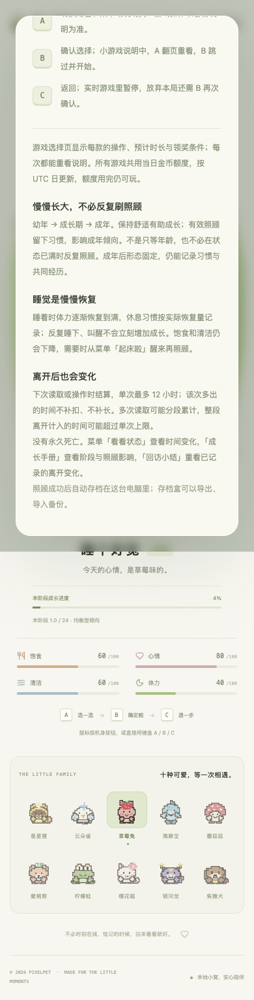

# 照顾与成长入门说明（2026-10-19）

## 修正与范围

帮助弹窗遗漏了此前的回访说明修正，仍写成整段离开「最多结算 12 小时」。现在改为读取已接受响应的 `careRules.maxOfflineHours`：**单次**结算有上限，多次读取可以分段累计；该次超过上限的时间不补扣、不补长。缺失或无效元数据不显示猜测的数字，不沿用上一份响应的上限。与「看看状态」共用元数据校验，旧服务仍能使用帮助。

帮助中另补充：

- 幼年 → 成长期 → 成年，舒适度与有效照顾的作用；成年形态固定，仍可记录习惯与经历。不预测当前宠物何时长大，也不从旧存档年龄编造当前进度。
- 睡眠渐进恢复、只按实际恢复量记录休息；反复切换不等于即时奖励，饱食与清洁仍会下降。
- 从既有菜单进入「看看状态」「成长手册」「回访小结」，保留自动存档、备份与没有永久死亡的说明。
- 小游戏说明中 A 翻页、B 按各游戏提示进入开始、准备或暂停的表述更明确。备份说明字号改为相对单位，随根字号放大。

只改只读帮助展示；没有新增屏幕玩法按钮、修改后端、数值、奖励或 schema 12。仍只用 A/B/C。长弹窗在框内纵向滚动；关闭按钮在顶部，可滚回使用，另保留 Escape、点击遮罩关闭与焦点归还。不声称关闭按钮会一直固定在滚动区域中。

## 验证

- 新增组件 14 项、App 流程 7 项，共 **21 项**：实际/自定义上限、缺失及无效值、旧响应拒绝、最新元数据消失、失败后 B 只读核对，以及蛋/旧成长记录/成年下的只读操作。
- 全量前端 **2287 项 / 93 文件**、TypeScript、生产构建通过；Go 无缓存 race、vet、构建和既有算术 **6 项**通过。
- 永久 Chrome 脚本 **36 组**：三阶段 × 普通/320px 200%字号/强制颜色 × 真实/自定义/缺失/无效元数据。核对帮助与真实 A/B/C 进入的状态说明上限一致、焦点约束/归还、滚动到底与关闭、文本横向边界、字体缩放、三个按键及零玩法写请求。只读 `/api/visit` 单独统计。
- 既有真实入睡/叫醒浏览器回归另 **33 组**通过。

普通、大字号与强制颜色的截图已查看。自定义/缺失规则仅替换独立测试服务的显示响应，不把它当成修改后的真实后端规则。三阶段使用受控导入夹具，不是自然长时或真人试玩验收。




## 复跑与存档边界

```sh
# 先完成 web 的 TypeScript 与生产构建
./.tools/go/bin/go build -o /tmp/pixelpet-care-guide ./cmd/pet
PIXELPET_TEST_BINARY=/tmp/pixelpet-care-guide \
PIXELPET_PLAYWRIGHT_MODULE=/absolute/path/to/playwright/index.mjs \
node scripts/check-care-guide.mjs
```

脚本自行选择空闲端口和临时 SQLite 数据库，不接受玩家 URL 或数据库。本批最终新检查使用端口 62208，结束已关闭；玩家库哈希与原服务保持不变，没有部署或重启原后端。共享 `web/dist` 构建已更新，原服务日后刷新可能读取新前端。

持续目标保持进行；下一步仍优先真实照顾、成长与离开恢复的可复现问题。自然长时、真人反馈与候选新小游戏不算本批交付。
