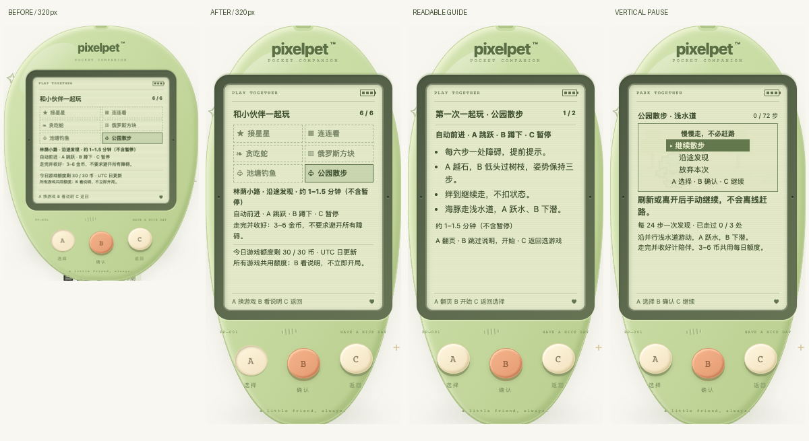

# 小屏试玩与下一款游戏评估（2026-10-19）

## 先分清现状

已经有六款：接星星、连连看、贪吃蛇、俄罗斯方块、池塘钓鱼、公园散步。本批修阅读和操作呈现，**不新增第七款、不改游戏速度或奖励、不迁移存档**。

以下是该历史批次的开发者自测发现与结果，**当时尚未收到实际用户试玩反馈**。后续用户反馈及入口/提示修复见 [PLAYTEST_FEEDBACK.md](PLAYTEST_FEEDBACK.md)；新玩法不能仅凭测试通过就声称「节奏舒服」。

## 本批先解决的明确问题

旧布局靠缩小整台机器适配手机：320px 宽时缩至 74%，目录说明实际约 6.66px，按键约 36.26×33.30px。没有横向溢出，却不好读、不好按。

改为 700px 及以下机身自适应宽度、纵向增加 LCD 空间，不再缩小文字和按键；短屏允许页面上下滚动，不保证所有内容同时塞进一屏。桌面尺寸保持原样。

| 视口宽度 | 原缩放 | 原目录说明实际字号 | 现实际字号 | 现按键 |
| --- | --- | --- | --- | --- |
| 320px | 0.74 | 6.66px | 10px | 49×45px |
| 390px | 0.88 | 7.92px | 10px | 49×45px |
| 700px | 0.96 | 8.64px | 10px | 49×45px |
| 1200px | 1 | 9px | 9px | 49×45px |

- 两页游戏说明拆成逐句列表，文字内容不删减；A 翻页、B 开始、C 返回仍不变。
- 手机的兴趣记录、图鉴、目录与散步提示增大字号；散步暂停的三个选项竖排，选中项加底色。
- 只有原 A/B/C 三键可操作，LCD 列表和选项不是点击控件。不改变宠物或棋盘的内部几何尺寸。

## 本批验收

- 575 项前端测试 / 25 文件、TypeScript 与生产构建、Go 全量竞态测试、vet、构建通过。六款说明逐句内容、两页往返、未提前开局和三键约束由回归测试验证。
- 完整应用只读模拟响应：320/390/700/1200px × 正常/减少动态效果，216 项目录、两页说明、六发现与六行兴趣布局检查通过；零额外玩法写请求。
- 另 448 项模拟布局检查覆盖小窝、12 菜单位置、状态、四页成长手册、日记、纪念册、商店分类/商品、鱼图鉴、选择/孵化、两页回访，以及六游戏的适用暂停/运行/结束/放弃状态；零运行错误、零边界失败。模拟响应不代表实际完成了所有游戏。
- 独立 `/tmp` SQLite + 真实 Chrome：320px 实际走完海豚 72 步、避开 12 处、三次发现、手动收好得 6 币；暂停/图鉴/刷新不补走、第二局 24 步后撤销及确认放弃保留发现不发奖，18 项布局检查通过。
- 另在 320×568px 触摸环境用机身 A/B/C 完成菜单→目录→说明翻页→返回，不提前开局。
- 玩家 `data/pixelpet.db` 前后 SHA-256 一致。本批没有重跑全部角色解剖矩阵；既有角色验证见 `PROGRESS.md`，本批不把旧结果算成新增验收。

复测入口：`pnpm --dir web test`、`pnpm --dir web build`、Go `test -race -count=1 ./...` / `vet ./...`。浏览器验收必须单独指定 `PIXELPET_DB=/tmp/.../test.db` 与测试端口，绝不连接玩家进程。用四种视口和两种动态设置检查上述页面，短屏同时验证上下滚动后的实体键触摸；不能只查 `scrollWidth`。

## 想请试玩者回答的三件事

1. 用什么屏幕/浏览器？哪一页文字仍小、哪一句不知道是什么意思？
2. 哪款游戏按键来不及、容易误按，或暂停之后不知道怎么回来？
3. 玩一局是太短、太长，还是愿意再来一次？可描述具体卡住的一步，不必给整套设计。

收到反馈再决定是否改速度、说明分页或布局。不要求每天玩、不引入照顾惩罚来增加时长。

## 下一款候选：节奏拍手（仅方案，未实现）

目的：补一款短时、规则少的节奏互动，不再复制蛇的方向控制或散步的躲障碍。

- **三键**：A 回应左侧符号，B 回应右侧符号，C 暂停；暂停用 A 选继续/放弃、B 确认、C 继续，放弃仍二次确认。
- **可无声玩**：文字「左 A / 右 B」+ 形状 + 提前可见的提示，不只靠颜色、闪烁或声音。减少动态效果时用静态提示与阶段文字替代缩放闪光。
- **先试参数，不先定规则**：考虑约 12 拍、30–45 秒；提前展示下一拍、宽松响应窗。具体拍距/窗口与陪伴门槛要经原型和试玩再定，不能照搬街机毫秒判定。
- **先做公平性试验**：确认手机触摸、键盘、低帧率、100/300/800ms 网络延迟下是否仍公平；若服务端按到达时间判分造成误判，先改交互节奏或暂停策略，不接受客户端自报分数来绕过校验。不连续发重试、不补跑离线节拍。
- **安全沿用**：服务端会话/拍序/每拍最多一次、过期暂停、前后台/刷新后手动继续、幂等明确收好、共享每日金币额度与成长间隔；既有成年形态不变。纪念与兴趣只记真实达标完成，不补写旧经历。
- **角色参与**：爪子、翅膀、鳍和蘑菇身体各用真实解剖表达节拍；「拍手」只是名称，不给鸟、海豚或蘑菇加人手。十只×三阶段、饰品遮挡和减少动态效果一起验。

补充：[离线时序评估](RHYTHM_EVALUATION.md) 对 432 组人为假设做算术比较，发现不能直接复用收包时钟配窄窗口；宽窗口在抖动压力组仍会拒绝部分输入。这不是可玩原型或实测反馈，未更改任何游戏参数。

开工门槛：先审本轮试玩问题，再做无奖励原型验证提示/节奏/延迟；通过后才接服务端、迁移、奖励和纪念。不同时做森林寻宝。

## 后续顺序与还欠的完善

1. **可读性后续**：本批只是改善，不宣称已达到完整无障碍标准。还需实际手机字体/触摸反馈、200% 文本放大与高对比度专项验证。
2. **可靠性持续回归**：后台、断网、在途请求、重启与多标签页不能重复结算或自动续局；新玩法必须复用已有安全边界，不一次重构所有六款。
3. **节奏拍手**：按上面的原型门槛分阶段做；参数明确后补全旧档与端到端测试，再提交推送。
4. **森林寻宝后置**：若做，优先回合制「A 选路线、B 探索、C 背包/返回」，用线索选择区别于现有散步；先论证差异，不先加菜单、背包货币和无限随机收藏。
5. **长期目标**：补少量有意义的共同纪念和发现叙事，避免把有限兴趣变成任务清单。暂不扩账号、云存档、社交或 AI 对话。
