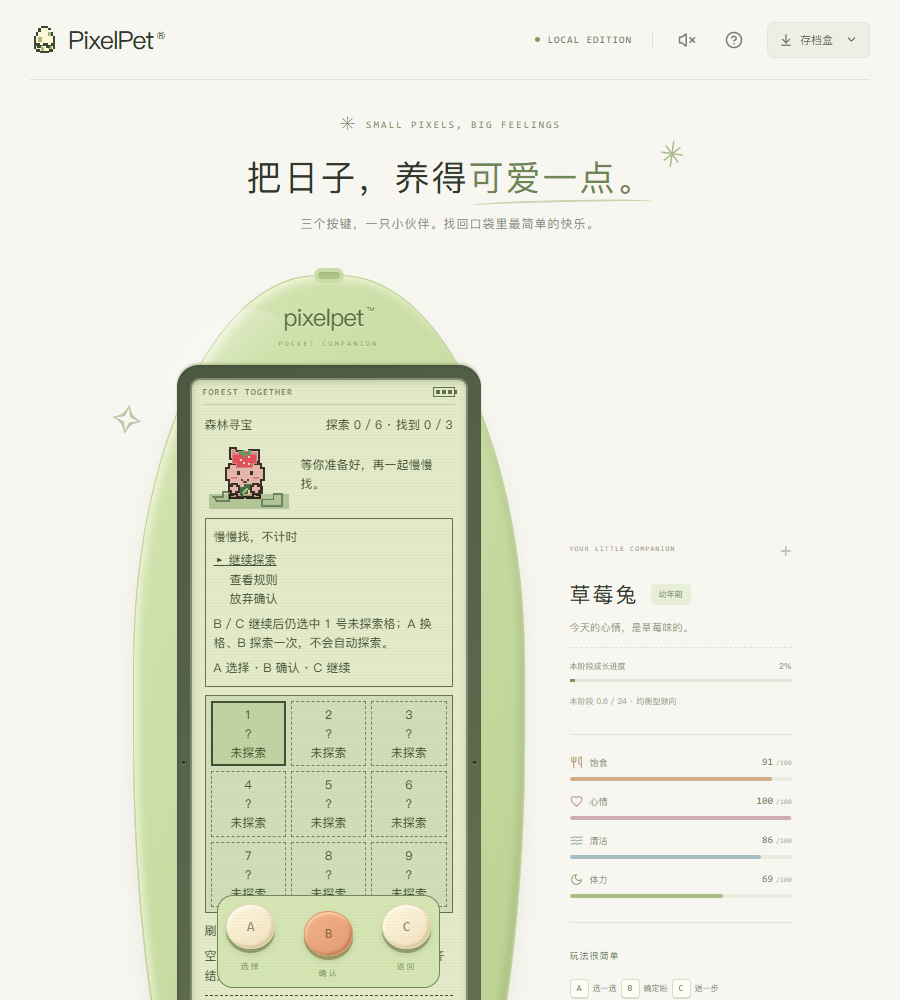
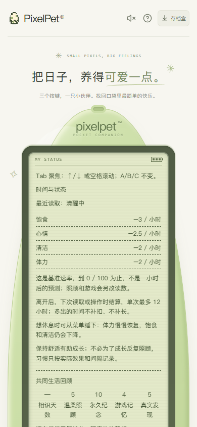

# 试玩记录：以玩家身份跑一遍最新代码（2026-10-22）

[项目首页](../README.md) · [文档导航](README.md) · [试玩反馈历史](PLAYTEST_FEEDBACK.md)

本轮从 `main` 拉取到 `e1d8b81`（比上次试玩的 `d505199` 多 65 个提交），用独立临时存档和独立构建，从孵化开始按普通玩家的顺序玩了一遍：孵化 → 照顾 → 接星星 → 看状态 → 日记 → 商店 → 钓鱼 → 贪吃蛇 → 散步 → 寻宝 → 陪它一会儿 → 成长手册。

- 服务：`PIXELPET_DB=<tmp>/playtest.db`、`PIXELPET_ADDR=127.0.0.1:18080`、`PIXELPET_WEB=<tmp>/web`；未触碰 `data/pixelpet.db`，未替换 `bin/` 与 `web/dist`。
- 操作只用键盘 A / B / C，没有点 LCD 内的元素。
- 一局结束时的存档：金币 16、成长 0.69 点（幼年期）、温柔照顾 5、永久纪念 10、鱼图鉴 2 种、沿途发现 3 种、完成散步 1 次。

## 玩下来最顺手的地方

- 孵化、喂食、商店购买→佩戴、钓鱼「等到明确咬钩再按 B」的节奏，都清楚且没有误触。
- 钓鱼的虚构风景标签（`夏 · 雨 · 月夜`）和等待时的短对白很加分，安静但不空。
- 寻宝的「邻格线索」和散步的「第 24 步发现」把探索感落到了具体的地方，而不是只发奖励。
- 「陪它一会儿」明确写着没有奖励也没有惩罚，确实做到了不制造压力。

## 需要修的问题

### 1. 「相识天数」永远显示「—」（数据错误，可稳定复现）

菜单 → 看看状态 → A 翻页 → 「共同生活回顾」第一格永远是 `—`，其余四格数字正常。

原因在 [`LifeSummary.tsx`](../web/src/LifeSummary.tsx) 的 `validTimestamp`：它要求 `Number.isSafeInteger(now)`，但页面里的 `now` 来自 [`serverClock.ts`](../web/src/serverClock.ts) 的 `readServerClock`，是 `serverTime + 浮点毫秒差`，几乎一定不是整数。首帧用的是整数 `serverTime` 所以偶尔能显示 1，等时钟推进一次就变成 `—`。

实测：`now = 1792655904701.9`、`Number.isSafeInteger(now) === false`、`pet.createdAt = 1792654466735`（整数、合法）。

建议：`now` 只要求 `Number.isFinite`，或在传参处取整。这个组件目前没有对应测试文件，所以没被拦住。

### 2. 森林寻宝的九宫格第三行被按键托盘压住

900×1000 视口下量到：LCD 区域 `top=378 / bottom=1148`，机身按钮 `top=895`。`treasure.css` 里 `.treasure-mode .device-buttons` 是故意做成 sticky 托盘的（「Keep the same three physical keys available while reading the tall grid」），所以这是设计取舍而不是漏改；但实际观感是第三行格子整排落在托盘底下，九宫格本身也不内滚（`scrollHeight === clientHeight`），第一次玩会以为只有两行。如果选中格会自动滚到托盘上方就还好，建议在 900×1000 这类窗口里再看一眼。

### 3. 「共同生活回顾」五列数字在小屏挤成一团

390px 宽时五个标签被压成竖排断字（`相识天` / `数`、`温柔照` / `顾`），数字和标签错位，读不出谁对应谁。桌面宽度下也会出现同样的断字。（本节截图是修复前拍的。）

### 4. 每个阅读页顶部都写着「Tab 聚焦：↑/↓ 或空格滚动；Enter 不操作，A/B/C 不变。」

状态、日记、纪念册、成长手册、商店、寻宝、陪它一会儿……几乎每一页第一行都是这句。它是给键盘/读屏用户的无障碍说明，但对普通玩家来说像调试提示，放在最显眼的位置会直接打断「像素小宠物」的氛围。建议收进帮助或只在聚焦时出现。

### 5. 菜单只露出 6 项，后面 7 项没有「还有更多」的暗示

菜单实际有 13 项（吃、玩、洗澡、睡、状态、日记、成长手册、回访小结、纪念册、商店、鱼图鉴、沿途发现、陪它一会儿），但一屏只显示 6 项。我第一次玩到第 6 项就以为到底了，后来才发现继续按 A 还会滚出新条目——商店、纪念册、图鉴、陪它一会儿全在后面。

### 6. 照顾回执和日记读起来像日志

一次喂食的回执里同时有 `79.98 → 99.98`、`本次成长：+0.00 点`、`喂食习惯：+0`、三条「本页暂存，刷新后不保留」之类的说明；日记条目里也是「即时需求：饱食−4.00、心情+14.00、体力−8.00（不含时间结算）」。数字和免责说明淹没了那句「饭团已吃好」。建议正文只说感受，数字折叠或缩小。

### 7. 散步说明里出现了海豚专属文案

`公园散步` 首次说明最后一句固定是「海豚走浅水道，A 跃水、B 下潜。」，但我养的是草莓兔（[`games.ts`](../web/src/games.ts) 里这句没有按物种区分）。

### 8. 相识天数的说法不一致

状态页写「相识第 1 天」，纪念册封面写「与你相识 0 天」。同一天两个说法，虽然各自都能自圆其说，但放在一起会觉得算错了。

### 9. 连续玩游戏的成长正反馈偏弱

钓鱼三分钟、散步一分半、寻宝六次探索，三次收好都是 `本次成长：+0.00 点 / 陪玩习惯：+0`（同类习惯间隔）。数值上合理，但玩家看到的是「玩了三个游戏，成长没动」。回执里如果能说清「下次陪玩大约什么时候才算」，会好很多。

### 10. 贪吃蛇容错很低

棋盘很小，我从开局到撞墙大约 5 秒，一颗果子都没吃到。真人用键盘会好得多，但第一局就 0 分、且没有任何「再慢一点」的余地，容易劝退。

## 本轮已处理

- 第 1 条：`LifeSummary` 的 `now` 改用只要求有限数值的校验（`validMoment`），存档时间仍用严格的整数校验；新增 `web/src/LifeSummary.test.tsx` 覆盖「浮点 now 仍能算天数」「起始时间不可用时才显示 —」「时钟倒退不出现负数」。
- 第 3 条：`life-summary.css` 的两组数字网格改为 `auto-fit` + `minmax(4.2em, 1fr)`，并禁止标签在字符之间断行，窄屏自动换行而不是竖排断字。
- 第 7 条：散步说明改为「换成海豚伙伴时走浅水道：A 跃水、B 下潜。」，不再是无限定条件的海豚指令。
- 第 8 条：纪念册封面在相遇当天显示「今天刚刚相识」，不再出现「相识 0 天」；`AlbumPanel.test.tsx` 补了对应断言。
- 第 2、4、5、6、9、10 条涉及玩法取舍或版式改版（sticky 按键托盘、菜单分页、回执信息层级、成长节奏），本轮只记录，不改动。

## 说明

以上是单人、单次、桌面 Chrome + 390px 窄屏的体验，不是实体手机或长时间养成的验收。第 1 条是可稳定复现的代码问题，其余多为版式与文案判断，是否修改以项目维护者决定为准。本记录没有改动任何玩法数值、存档格式或后端行为。
