# 试玩记录 2026-10-26（玩家视角，只记录不修改）

对应提交 `6e8377c`（比上一轮 `d006461` 多 134 个提交）。用**全新临时存档**从孵化开始玩了一轮：独立构建、独立 SQLite（`playtest3.db`）、端口 18080，未连接玩家进程，`data/pixelpet.db` 前后未改动（SHA-256 `7c9578b9…`，修改时间仍是 10-24）。

本轮**没有改任何代码**，只记录观察。

## 玩了什么

海豚宝（幼年期）→ 喂食 → 状态两页 → 接星星 5 轮 → 俄罗斯方块 → 公园散步（池畔小路 · 浅水道，72 步，避开 8/12）→ 小窝商店领 10 币、买「海边贝壳」并使用 → 陪它一会儿（三种方式 + 10 条回忆）→ 纪念册 → 小窝纪念角摆「接星星的小缎带」→ 池塘钓鱼 3 竿 3 鱼 → 成长手册 6 页 → 入睡 / 起床 → 森林寻宝（验证版面后放弃）→ 手机 390×844 复看状态页、寻宝、结算。

收尾存档：6 币、成长 0.64、永久纪念 12 条、鱼 3 种、散步 1 次、发现 2 类（落羽 ×2、圆石子 ×1）、共同游戏 3 局。

---

## 一、已经修好的（对比上一轮）

| 上一轮的问题 | 现在 |
| --- | --- |
| 菜单 13 项只露 6 项，看不出还有 | 顶部有「第 1–6 / 13 项 · A 继续浏览（还有 7 项）」「第 8–13 / 13 项 · 已到最后一项，A 将回到第 1 项」 |
| 「Tab 聚焦：↑/↓ 或空格滚动…」占据最显眼位置 | 视觉上已不占位（DOM 里仍保留给读屏器） |
| 生活回顾五列在窄屏竖排断字 | 390px 下标签完整、数字对得上，「相识天数」稳定显示 1 |
| 寻宝九宫格被机身按钮压住 | 不再被压住；改为 LCD 内滚，选中会自动滚到可见 |
| 散步说明对兔子念海豚指令 | 已改成条件句（但仍有个小问题，见 4.1） |

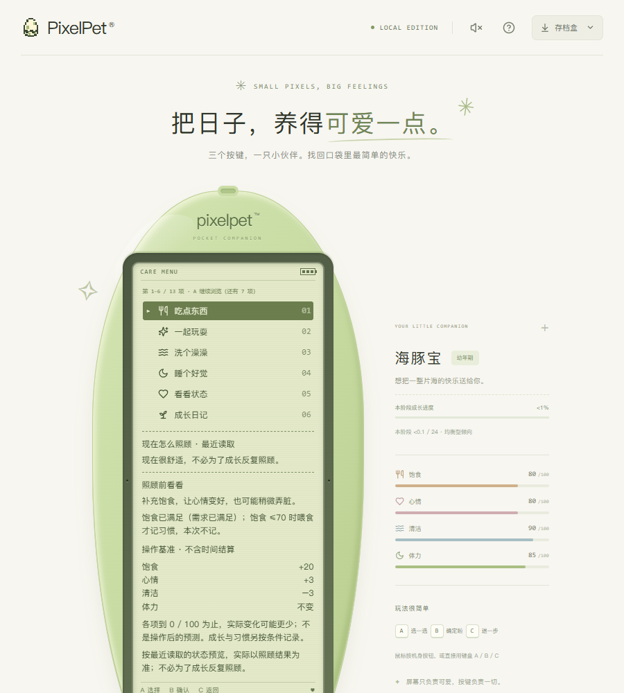

---

## 二、明确的问题（按影响排序）

### 1. 机身被内容拉长——不只是阅读页，**游戏框本身也在变长**

`readability.css` 里阅读模式是：

```css
.device-stage.reading-mode { height: auto; }
.reading-mode .device { height: auto; }
.reading-mode .lcd { height: auto; }
.reading-mode .lcd-content { height: auto; }
```

而 `App.tsx:2432` 的 `readingMode` 除了「非游戏页」，还把**暂停、结束、结果、以及不计时的接星星**都算进来：

```js
const readingMode = page !== "game" || abandoning || uncertain || unavailable || corrupt
  || treasure || pet?.game?.kind === "tiles" || (pet?.game && !pet.game.kind)
  || (snake && (snake.paused || snake.end || ...))
  || (blocks && (blocks.paused || blocks.end || ...))
  || (walking && (walking.paused || walking.beat === 72 || ...))
  || (fishing && (fishing.paused || fishing.phase === "done" || ...));
```

于是机身高度完全跟着内容走。设计高度是 **516px**，实测（900×1000，`.device` 高度）：

| 页面 / 状态 | 机身 | LCD 内容 | 是否内滚 | 三个键 y |
| --- | --- | --- | --- | --- |
| 小窝 | 594 | 275/275 | 否 | 755 |
| 菜单（13 项） | 940 | 621/621 | 否 | 1101 |
| 状态第 1 页 | 695 | 376/376 | 否 | 856 |
| **状态第 2 页** | **2060** | 1741/1741 | 否 | **2221** |
| 游戏列表 | 634 | 315/315 | 否 | 795 |
| 接星星（运行中，不计时） | 619 | 300/300 | 否 | 780 |
| 连连看（运行中） | 575 | 238/238 | 否 | 718 |
| 贪吃蛇（**运行中**） | **516** | 218/204 | 否 | 688 |
| 贪吃蛇（暂停） | 910 | 591/591 | 否 | 1071 |
| 贪吃蛇（结束） | 759 | 440/440 | 否 | 920 |
| 俄罗斯方块（**运行中**） | **516** | 204/204 | 否 | 688 |
| **俄罗斯方块（暂停）** | **1237** | 918/918 | 否 | **1398** |
| 钓鱼（就绪 / 等待） | 516 | 204/204 | 否 | 688 |
| 钓鱼（暂停） | 1003 | 684/684 | 否 | 1164 |
| 散步（运行中） | 540 | 228/228 | 否 | 712 |
| 散步（暂停） | 1005 | 686/686 | 否 | 1166 |
| **寻宝（暂停）** | **699** | 802/**380** | **是** | 860 |
| 回访小结（2 页） | 699 | 380/380 | 否 | 860 |

手机 390×844：

| 页面 | 机身 | 整页 | 三个键 y |
| --- | --- | --- | --- |
| 状态第 2 页 | 2062 | 3001（3.6 屏） | 2163 |
| **俄罗斯方块（暂停）** | **1201** | 2236 | **1302** |
| 寻宝（暂停） | 592 | 1532 | 687（首屏内） |

三个要点：

1. **同一局俄罗斯方块，运行中 516px，一按 C 暂停就变 1237px**——机器当场“长高”一倍多，按键从 688 掉到 1398，跑出屏幕。玩家每次想看“旋转 / 落底 / 放弃”都要先滚过整台机器。
2. 接星星因为不计时，`pet.game.kind === ""` 让它**永远**处在阅读模式（619px），棋盘从开始就是被拉长的。
3. **只有森林寻宝是例外**：`treasure.css` 给它固定 `screen-bezel: 460px` + `lcd-content: 380px; overflow-y: auto`，所以机身恒为 699、内容内滚、按键在首屏。这是现成的正确做法。

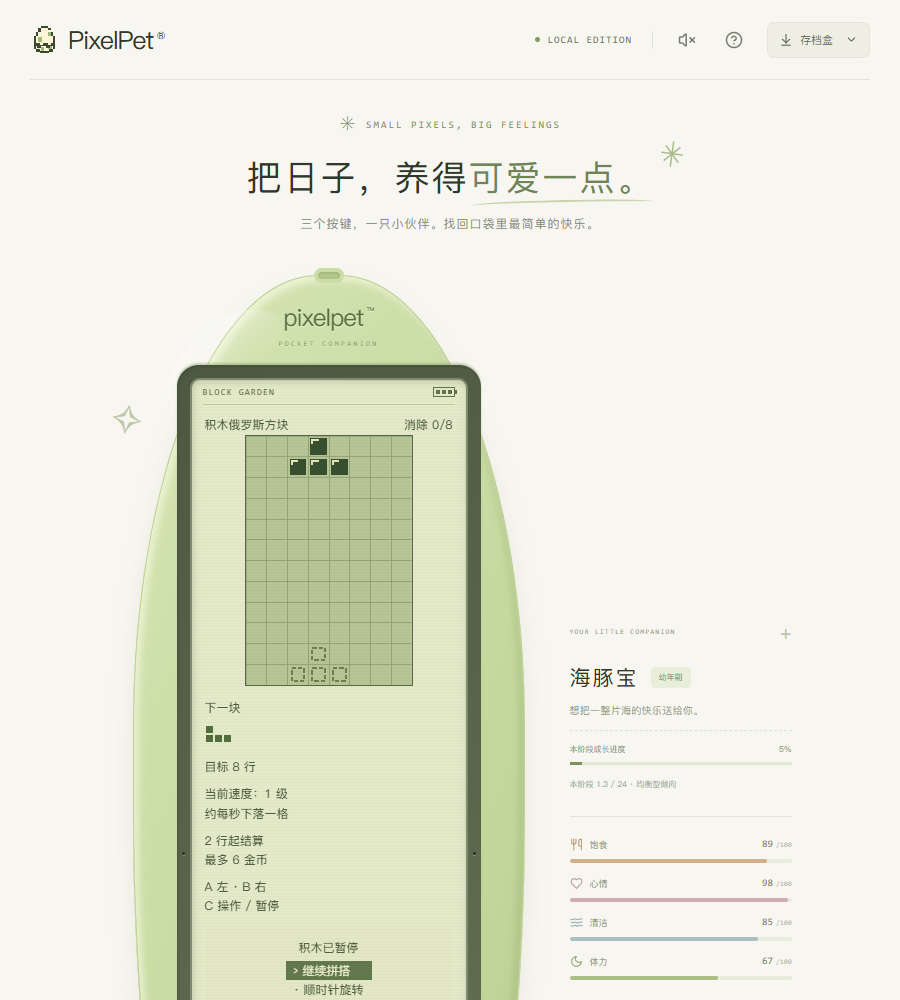
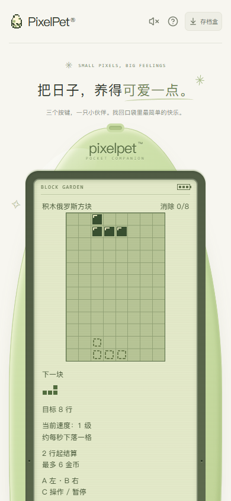
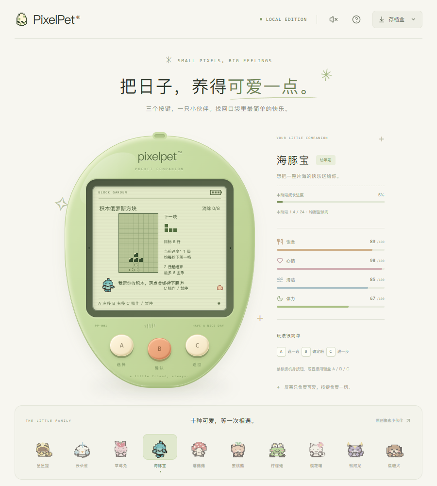
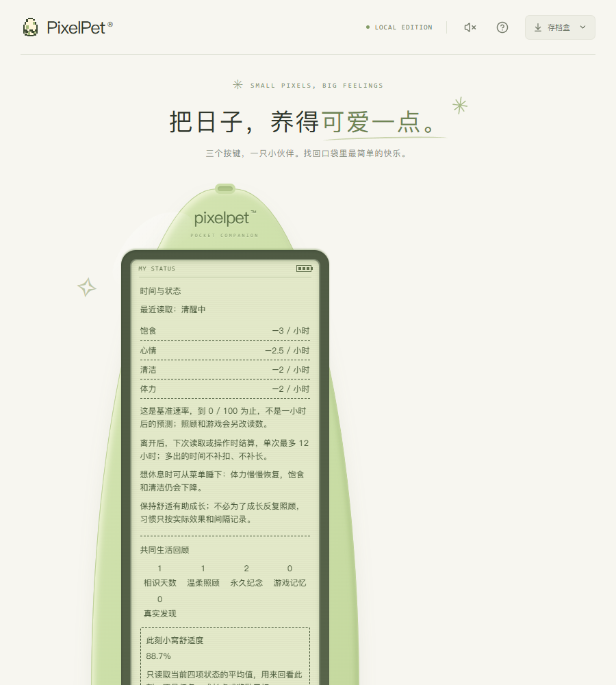

**建议**：把寻宝那套搬到“暂停 / 结束 / 结果”这几类屏幕上——机身保持 516（或给一个上限，例如 700），让 `.lcd-content` 自己滚；真正需要“长阅读”的只有状态第 2 页、成长手册、纪念册这类页面，那几页可以另给一个较大的固定高度（例如 900）而不是无限 auto。状态第 2 页本身也够拆成「时间与状态」和「共同生活回顾」两页。

### 2. 状态页第二页是一张数据报表

一页里塞了 7 组内容：四项消耗速率、共同生活回顾 5 格、此刻舒适度、一起生活的下一步、共同经历统计 4 格、七款游戏各自局数（7 行 ×2）、最近保存的回忆，外加 6 段说明。作为「看看状态」这个入口，玩家想知道的是「它现在好不好」，但第一屏全是「−3 / 小时」这种速率表。

其中「各游戏共同经历」7 行占了整页的三分之一，信息在成长手册第 4 页已有更紧凑的版本（`接星星 ●○○○○`）。

### 3. 每个动作都附一张四项数值表，即使全部「不变」

入睡回执：饱食 91.11 → 91.11（不变）、心情（不变）、清洁（不变）、体力（不变），四行全是「不变」，后面还有「本次没有新增成长点 / 休息习惯：本次不计入 / 本次切换不计休息习惯 / 记录数值：成长 +0.00 点 · 休息习惯：+0」。

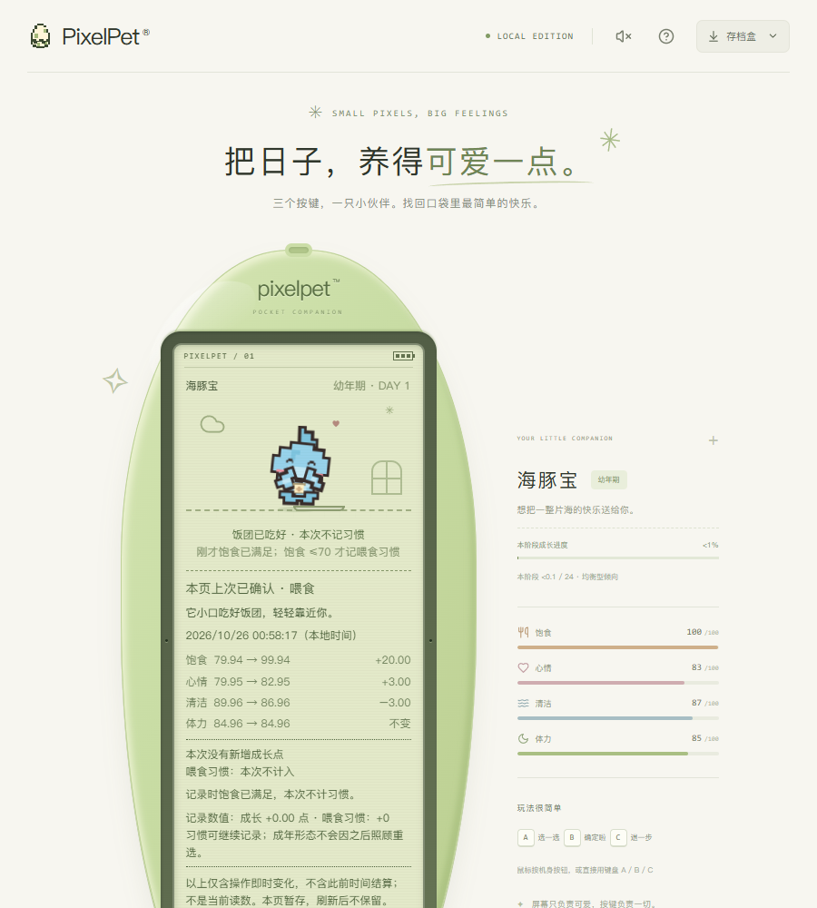

喂食、洗澡、入睡、起床、每局游戏结算都是这个结构。真正有信息量的是一头一尾两句（「饭团已吃好 · 本次不记习惯」「它小口吃好饭团，轻轻靠近你。」），中间那张表和 3 段免责说明把这两句冲淡了。散步结算 25 行，其中 4 行是数值、3 段是「不代表本局一定得币」类说明。

**建议**：数值表只在「有变化」时出现；说明段落收进「查看细节」一页（A/B 翻页），回执首页只留标题 + 一句人话 + 金币/成长。

### 4. 文案细节

**4.1 散步说明仍像在说别人。** 我是海豚宝，说明页写「换成海豚伙伴时走浅水道：A 跃水、B 下潜。」——条件句用在了当前角色身上。建议按当前物种直接写「你是海豚伙伴，走浅水道：A 跃水、B 下潜。」

**4.2 一天里三个季节。** 同一晚：小窝「秋日小事 · 树影换了新的颜色」、公园「虚构风景 · 冬 · 晴 · 白昼」、钓鱼「虚构风景 · 夏 · 晴 · 晨光」。公园和钓鱼前面有「虚构风景」四个字，但玩家读到的是三个互相矛盾的季节。

**4.3 成长日记还是日志。** 最新一条是：「早安！本段休息实际结算 <0.01 小时，恢复体力 +0.04，休息习惯 +<0.01，期间成长 +<0.01 点（含自然成长，非起床奖励）。」——这是调试输出，不是日记。同页另一条「收好海边贝壳，花费 20 金币」就正常得多。

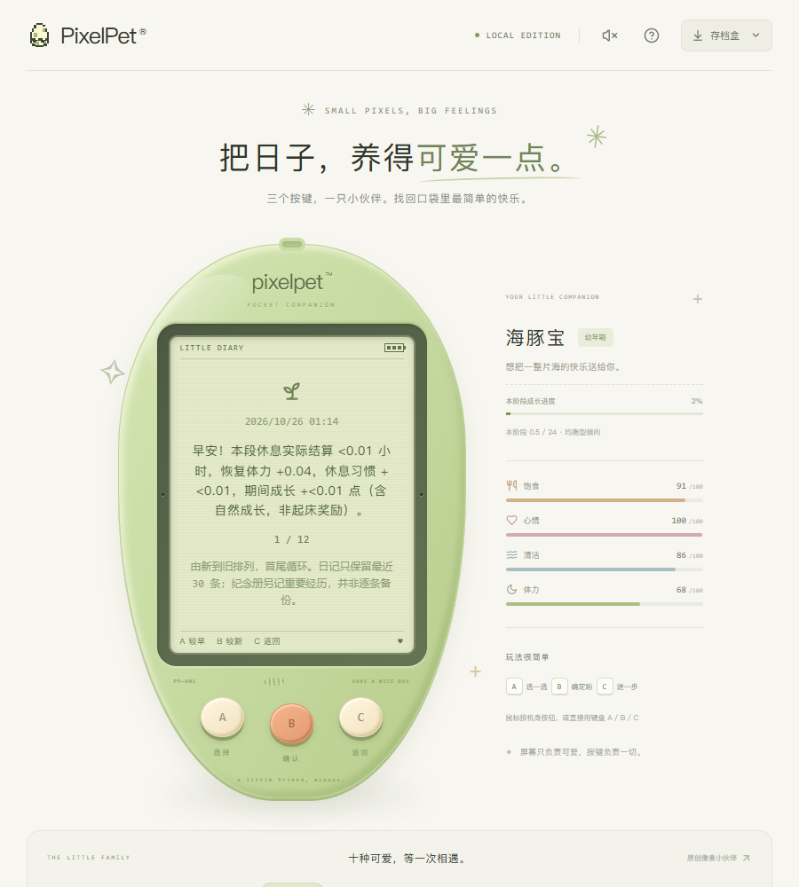

**4.4 同一局里两次同一个发现。** 池畔小路三次发现是 落羽 / 落羽 / 圆石子。**4.5** 陪它一会儿的 10 条回忆里，第 7、8 条都在讲接星星（小缎带 + 星光）。

### 5. 生活回顾 5 格在窄屏排成 4+1

标签不再断字了，但 390px 下 5 格变成 4 格一行 + 「0 真实发现」单独一行，看着像少了一格。3+2 或按 5 格缩字号会更稳。

---

## 三、玩法与节奏

### 1. 接星星：亮星每 900ms 换一格，屏幕上的提示 1 秒内就过期

服务端判定是 `beat = (now - startedAt) / 900`，命中条件是 `beat % 3 === lane`。也就是说亮星位置由**按下 B 的那一刻**的墙上时间决定，每 900ms 跳一格；而屏幕上「伙伴在中间；A 移到右边」这句在下一个 900ms 就过期了。

我的实际结果：同一局 5 轮里，**按提示「读位置 → 按 A → 按 B」的 3 轮全部「差一点」，0 中**；改成在同一拍内完成（脚本里读 `beat%3` → 连按 A → 按 B，全部压在 100ms 内）的 2 轮**都接住，2 中**。最终本局「一起接住了 2 颗星星」。

对玩家来说这意味着：这句提示不可靠，真正的规则是「跟着跳动的亮星走，并在同一拍内按 B」，而说明页写的是「移到亮星下面就能按 B，不必等落到底」——听起来像亮星会等你。

**建议**：亮星停在原地直到玩家动作（改成回合制），或保留节拍但给 2 拍宽限，并把说明改成「亮星每拍换一格，要跟着它走」。

### 2. 俄罗斯方块：8 行盘面很浅，20 秒就结束

我 6 次「落到底」（没有左右移动）就顶到顶结束，消除 0 行 → 0 金币、不计陪伴、不进共同游戏记录。落底预览很好用（「落底预览：本块落下后暂不消行。按 B 才固定。」），这是这个版本最好的新增之一，但盘面高度让一局结束得太快，2 行的门槛在浅盘上不容易达到。

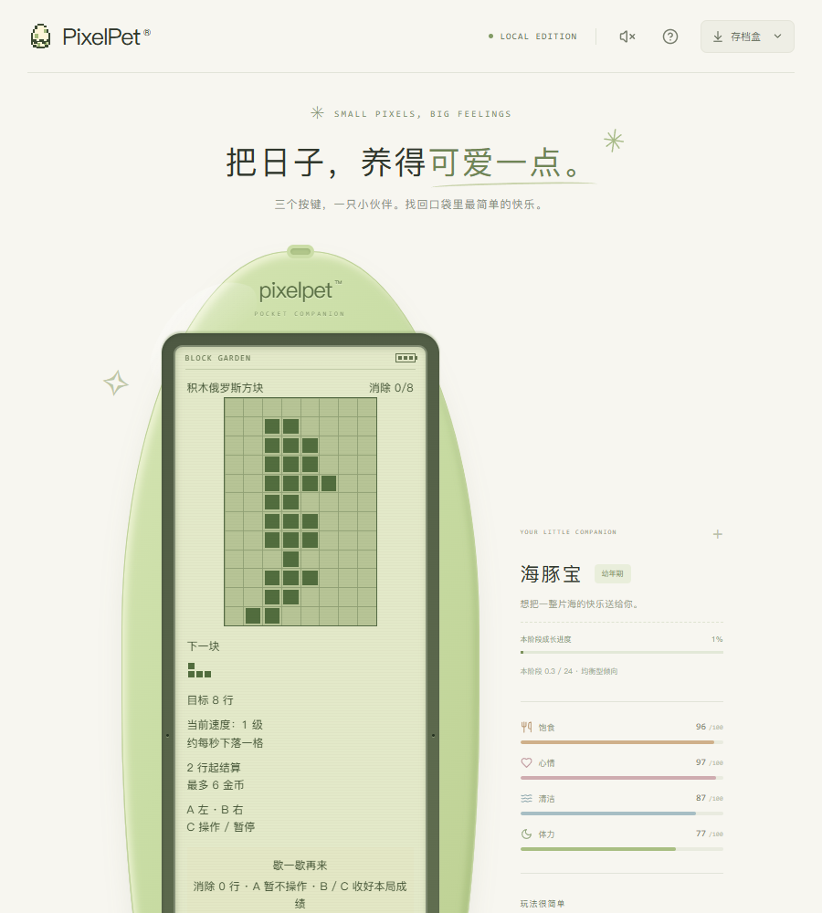

### 3. 钓鱼首竿等了 31 秒

脚本从按 B 抛竿到出现「咬钩啦」计时：**31.1 秒**。等待期间只有「还没咬钩；鱼影只是风景」和轮换的环境句（「鳍轻扶竿架，在浅水边陪你等。」「水纹一圈圈散开，不急着提竿。」）。三竿都中，鱼名和描述（丝带泥鳅 / 青苇小鲦 / 柳影小鳉）都挺可爱。31 秒对「随手玩一下」偏长。

### 4. 连续玩三局，只有第一局算数

接星星 +0.25 成长；之后散步、钓鱼的回执第一行都是「陪玩完成 · 本次不记习惯 … 记录时约还需 20–26 分钟」。三局连玩，后两局在玩家读来是「白玩了」。透明是好事（写明了还需多久），但正反馈断了。

### 5. 挑条小路：好用

出发前三条路（林荫小径 / 池畔小路 / 花园步道），各列出三样可能遇见的东西，和物种路线叠加显示为「公园散步 · 池畔小路 · 浅水道」。选完仍停在暂停，不自动开局，这点很稳。

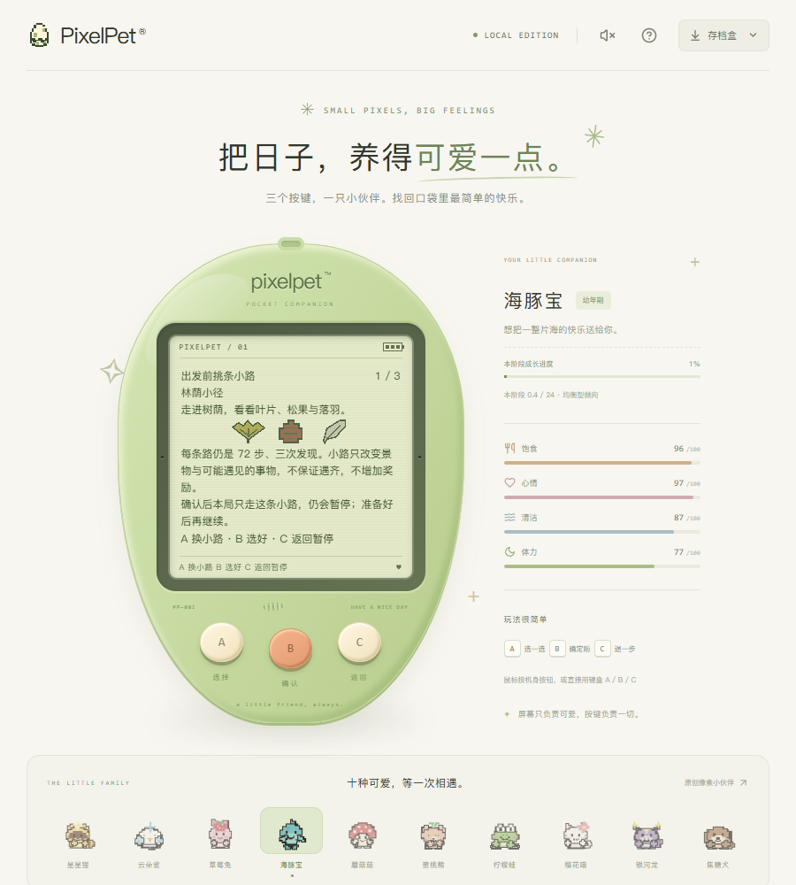

### 6. 森林寻宝在手机上仍看不全九格

390×844 下 LCD 内容 476px、可视 284px，需要内滚；选中会自动滚到可见（验证过 scrollTop 会跟着变）。但玩法要求比较「周围八格有几件」，看不到全盘会削弱推理。

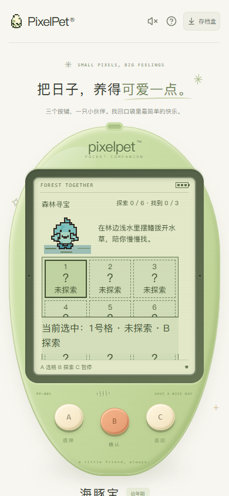

---

## 四、做得好的

- **小窝纪念角**：摆上之后小窝里直接出现「小窝纪念角 / 接星星的小缎带」，并且会被「说声你好」引用——我买完贝壳再进回忆，第一条就是「还记得一起摆好的『海边贝壳』」。
- **运行信息**（存档盒 → 运行信息）：连接状态、最近成功同步时间、网页/后端构建、schema 23，写得克制，也明确说「提交标识不代表 GitHub 最新版本」。
- **商店**：季节主题 4 件（秋叶墙纸 26 / 雪夜地毯 28 / 春枝花瓶 18 / 海边贝壳 20），余额不够时写「还差 6 金币，慢慢来」，购买前有确认和「购买后剩 0 金币」，购买后不会自动使用。
- **游戏列表记住上次选的项目**，回到列表还是 6/7；方便，但也让我两次按错方向（以为从 1 开始）。
- 钓鱼的「本局钓到的小鱼 · 3 条」带描述、按钓到先后排，比只报数字好读。

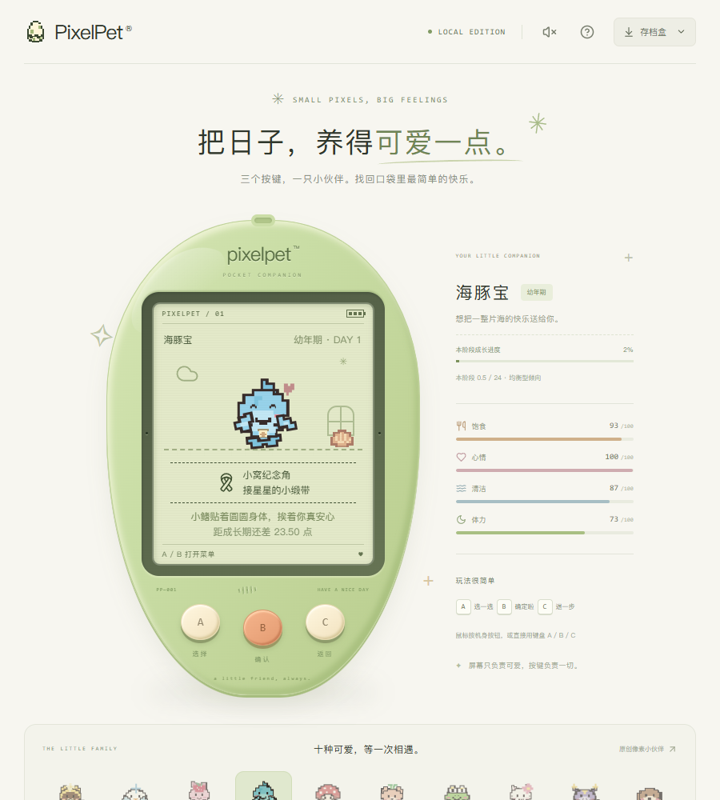
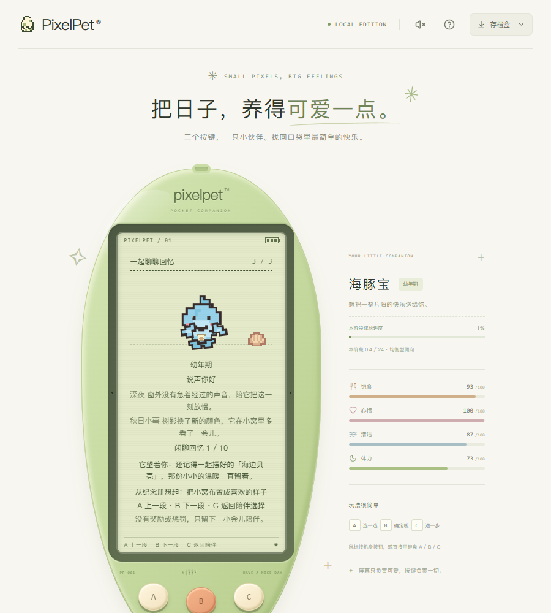

---

## 五、如果只改三件事

1. **机身别跟着内容长**：暂停 / 结束 / 结果三类屏幕改用寻宝那套（固定机身 + LCD 内滚），机身不要超过 700px；状态第 2 页这类长阅读页给一个固定上限而不是 `height: auto`，并考虑拆页。
2. 回执收口：数值表只在有变化时出现，说明段落折进第二页。
3. 接星星的亮星别每 900ms 跳走，或把提示改成「跟着亮星走」。

## 说明

- 本轮只用独立临时存档（`playtest3.db`）与临时构建目录，未连接玩家进程，`data/pixelpet.db` 未被读写。
- 三键约束未被破坏：全程只用 A/B/C，未点击 LCD 内任何元素；只有存档盒、运行信息这类存档级面板用了鼠标。
- 计时（31.1 秒、900ms 节拍）来自脚本在同一页面内的高精度计时，不是肉眼估计；接星星的「0–2 颗」是真实按键结果。
- 连连看、贪吃蛇本轮未玩；森林寻宝只验证了版面后放弃。
