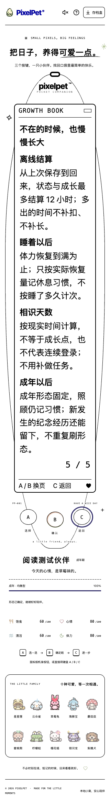
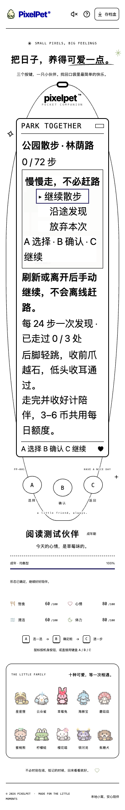

# 三键阅读与可达性专项（2026-10-19）

## 本批改变

- 小窝、菜单、手册、商店、纪念册等阅读页随内容展开，用页面滚动到达三键，不再把长说明塞进固定高度的 LCD。运行中的棋盘尺寸和速度不变。
- 暂停说明可展开；成长手册页码改普通文档流。正文使用可随根字号放大的单位，长文字换行，习惯表格与商店说明重排。
- 高对比度模式补选中轮廓、进度条和系统配色按键。真实 Chrome 截图发现焦点键的合成文字背板遮字，已用明确系统色、移除按键滤镜/位移合成修复；保留焦点轮廓。
- 键盘长按映射键时阻止浏览器原生 Enter/Space 重复 click，但不重复执行玩法；保留输入框、链接、非玩法按钮及组合键保护。
- 帮助弹层关闭返回原触发按钮；重新开始弹层返回稳定的存档盒按钮，不返回已经卸载的菜单项。仍保留焦点圈定、Escape 关闭与三键玩法。

## 验证与边界

独立临时数据库、真实 Chrome 自测，不是用户试玩反馈：

- 前端 623 项 / 28 文件通过，TypeScript 与生产构建通过；Go race、vet、构建通过。
- 320 / 390 / 1200px，短屏 480px；正常字号 / 根字号 200%，普通色+正常动态 / 高对比度+减少动态，共 12 组合、180 阅读布局。200% 是实际 rem 文字放大，不是只缩放截图。
- 每组合覆盖小窝、状态、五页成长手册、商店目录/物品、纪念册封面/卡片，以及蛇、积木、散步、钓鱼四种暂停页。核对文本边界和字号、页面横向溢出、三键触摸尺寸与 LCD 内没有可点击玩法控件。
- 路径包括聚焦 B 后长按 Enter、帮助焦点圈定与恢复、关闭重置不执行重置、暂停中放弃确认取消、触摸三键后键盘继续操作。
- 视觉复核下列 320px/200%/高对比度截图与按键特写；长页通过页面滚动阅读，不要求整个设备塞进一个短屏。

本批不声称所有浏览器/读屏器认证，也没有重新完成六款游戏的全部通关；没有修改存档结构、养成数值、奖励或成年形态。所有浏览器写操作只在临时数据库进行，玩家存档未动。

