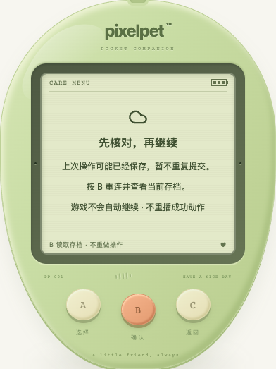
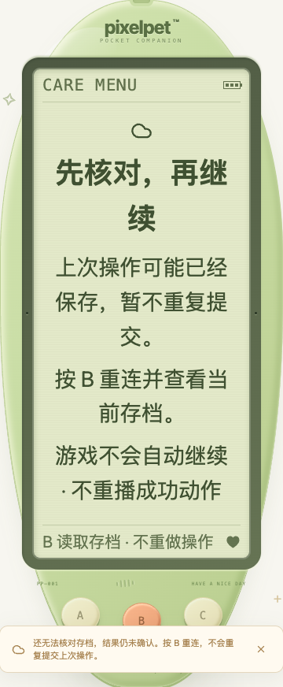

# 成功响应的基础数据保护

日期：2026-10-19。不新增玩法、控件、养成参数或存档字段。

## 缺口与处理

旧请求层只核对 revision、lastTick、serverTime 和可选存档代次。一份仍带有这些字段、但需求值缺失、名字变成对象或日记变成非数组的 HTTP 200 JSON，仍可能被当作成功结果交给界面，造成渲染/阅读错误。最终版新增 API 回归在旧实现下有 46 项失败，补丁后通过。

- 在应用回复、记录保存时间或展示成功动作前，检查基础状态字段、四项有限且在 0–100 内的需求值、可显示的文本、合法数值时间和非负整数计数；非空日记须为带时间和文字的数组。
- 照顾等写请求的异常成功回复依然是「结果未知」，不是「一定未保存」；进入现有 B 核对，不重发原操作，不补播照顾或成长成功。
- 初始连接/轮询异常保留连接恢复入口，不把错误回复覆盖进可读状态。再次读取仍异常时保持保护；正常权威读取后才能继续照顾。
- 合法的 null/缺失日记沿用原有空历史处理，不伪造记录，不擅自修改回复。旧服务器没有 growth、album、economy、careRules、shop 或 saveGeneration 等可选字段仍可使用；未知新增字段也原样保留。

这是**基础响应结构保护**，不是第二套服务端存档校验器：未覆盖所有可选功能对象的深层字段，也不替代服务端的迁移、合法性和业务规则。不能凭一份不完整响应诊断 SQLite 已损坏，更不会因此自动开放重置/导入或更改存档。存档 schema 仍为 12，现有三键、离线结算及成长规则不变。

后续已补上可选成长对象的显示安全检查：习惯、积分、时间与可选定型依据；旧服务缺失/null 成长仍兼容。详见 [成长响应保护](GROWTH_RESPONSE_GUARD.md)。仍不是全可选功能对象的深层校验；下方数字为本基础保护批次的历史验收。

## 验证

- 新增 API 回归 50 项及使用真实请求解析器的 App 回归 16 项；前端全量 **1543 项 / 71 文件**、TypeScript 和生产构建通过。覆盖初始读取、轮询、已保存/未保存照顾、连续异常核对、恢复后再次明确喂食、旧空历史和可选字段兼容。
- Go 全量无缓存 `test -race -count=1 ./...`、`vet ./...`、构建通过；既有节奏算术 6 项通过，不代表新增节奏游戏。
- 独立临时库真实 Chrome **19 组**通过：四类异常 × 初始/轮询/已提交照顾/未转发照顾 16 组，两个旧式可选字段与空日记场景，以及正常新蛋孵化、入睡和刷新链路。核对服务端照顾次数、无重发、无误报成功、无页面异常，以及 A/B/C 和 LCD 无新增点击控件。
- 已提交场景先让真实服务保存，再仅修改浏览器收到的回复；未提交场景拦截而不转发操作。轮询用浏览器受控时间推进 15 秒；不是自然长时间挂机，也不是所有代理/网络环境认证。旧式响应是兼容夹具，不是运行历史服务器版本。
- 键盘与 390px 短屏触摸交替，核对恢复说明文字边界和三键滚动可达；双倍字号截图只用于本次恢复页阅读检查，不声称所有布局或辅助技术认证。两张最终截图已查看。

普通恢复画面：

双倍文字恢复画面（短屏需滚动到三键）：

## 数据与运行边界

- 临时库：`/tmp/pixelpet-response-Uxo1S2/test.db`；浏览器脚本：`/tmp/pixelpet-response-browser.mjs`；结果：`/tmp/pet-response-browser-results.json`。专项 API/App 回归保存在仓库，临时脚本不是永久测试入口。
- 只启停自己的 18132 测试服务。玩家库 SHA256 仍为 `a8b712d5419fe6227b255f4d63869612e451da7abddffd60124de8ee65c23eee`；原进程 38015 / 39567 保留，没有操作玩家存档或主动刷新玩家页面。
- 未部署或重启原后端；本地构建会更新忽略的 web/dist，原服务如果读取同一目录，在页面重载时可能读到新前端。提交/推送不等于完整运行环境已升级。

持续迭代目标保留；后续继续优先可复现照顾、成长和恢复问题，真实人工试玩与自然长时间体验仍待验收，候选新游戏尚未开发。

后续已补充 [照顾反馈保护与单次习惯显示](CARE_FEEDBACK_SAFETY.md)，不改变本批基础响应及未知结果核对约定。

2026-10-20 后续：[鱼图鉴与公园发现响应保护](OUTING_COLLECTION_COMPATIBILITY.md)允许合法 null/缺失空集合，拒绝损坏的已提供记录，不改存档、不冒报成功或自动重试。仍只检查显示安全结构，服务端继续负责完整存档业务合法性。
