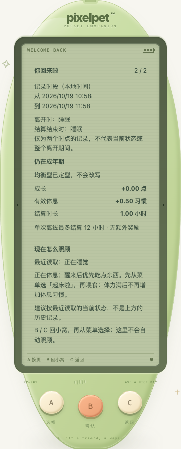
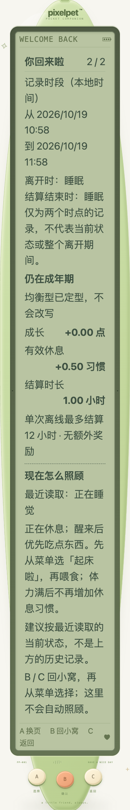

# 回访后的当前照顾建议（2026-10-19）

## 本批内容

回访小结原先只解释离开期间发生了什么；第二页现在补充「现在怎么照顾」，帮助玩家接回日常照顾流程：

- 历史时段、历史睡眠、成长/休息变化仍全部来自已保存的小结，不改写原记录。
- 新区块明确「最近读取：清醒中 / 正在睡觉」，使用当前权威响应中的宠物状态，复用状态页的 `CareAdvice`，不另造需求优先级或奖励条件。
- 明确建议不是上方历史；其他页面实际喂食后，小结仍保留旧数值，建议随被接受的新读取更新。陈旧响应不会倒退建议。
- 饥饿、清洁、疲惫、想玩、舒适和睡眠指引沿用既有规则；睡眠时提醒从菜单「起床啦」而非自动叫醒；成年后不重选形态。
- 仅放在现有第二页。B / C 回小窝，再从菜单选择；看建议、翻页与返回不自动执行照顾。当前状态缺失时不拿历史读数替代，明确回小窝查看。

没有新增任务、按钮、玩法控件、奖励、存档字段或后端改动；schema 12、两页与 A/B/C 不变。这里的「当前」指最近权威读取，不是客户端预测下一秒的需求，离线/读取失败时沿用原恢复界面，不把旧建议当连接已恢复。

## 持久回归

- `web/src/ReturnCare.test.tsx` 31 项：三阶段 × 九种清醒/睡眠需求组合，复用原建议、历史/当前分离、状态缺失和旧成长字段、第二页范围、无控件、不改传入数据。红测为 30 失败 / 1 通过。
- `web/src/ReturnCareFlow.test.tsx` 7 项：自动/手动阅读、轮询与前台读取更新、旧响应拒绝、新小结回第一页、断线隐藏及重连、返回后明确确认菜单才喂食。
- 一次流程测试最初误假定普通断线重连必回小窝；实际恢复原阅读位置，已按既有行为修正夹具预期，没有为测试改导航。

## 小屏与大字号

真实截图发现原成长列表在窄屏双倍文字下把「有效休息」「习惯」「小时」拆开。成长行现在允许整组标签/读数换行，但每个标签和数值单位保持完整，数值仍右对齐；不缩小字号或三键触摸目标。先在 320px / 200% 文字复现 `有效休息` 分为两行的失败，再修复并复跑布局断言。此修复同时作用于第一页共用的成长列表样式，不改读数。

最终 390px 普通/双倍文字截图均已人工查看：




长内容通过页面滚动阅读，不新增 LCD 内部滚动区；568px 高短屏可滚动抵达机身 A/B/C，不宣称所有内容同时装进一屏。

## 最终验证

- 新增前端 **38 项**，全量 **1406 项 / 66 文件**，TypeScript 与生产构建通过。
- Go `test -race -count=1 ./...`、`vet ./...` 与构建通过；既有节奏算术 **6 项**通过，并非新增节奏游戏。
- 独立临时 SQLite + 真实 Chrome **26 组检查**通过：三阶段 × 四类清醒/睡眠状态；320/390/1200px × 普通/双倍文字 × 默认/强制配色（后者同时减少动态）；568px 高短屏和手机触摸三键；外部实际喂食后的建议更新及刷新；自动认领后必须明确菜单确认才喂食。
- 核对真实写请求、历史稳定、阅读页码、文字边界/完整单位、44px 机身键、无 LCD 新控件、无页面脚本错误。历史时段睡眠与当前睡眠允许不同；临时夹具构造的三阶段不是自然养成或用户试玩反馈。
- 一次浏览器脚本最初在跳过照顾动画回小窝后立即查找历史，正确失败；验收脚本改为先按三键重开小结后查询，没有改产品来绕过。布局红测是另一个真实复现，已修复 CSS。

持久回归入口：

```sh
pnpm --dir web test
pnpm --dir web build
node --test scripts/evaluate-rhythm.test.mjs
./.tools/go/bin/go test -race -count=1 ./...
./.tools/go/bin/go vet ./...
./.tools/go/bin/go build -o /tmp/pixelpet-return-care ./cmd/pet
```

本机记录：`/tmp/pet-return-care-red.log`、`/tmp/pet-return-care-layout-red.log`、`/tmp/pet-return-care-layout-fixed.log`、`/tmp/pet-return-care-{web,go}-final.log`、`/tmp/pet-return-care-browser{.log,-results.json}`；浏览器脚本 `/tmp/pixelpet-return-care-browser.mjs`，临时库 `/tmp/pixelpet-return-care-0OlLTI/test.db`。浏览器脚本和临时库不是仓库持久入口，新增两个 Vitest 文件是持久回归；截图布局另由本次真实 Chrome 验证。

## 玩家数据与后续

不操作玩家 `data/pixelpet.db`；前后 SHA-256 均为 `a8b712d5419fe6227b255f4d63869612e451da7abddffd60124de8ee65c23eee`。原服务进程保留，自己的 18129 测试服务已停止。不主动刷新玩家页面或部署/重启后端；构建生成本地 `web/dist`，使用该目录的服务在下次页面重载时可能读到新前端，不能据此称整套服务已部署。

持续目标保留，下一批仍优先处理照顾、成长与离开恢复中可复现的问题，并等待真实试玩反馈；节奏拍手/森林寻宝仍是未开发候选。
