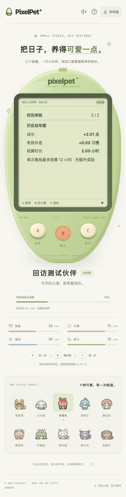

# 回访小结翻页修复（2026-10-19）

## 问题与修复

回访小结实际只有两页，但 A 原先按三页循环，出现「3 / 2」并重复第二页。现在页码与导航共用两页常量：

- A：第一页、第二页循环，无第三页。
- B：第一页继续，第二页回小窝；底部提示同步显示实际动作。
- C：任一页返回。菜单重看始终从第一页开始，不再次领取通知，不清除小结。

不新增玩法控件、奖励或存档字段，不改变离线结算、睡眠、成长速度和成年定型规则。schema 仍为 11。

## 验证

- 先添加回归复现：自动展示和菜单重看的 A 循环均出现「3 / 2」，最后一页提示也未说明返回；修复后新增 5 项应用回归通过。
- 全量前端 **753 项 / 35 文件**、TypeScript/生产构建、Go 全量 race/vet/构建通过。既有节奏算术脚本另 6 项通过，不代表节奏游戏已实现。
- 独立临时 SQLite + 真实 Chrome **41 项检查**：320/390/1200px × 普通/200% 根字号 × 普通色/强制高对比并减少动态，共 12 个组合。每组检查两页文字边界、最小字号、三键尺寸及无 LCD 点击控件，再走自动展示、A 多轮循环、B 返回、C 两页返回、菜单重看与刷新链路。翻页不发送照顾/导入/重置请求，小结只认领一次，内容不被重看改写。
- 另验证真实两小时睡眠结算跨入成长期：睡眠中不认领通知，用手机触摸实际叫醒后才展示，叫醒不混入离线变化；48 小时离开只结算 12 小时，成年形态固定，真实服务重启后不重弹，菜单仍能重看原小结。
- 夹具仅在新建临时库中设置合法存档与过去的到访基线；小结由实际服务结算生成，不是预填渲染结果。首次浏览器脚本将阶段文案误写为「幼年」，修正为现有「幼年期」后完整重跑通过，没有放松产品规则。

测试库：`/tmp/pixelpet-return-navigation-5A3iOp/test.db`；本机浏览器脚本与结果：`/tmp/pixelpet-return-navigation-browser.mjs`、`/tmp/pet-return-navigation-browser-results.json`。复测脚本须先确认端口 18107 空闲；脚本只创建独立测试库，结束关闭自己的服务。

玩家 `data/pixelpet.db` SHA-256 前后保持 `a8b712d5419fe6227b255f4d63869612e451da7abddffd60124de8ee65c23eee`；未导入、重置、代玩或停止玩家服务。这是自测，不是用户试玩反馈，也没有重新验收全部六款小游戏。

