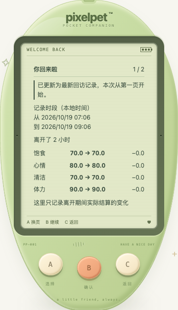
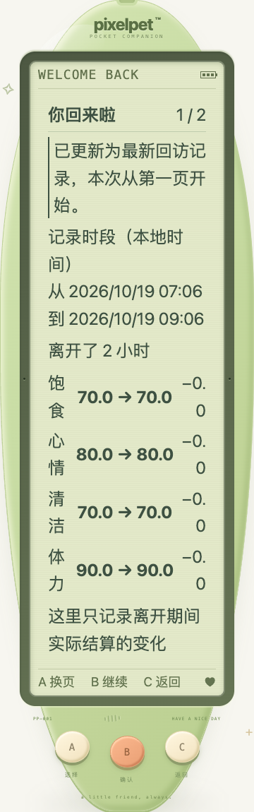

# 回访记录更新时，从第一页重新阅读

日期：2026-10-19。完善离开恢复后的阅读，不改变离线结算或回访认领规则。

## 复现

在回访小结第二页停留，进入后台一段时间；其他页面产生并认领新小结后，原页面恢复前台读取新记录。原实现沿用旧页码，直接显示新记录第二页，B 提示仍是「回小窝」，容易漏看本次饱食、清洁等变化。即使原先在第一页，也没有说明数据已换成另一份记录。8 项新增应用测试先在旧实现跑出这 2 个失败。

## 本批调整

- 阅读位置绑定服务端回访记录 ID。新 ID 到达且正在阅读时，直接呈现第一页，显示「已更新为最新回访记录，本次从第一页开始」。页码、LCD 提示与 A/B/C 使用同一个派生位置，不能继续沿用旧记录最后一页的 B 意图。
- 同 ID 的正常轮询保留页码；新记录的提示随本次翻页保留，离开再主动进入时清除。再次更新仍回到第一页。
- 两页都显示这份记录的起止日期与时间，按浏览器本地时区显示，并保留 ISO `datetime`，不把「离开了 2 小时」伪装成现在刚刚发生的离开。
- 清空小结、替换存档、新对局及异常恢复仍沿用原来的路由与清理。被拒绝的旧版本回复不能更新记录或阅读位置。

仍只有 A 换页 / B 继续或回小窝 / C 返回。没有 LCD 内玩法控件，没有新增写请求、照顾、奖励、成长数值或存档字段，schema 仍为 11。成年形态不变，旧备份兼容。

## 认领与边界

「已更新」只是阅读提示，不是新的服务端认领操作。其他页已认领的记录不会由本页重复确认；若最新记录仍待认领，阅读本身也不会偷偷确认，返回小窝后仍沿用原有一次性自动认领/展示流程。本批没有更改这一语义，不声称已解决全部多页竞态。

只保留服务端最近一份小结，不新增历史小结归档，也不冻结已经被替换的旧记录。阅读位置和更新提示仅在本页临时保存；刷新或重启后从最近记录第一页开始，不伪造「刚更新」通知。

## 证据

- 新增应用回归 **8 项**：两页更新、两页同 ID 轮询、连续换记录/重新进入、未阅读时更新、记录清空与旧回复拒绝；新增组件 **4 项**：两页准确保存时段、独立提示、跨日时间。专项六文件 **86 项**通过。
- 全量前端 **1088 项 / 48 文件**，TypeScript、生产构建，Go 全量 `test -race -count=1 ./...`、vet、构建通过。既有节奏算术 6 项也通过，不计成新小游戏。
- 独立临时库真实 Chrome **50 项**：320 / 390 / 1200px × 正常 / 双倍根字号 × 普通 / 高对比度并减少动态效果 × 原记录 / 更新后 × 两页（48）；未认领新记录返回小窝后仅确认一次（1）；真实服务重启保留记录与时段（1）。所有矩阵项检查正文边界与字号、无内部滚动陷阱、可滚达的至少 44px 实体键、三键/LCD 无玩法控件、时段与服务端一致；手机宽度实际触摸，桌面键盘。
- 原记录矩阵还核对同 ID 保留第二页，新记录核对重定位后 B 继续，返回再进入不保留更新提示。48 个矩阵项均没有照顾/导入/重置/认领请求；待认领专项单独核对恰好一次 `/api/recap/read`。无浏览器异常，照顾次数/金币均未增加，schema 与成年形态规则不变。
- 访问基线使用临时库中合成的一/两小时前时间，再由真实 Go 服务生成新记录 ID 并真实认领。**没有自然等待一/两小时，也未回拨存档 `lastTick` 来模拟真实离线变化**；这是阅读/同步测试，不替代既有离线结算测试、真实手机后台或用户试玩。可见性变化为事件注入。
- 脚本 `/tmp/pixelpet-return-reading-browser.mjs`，结果 `/tmp/pet-return-reading-browser-results.json`，临时库 `/tmp/pixelpet-return-reading-iTuNWX/test.db`；仅启停自己的 18113 测试服务，结束后已停止。
- 玩家库 SHA256 保持 `a8b712d5419fe6227b255f4d63869612e451da7abddffd60124de8ee65c23eee`；原玩家进程 38015 / 39567 未重启。构建/推送不代表运行中的玩家服务已经部署。

总体持续迭代目标保留；后续仍优先真实反馈与可复现的照顾/恢复问题，不任意改成长节奏或把候选游戏算成完成。
