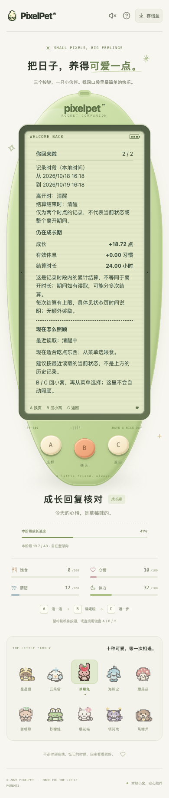
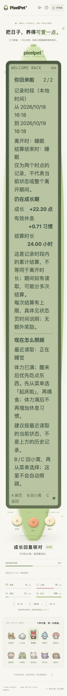

# 回访累计结算说明（2026-10-19）

## 问题与修正

回访页原来的「单次离线最多结算 12 小时」及成长手册的同类表述，容易被理解成整段离开最多计入 12 小时。实际限制作用于每次服务端结算：普通状态读取、导出备份也会结算，但不会更新前台访问基线。因此，没有回来操作时也可能分多次结算，回访累计量可以超过 12 小时。

- 回访第二页说明「结算时长」是记录时段内的累计量，不等同于第一页面的现实离开时长。
- 成长手册时间页说明每次结算有上限、超出该次上限不补算，多次读取可能累计更多。
- 历史小结没有保存当时的结算上限，不把当前数字冒充历史规则；当前上限仍在状态页时间说明中展示。
- 显示原始历史差值，不对回访累计量再次限幅，不改需求衰减、睡眠恢复、成长速度或任何奖励。没有后端生产逻辑、schema 或存档结构改动，仍仅 A/B/C 操作。

## 受控时间验证

清醒/睡眠各覆盖三种时段：

| 现实离开 | 中间被动读取 | 实际累计结算 |
| --- | --- | --- |
| 24 小时 | 无 | 12 小时 |
| 24 小时 | 第 8、16 小时 | 24 小时 |
| 48 小时 | 第 8 小时 | 20 小时 |

Go 测试使用独立临时库和显式时间，验证累计时长、饱食/清洁消耗、清醒体力消耗或睡眠实际恢复及休息习惯、不额外奖励、不移动前台离开基线、重开数据库后历史与待展示标记保留。前端 8 项覆盖三组读数、零累计不推断、说明所在页面及三阶段手册；原有导航断言同步更新，仍检查超出单次上限不补算。

浏览器脚本以自己的临时数据库回拨夹具时间戳，执行真实被动读取和回访结算，不修改系统或玩家时钟。三组分别使用幼年/成长期/成年旧存档迁移夹具，清醒使用普通手机视口、睡眠使用小屏大字号。通过三键阅读两页小结、循环返回、进入手册时间页；检查历史不改写、无照顾/金币奖励、文字边界和仅三个玩法按键。

浏览器在显示响应中将 `recapPending` 设为 false，以隔离手动阅读，不让自动认领消费真实待展示记录；后端仍保留原记录和 pending。这六组不是自动认领生命周期验收，不是自然等待 24/48 小时，也不是后台存活或真人试玩认证。

## 验证结果

- 新增前端 8 项，相关专项 138 项 / 10 文件；全量 2217 项 / 87 文件、TypeScript 和生产构建通过。
- Go 新增 1 个测试 / 6 子场景；全量无缓存 race、vet、构建与既有节奏算术 6 项通过。
- 独立临时库 Chrome 累计结算六组和完整响应回归 64 组通过。每组检查无页面错误、无新增屏幕玩法控件、三键可达与无额外玩法写请求。
- 普通 390×844 / 根字号 14px、大字号 320×568 / 根字号 28px，最终三张截图已查看。大字号页面可纵向滚动，不要求整页缩入一屏；不代表所有设备或辅助技术的完整矩阵。






## 复跑

先完成前端构建，再执行：

```sh
export PIXELPET_TEST_WEB=/tmp/pixelpet-return-settlement-web
(cd web && ./node_modules/.bin/vite build --outDir "$PIXELPET_TEST_WEB")
./.tools/go/bin/go test -race -count=1 ./...
./.tools/go/bin/go vet ./...
./.tools/go/bin/go build -o /tmp/pixelpet-return-settlement ./cmd/pet
PIXELPET_TEST_BINARY=/tmp/pixelpet-return-settlement \
PIXELPET_PLAYWRIGHT_MODULE=/absolute/path/to/playwright/index.mjs \
PIXELPET_TEST_SCOPE=settlement node scripts/check-growth-response.mjs
# 去掉 PIXELPET_TEST_SCOPE 执行完整响应回归；return 子集保持原八组。
```

测试仅使用脚本自建临时库和空闲端口，结束关闭自己的服务；不刷新玩家页面、不重启原进程、不导入/覆盖玩家存档。构建会更新被忽略的 `web/dist`，共用目录的原服务之后重载可能读到新前端，不代表其后端已部署。

当前复跑须显式提供独立前端及二进制，共享构建不再作为默认值，见 [浏览器构建隔离](BROWSER_BUILD_ISOLATION.md)；本页旧共享构建说明为历史记录。
