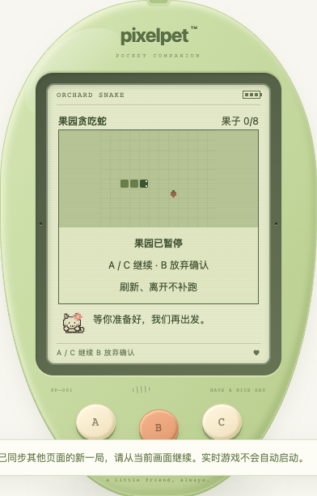

# 回访确认回复与当前状态同步

日期：2026-10-19。修复自动回访小结确认期间的跨页同步与迟到展示，不新增小游戏。

## 问题与修复

自动确认回访小结也会返回服务端当前状态。以前只更新状态、不执行轮询的路由逻辑：另一页先开了游戏，确认回复把新对局写入本地，但画面仍在小窝；下一次轮询认为已同步，也不会进入游戏。新增六游戏测试先复现失败，再修复。

- 轮询与回访确认共用 `acceptCurrentRead`：先拒绝旧回复，再同步存档替换、对局变化、终局和回访卡片。新对局可达，但不会自动运行或收好。
- 旧成功回复不再被当成已确认的展示结果；进入只读核对，B 读取当前状态，不自动重发确认或玩法动作。
- 记录展示代次：确认等待期间打开帮助/存档盒、离开页面或进入后台，会取消这次自动弹出。即使回复前已经关闭帮助或回到前台，也不抢走当前画面。
- 取消的是自动展示，不是服务已接受的数据；原小结仍能从菜单主动重看。正常不间断确认仍进入两页回访流程。
- 服务端已有睡眠/对局保护不变；确认时遇到游戏保留待读小结，明确结束后才允许领取一次。没有新增成长、金币或照顾奖励。

## 兼容与边界

本批生产代码只改前端，服务端新增回归测试。schema 11、备份格式、成长参数、奖励和固定成年形态均不变，仍只有 A / B / C 三个玩法键，LCD 内无新增可点击控件。

这不是所有异步展示/多页竞争问题的全面解决；本批覆盖回访确认的当前状态同步及其迟到弹出。原玩家服务没有重启，也没有操作玩家宠物；构建与推送不等于原运行中的服务已更新。

## 验证

- 新增前端 **22 项**，全量 **955 项 / 41 文件**、TypeScript 与生产构建通过。覆盖六游戏新对局、四终局、帮助/存档盒、后台、旧回复、卡片清除、旧服务生命周期替换、睡眠延期和请求失败恢复。
- Go 全量 `test -race -count=1 ./...`、`vet ./...`、构建通过。六游戏各在同一个 Store 上并发八个确认请求：新对局/待读卡片不丢、五张业务表不变；明确放弃未完成对局后，再并发确认且恰好领取一次，不增奖励。不是八个独立数据库连接的验证。
- 既有节奏算术 **6 项**通过，不代表节奏游戏已开发。
- 独立临时库真实 Chrome **19 场景**通过：六游戏确认前由另一真实 HTTP 客户端开局、四终局、四帮助/存档盒开关、两可见性场景、真实成功确认丢响应、响应 revision 降低、正常两页回访。桌面键盘与 320px 触摸交替，检查没有自动玩法写入/奖励、后续轮询仍可达、三键与 LCD 控件约束。
- 回访由临时库合成的一小时前访问基线产生，不算自然离开一小时；四终局为实际服务校验的合成夹具，不算完整通关。后台是可见性事件注入，不替代真实设备切后台；旧回复是拦截降低响应 revision。其余确认与游戏启动走真实服务。
- 临时库：`/tmp/pixelpet-return-sync-o0BzWQ/test.db`；脚本：`/tmp/pixelpet-return-sync-browser.mjs`；结果：`/tmp/pet-return-sync-browser-results.json`。
- 玩家库 SHA256 仍为 `a8b712d5419fe6227b255f4d63869612e451da7abddffd60124de8ee65c23eee`；原进程 38015 / 39567 仍在，只启停自己的临时服务。

持续迭代目标保留；下一批继续优先可复现的养成、离开恢复和三键体验问题。节奏拍手/森林寻宝仍是候选，不重复算作已交付。
