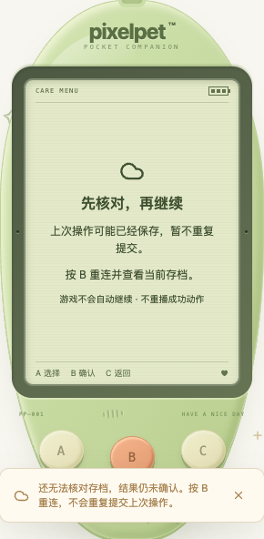

# 保存与连接恢复（2026-10-19）

这是非小游戏完善计划的第一批，不新增游戏、存档字段、玩法控件或后端规则。

## 玩家看到什么

- 确定的服务端拒绝（例如金币不足）：保留原提示，不播放成功动作；仍可用三键返回或在了解原因后重新操作。
- 写请求网络中断、超时、服务端 5xx/408、响应体中断或不合格的成功响应：不能断言没保存，进入「先核对，再继续」。只开放 B 核对，原请求不会被自动重发；照顾、购买、导入、重新开始也不能从工具入口绕过保护。
- B 只 GET 当前 `/api/state`；15 秒轮询与返回前台也可触发同样的只读核对。读取失败/过旧继续锁住，重复按 B 不创建并发核对。
- 核对成功后显示当前存档，购买确认返回小窝；既不补播照顾、成长或领奖成功画面，也不自动恢复游戏进度。需要玩家手动继续。
- 单纯读取失败与未知写结果分开表达。初次连接失败或原本已连接后的读取失败，也会明确暂停操作、显示 B 重连；按 A/C 不能把错误清掉并伪装已保存。

## 技术与边界

- 请求层提供明确拒绝/写结果未知/读取不可用的错误类别，保留 10 秒超时，无自动写重试。
- 校验成功响应的最小存档信封（revision/lastTick/serverTime），不是完整存档 schema 校验；旧版数据仍由既有兼容逻辑处理。
- 写开始后，之前启动的轮询响应及错误均失效。正常读取每个 epoch 最多一个；旧 epoch 仍在途不阻塞新的核对。
- 除过旧 revision 不可应用外，动作请求也必须先确认结果可应用，才能触发后续成功动画。
- 网络异常立即停止本地实时会话与排队转向，避免下一帧再次写入；服务端原有暂停/过期机制保持不变。
- **核对取得的是读取时刻的权威状态，不是原请求回执或取消机制。**不能仅靠它证明某个仍在途请求一定未执行；不会宣称客户端提供跨网络的 exactly-once 保证。无离线写队列、客户端补发或自报结算。服务端既有 requestId 幂等规则没有改动。

## 本批验证

- 前端 611 项 / 27 文件通过（原 575 项 + 36 项请求分类/恢复测试）；TypeScript 与生产构建通过。
- 新测试包括：发送前失败、保存后响应丢失、超时/5xx/坏响应、连续按键、核对失败/并发/过旧、旧轮询晚到、旧动作响应、刷新、购买已扣款、导入/重置未知结果、游戏未知步骤后手动恢复边界、初次与后续读取失败。既有 mock 明确标为服务端拒绝；未知网络结果使用独立案例，不混为一类。
- Go 全量 `test -race -count=1 ./...`、`vet ./...` 与构建通过；无后端规则或数据库结构变更。
- 独立 `/tmp` SQLite + 真实 Chrome：320/390/1200px × 正常/减少动态效果，30 个场景通过。每组覆盖饭团请求发出前失败、真实服务端已保存但浏览器丢响应、真实购买扣款后丢响应、首次读取失败、连接后的读取失败；通过机身 A/B/C 验证核对、禁止重复写与刷新。
- 真实浏览器每条饭团/购买故障链路只有一次动作请求；核对失败仍锁住，恢复后无成功动画，购买只扣一次 12 币。饭团恢复页文字边界检查通过，LCD 无按钮/链接/输入框；无页面运行错误。
- `data/pixelpet.db` 前后 SHA-256 一致；测试仅使用 18103 独立临时服务，不操作玩家或 18102 用户试玩服务。浏览器测试中的备份初始化只针对这个临时数据库。
- 本批未重跑十只解剖矩阵或所有六游戏完整端到端；不把旧结果计作新增验收。导入/重置未知结果与蛇的失败步骤覆盖在自动回归中，不冒称全部完成真实浏览器验收。

复测：`pnpm --dir web test`、`pnpm --dir web build`，以及 Go 的竞态测试、vet 与构建。浏览器故障验收必须独立临时数据库，分别在请求到达前阻断、服务器提交后丢弃响应，不能只使用一张模拟成功截图代替。
