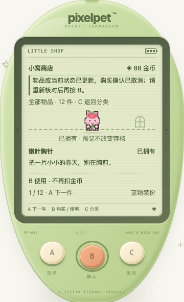

# 多窗口下的商店选择与购买确认

日期：2026-10-19。本批修复商店同步导致的误选，不新增商品或奖励。

## 实际问题与修复

「已拥有」按服务端目录顺序筛选，原来只用数组下标定位。如果一处预览四叶草盆栽、另一窗口买入排序更靠前的嫩叶胸针，同步后旧下标指向了胸针，预览和 B 使用目标会一起变掉。

- 按已有商品 ID 记住所选物品，不把已拥有列表的位置当作商品身份。新购买的物品仍按原目录顺序出现，不重排服务端规则。
- A 从当前物品在新列表中的位置继续浏览并循环；C 回分类，再进入从该分类第一件开始。空列表可以等到第一件真实购买的物品出现。
- 若所选物品不再位于当前分类，预览转到当前第一件并明确说明；空列表不虚构商品，重新有物品时重新定位。不会默默保留消失的旧商品，之后又突然跳回。
- 购买确认保存一份本次所见商品的 ID、名称、槽位、价格与说明，而不是一个与当前下标绑定的布尔值。目录只换顺序、原物品细节不变时，仍确认原物品；细节改变或物品消失时，取消旧确认并要求重新核对。
- 同步发现已买过、余额已不足或宠物睡着时，也取消旧确认，不自动重买、换成穿戴或向服务端补发操作。玩家看清当前状态后再按 B，是当前页面明确显示的新操作；未拥有的物品仍需再次 B 确认。
- 三键提示跟随当前确认有效性。仍只有 **A 下一件 / 取消、B 查看 / 使用 / 两步购买、C 分类 / 返回 / 取消**；屏幕内无新增玩法控件。更新说明沿用阅读模式正常文流。

## 不变的边界

选中 ID 与购买预览只是当前页面的临时状态，不写入玩家存档，不添加迁移或新版本。schema 仍为 11；12 件物品、价格、四个装备槽、金币/每日额度、成长与成年形态都不变。

这份确认只核对**最近读到的状态**，不是服务端价格保留协议，不能保证未观察到的部署变更仍按旧价成交。实际购买仍由现有服务端校验；本批没有给静态商店引入动态价格。服务端已保存但响应丢失的购买，仍沿用已有结果未知/只读核对机制，不自动重试。

## 验证

- 新增 **16 项 App 回归**，复现原来已拥有列表前插导致预览换物和目录重排导致购买目标换物的问题；另覆盖更新后的浏览顺序、四种商品细节变化、三种不兼容状态、选择消失、空列表补入和被确认物品消失，并核对兼容的余额变化不误取消、自己的成功购买不误报外部变化。测试区分同步读取与真实操作请求。
- 全量前端 **1061 项 / 46 文件**、TypeScript 与生产构建通过；Go 全量 `test -race -count=1 ./...`、`vet ./...`、构建与既有节奏算术 **6 项**通过。没有新增小游戏。
- 独立库真实 Chrome **51 项检查**通过：两个实际浏览器上下文购买较早商品、阅读端保持两种选中位置并免费使用（4，包含购买端各自的检查）；四种合成目录细节更新取消确认（4）；目录合成重排但按原 ID 实际购买（1）；被确认物品合成移除（1）；另一执行者实际购买同物/花费余额/睡眠导致取消（3）；三尺寸 × 双字号 × 普通/强制色与减少动态 × 稳定选择/确认取消/选择消失（36）；正常两步购买与免费使用（1）；实际服务重启后金币、库存与装备一致（1）。
- 实际双窗口流程包括 390px 机身 A/B/C 触摸，布局覆盖 320 / 390 / 1200px、普通与 200% 根字号。检查文字/字号/边界、三个至少 44px 的按键可滚动到达、无内部阅读滚动陷阱或新增屏幕按钮，无 JS 错误；只读阶段没有操作/导入/重置/回访确认请求。正常访问仍可能结算时间，不等于数据库零写入。
- 真实服务目录是固定的；名称、价格、槽位、说明变化和移除是明确的响应改写测试，不算上线动态价格或实际删商品。改变价格后未向真实服务发购买；只验证必须重新确认。目录重排场景则按原来叶胸针 ID 进行真实 12 币购买。新库存和余额来自临时库合成初始状态；不是用户自然游玩所得。
- 同步使用注入可见性事件触发已有访问逻辑；不是实际设备后台切换或用户试玩。200% 使用根字号放大，不宣称覆盖所有系统辅助技术。
- 脚本 `/tmp/pixelpet-shop-sync-browser.mjs`，结果 `/tmp/pet-shop-sync-browser-results.json`，独立库 `/tmp/pixelpet-shop-sync-PQ1cDV/test.db`。只启停 18111 验证服务，结束后已停止。
- 玩家库 SHA256 保持 `a8b712d5419fe6227b255f4d63869612e451da7abddffd60124de8ee65c23eee`，原进程 38015 / 39567 未重启或操作。构建/推送不等于向已有试玩进程部署。

[200% 根字号截图](shop-sync-large-text.png)

持续目标保留，后续仍优先可复现的照顾/保存与三键交互问题。
