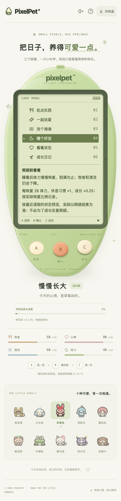
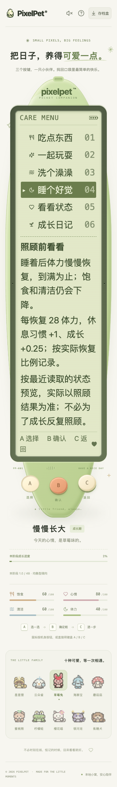

# 睡眠菜单与成长手册共用基准（2026-10-19）

## 修正

成长手册已经读取响应中的 `careRules.growth`，但睡觉菜单仍写死“恢复 28 体力 / 成长 +0.25”，因此在服务端基准不同或旧服务没有元数据时，两处说明可能矛盾。

- 将手册原有的基准校验抽为共享函数；睡觉菜单读取同一份已接受响应。
- 幼年、成长期展示恢复量与按比例累计的休息习惯、成长；成年只展示休息习惯，说明成年形态不变。
- 缺失/null/无效基准时不回填客户端默认数字，保留实际恢复量的文字说明。缺失成长记录时仍明确记录尚未读到。
- 满体力仍可休息，但不许诺多记习惯；叫醒不许诺即时体力或成长奖励。
- 不改服务端成长数值、形态判定、schema 12、存档内容或 A/B/C 操作。数值说明不是客户端奖励判定。

## 验证

新增前端 49 项：

- `SleepBasis.test.tsx` 41 项：三阶段、与手册一致、缺失/无效基准、满体力、缺失成长、叫醒、有效零系数及不修改输入。原实现下 39 失败 / 2 通过，修正后全通过。
- `SleepBasisFlow.test.tsx` 8 项：A 选择/C 取消不写入、B 明确睡眠一次、有效新响应与过期响应、三类元数据降级、成年、外部睡眠及断线后 B 只读核对。
- 专项 122 项 / 6 文件；全量前端 2209 项 / 86 文件、TypeScript、生产构建通过。
- Go 无缓存 race、vet、构建及既有节奏算术 6 项通过。

复用 `scripts/check-growth-basis.mjs`，临时库 Chrome 27 组全部通过，覆盖睡眠菜单与手册：

- 三阶段 × 清醒/睡眠 × 普通/大字号 12 组。
- 旧服务、缺失成长基准、无效成长基准 × 幼年/成年 × 清醒/睡眠 12 组。
- 三阶段各一组响应注入 20 / 0.2 的显示测试，两处同步使用该元数据；这不是修改实际服务端系数或证明其结算使用该注入值。
- 每组通过机身三键选择睡眠、取消、阅读手册、换页返回；不执行照顾/重置/导入/小结确认写请求。独立库夹具导入在页面操作之前单独执行。
- 检查 LCD 文字边界、无横向溢出、仅三个机身按钮、LCD 无可点击玩法控件和页面错误。普通 390×844 / 根字号 14px、大字号 320×568 / 根字号 28px；并非所有设备或辅助技术的完整矩阵。

测试夹具使用旧 schema 的受控年龄进行迁移，不是自然长时间养成或真人试玩。仅选择/取消睡眠不会改变睡眠状态或照顾计数；自然时间仍可能推进服务端状态。

复跑：

```sh
./.tools/go/bin/go build -o /tmp/pixelpet-sleep-basis ./cmd/pet
# 先构建 web；模块路径可按本机安装填写。
PIXELPET_TEST_BINARY=/tmp/pixelpet-sleep-basis \
PIXELPET_PLAYWRIGHT_MODULE=/absolute/path/to/playwright/index.mjs \
node scripts/check-growth-basis.mjs
```

## 隔离边界

测试只使用脚本创建的临时数据库和空闲端口，结束后关闭自己的服务。不导入、重置或覆盖玩家库，不刷新玩家页面、不重启原服务。构建会更新忽略的 `web/dist`，共用目录的原服务在之后重载时可能读到新前端；不代表原后端已部署。

持续目标保留；后续继续核查实际照顾、离开与成长体验中的可复现问题，并保留自然长时和真人试玩验收，不将自动化当作真人反馈。

普通/大字号睡眠菜单截图已查看。大字号是需要纵向滚动的长页，不宣称三键始终一屏可见：





最终临时库与结果：`/var/folders/12/7y0bpzpj5055788qjjnq3c9c0000gn/T/pixelpet-growth-basis-Ok49Px/{test.db,growth-basis-results.json}`；自己的端口 63650 已关闭。日志 `/tmp/pet-sleep-basis-{red,focused,frontend-final,go,arithmetic,browser}.log`。玩家库 SHA256 仍为 `a8b712d5419fe6227b255f4d63869612e451da7abddffd60124de8ee65c23eee`，原进程 38015 / 39567 及 Vite 24615 保留。
