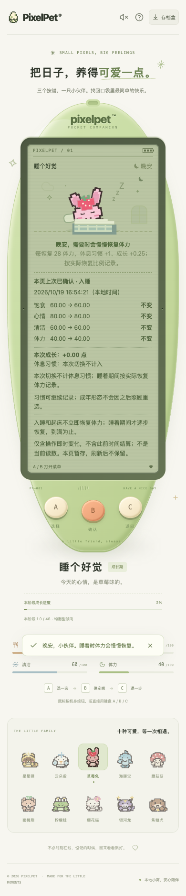
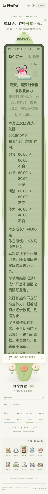

# 入睡确认提示与成长基准（2026-10-19）

## 修正的问题

睡眠菜单已经使用服务端成长基准，但按 B 入睡后，小窝的短提示仍写死「28 体力 / 0.25 成长」，与响应缺失、自定义基准和手册显示不一致。成年原来就不承诺额外成长；本批保留这一规则。

现在菜单与入睡确认共用 `sleepGrowthGuidance`：

- 从最近接受的服务端响应读取恢复体力/休息习惯及额外成长比例，不沿用旧菜单数字或客户端默认值。
- 基准缺失、无效时明确说明未读到，不猜数字；实际成长记录缺失时，不用年龄推断的成年/幼年显示收益。
- 幼年、成长期说明「每恢复…按实际恢复比例记录」，不把入睡本身说成即时奖励；有效零成长系数仍显示零。
- 成年只解释实际恢复所记休息习惯及形态不变，不显示成长奖励。
- 起床提示仍单独说明实际恢复；喂食/洗澡反馈、既有八秒阅读/遮挡恢复机制不变。

仅调整展示与共用文案，不改服务端、成长/需求/奖励参数、schema 12 或 A/B/C 三键操作。

## 自动验证

新增组件 19 项，旧实现下 18 失败 / 1 通过；另加 App 流程 8 项，覆盖实际确认响应换基准、过期响应整体拒绝、action/poll 元数据消失、旧成长缺失、成年锁定、断线后 B 只读核对，以及遮挡后的完整阅读时间。专项 67 项通过；全量前端 **2266 项 / 91 文件**、TypeScript、生产构建通过。Go 全量无缓存 race、vet、构建及既有算术 6 项通过。

独立库 Chrome **33 组通过**：三阶段 × 普通/大字号 × 真实/确认响应换基准/初始满体力，共 18 组；另有三阶段 × 旧服务/缺失成长基准/无效基准/缺失成长记录/有效零系数，共 15 组。最终普通与大字号截图已查看；大字号允许整页纵向滚动，不缩小文字。





既有成长基准/当前参考浏览器回归另 **33 组通过**。自己的端口 59041 / 58389 已关闭，玩家库哈希和原服务进程保持不变。

## 浏览器复跑

永久脚本 `scripts/check-sleep-feedback.mjs` 使用独立临时数据库和空闲端口，三阶段通过真实 A/B/C 入睡、叫醒。真实动作仍按原后端结算；只有指定场景的动作响应被修改以检查元数据降级、自定义/零系数和旧成长记录兼容。不会把响应注入当作真实结算规则。

每组核对入睡/起床即时反馈均无成长或习惯奖励、入睡不凭空加体力/休息、仅两次玩法写请求（只读 `/api/visit` 另外统计）、照顾次数/金币不变、成年成长与形态锁定。普通/320px 大字号检查 LCD 文本边界、字号和三个按键，没有新增屏幕内玩法控件。初始体力 100 的夹具会自然略降，不能据此声称在动作时仍精确满体力或已经验收长时间满体力睡眠。

```sh
# 先完成前端生产构建
./.tools/go/bin/go build -o /tmp/pixelpet-sleep-feedback ./cmd/pet
PIXELPET_TEST_BINARY=/tmp/pixelpet-sleep-feedback \
PIXELPET_PLAYWRIGHT_MODULE=/absolute/path/to/playwright/index.mjs \
node scripts/check-sleep-feedback.mjs
```

不读取/修改玩家库，不刷新玩家页面或重启原服务；结束关闭自己的服务。生产构建更新共享的忽略目录 `web/dist`，原服务以后重载可能读取新前端，不代表原后端已升级。旧 schema 受控年龄迁移并非自然养成数日；真人试玩、自然长时睡眠和系统后台行为仍需独立验收。
