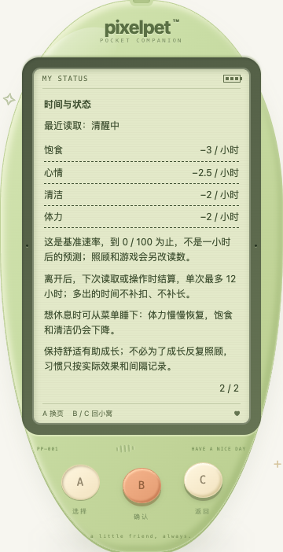

# 状态页：时间与状态说明

日期：2026-10-19。养成解释的小批次完善，不新增成长机制或小游戏。

## 已交付

- 菜单「状态」分为两页：第一页保留当前读数、照顾建议与次数；第二页解释最近读取的清醒/睡眠模式、四项每小时基准变化、上下限与离线结算。
- A 在两页间循环，B / C 均返回小窝；重新进入从第一页开始。仍只有三个玩法键，LCD 内没有新控件。
- 新服务返回可选响应元数据 `careRules`。清醒基准：饱食 −3、心情 −2.5、清洁 −2、体力 −2 / 小时；睡眠：饱食 −3、心情 0、清洁 −2、体力 +14 / 小时。一次时间结算上限仍为 12 小时。
- 实际结算、成长预览积分与响应元数据共用同一组速率；本次只提取原有常量，没有修改数值、成长条件、成年形态或奖励。
- 明确这是基准而非一小时后的预测：需求到 0 / 100 为止，照顾/游戏另有影响；离开后下次读取或操作才结算，超出上限的时间不补扣、不补长。
- 只展示已接受的服务端快照，不按客户端时钟推算状态。低 revision 回复不更新模式或规则；读取失败时沿用现有只读恢复界面，不继续冒充实时数据。

## 兼容与边界

`careRules` 位于响应顶层，不属于宠物状态、导出备份或用户可提交的动作。schema 保持 11；旧存档无需补字段。幂等缓存返回时刷新规则元数据，但不重写缓存/存档。

旧服务不返回元数据，或元数据缺失/类型不对/非有限数值/上限非正时，页面显示「详细速率尚未读到」而不猜数字；基本状态读数照常。接受一个缺少规则的新回复会清除旧规则，不混用历史缓存。

**运行中的原玩家服务没有被重启**。本批构建和临时服务验证不代表旧进程已加载新后端；使用旧服务时只能看到兼容说明。浏览器旧数据覆盖测试是响应拦截模拟，不冒称运行了真实旧二进制。

## 本批验证

- 前端新增 32 项，全量 **933 项 / 40 文件**；TypeScript 与生产构建通过。
- Go 全量 `test -race -count=1 ./...`、`vet ./...`、构建通过。新增结算测试覆盖清醒/睡眠、五种初始值、0.25 / 1 / 48 小时（共 30 组合），校验元数据与真实结算、成长积分预览一致；覆盖读/写/回访/导入/重置/缓存元数据、缓存不重写、备份边界与非法客户端字段。
- 既有节奏算术 6 项通过；不算新节奏游戏。
- 真实 Chrome **150 项检查**：320 / 390 / 1200px，正常/200% 根字号，高对比度与减少动态效果组合，三成长阶段 × 清醒/睡眠 × 两页（144）；另覆盖实际触摸睡下/叫醒（1）、0 / 100 边界（2）、模拟旧/畸形元数据（2）、自己的临时服务重启（1）。验证阅读不产生照顾/导入/重置/领取写入、A 循环/B-C 返回/重进归零、文字不越 LCD、三键可滚动到达与成年形态保持。
- 临时验证库：`/tmp/pixelpet-status-time-guide-AlqjLE/test.db`。脚本与结果：`/tmp/pixelpet-status-time-guide-browser.mjs`、`/tmp/pet-status-time-guide-browser-results.json`。阶段来自服务校验的合成夹具，不是完整自然养成或用户试玩反馈。
- 玩家库 `data/pixelpet.db` SHA256 仍为 `a8b712d5419fe6227b255f4d63869612e451da7abddffd60124de8ee65c23eee`；没有操作玩家存档，仅启停自己的临时服务。

持续目标仍进行中。后续优先实际试玩中的可复现问题、三键流程与保存可信；候选新游戏仍需独立玩法验证，不通过增加说明冒称新玩法完成。
