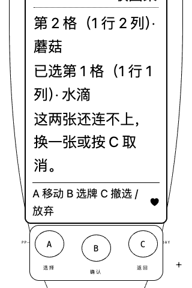

# 宠物连连看

## 三键玩法

菜单「一起玩耍」→ A 选择连连看 → B 看说明 → B 开始；C 返回。默认选择仍是接星星。

- 4×4 棋盘，共八种图案、每种两张。匹配必须同图案，连线最多拐两次直角弯，可以沿棋盘外一格绕行。
- A 按行循环移动到下一张未消除图案；B 选第一张，再移动并按 B 配对。再次 B 选中同一张可取消选择。
- 不同图案或被挡住的配对不会消除，也不偷偷改选第一张。C 有选择时只清除；无选择时打开放弃确认，B 确认才丢弃本局，A/C 取消确认。
- 每次成功消除后，服务端检查剩余棋盘；无合法配对就免费重排，保留剩余图案，不收费、不增加玩法按键。
- 宠物在棋盘旁收图案，连线来自服务端真实路径；重排后不把旧路径叠到新棋盘上。装扮和小窝装饰保留，减少动态效果模式只显示静态反馈。

## 结算与陪伴

完整消除八对后心情 +18、体力 −6、饱食 −3，照顾次数 +1；按现有 30 分钟陪玩习惯间隔记录成长，不靠反复开局刷习惯。首次真正完成留下永久「一起连好图案」纪念，不覆盖成年形态。

每局完整结束获得 6 金币，与接星星、贪吃蛇、俄罗斯方块共用服务端 UTC 日最多 30 金币的额度。额度只剩 4 则发 4，满额仍可陪玩但发 0；部分消除、取消、清除选牌、重排不发币，也不记一次完整陪玩。睡着或体力不足不能开始，不会自动叫醒宠物。

## 会话与兼容（本功能初次交付时）

- 本功能初次交付使用 schema 5；兼容 schema 1–4 存档和备份，迁移保留原始快照。schema 4 的钱包、库存、纪念、成长和接星星会话均保留。
- 棋盘、选择、配对数、重排数和随机会话 ID 保存到 SQLite；刷新和重启续局，不重播旧连线动画。
- 客户端只提交会话 ID 与格子序号，不能提交棋盘、路径、分数或金币；HTTP 严格拒绝额外字段，后端校验合法匹配。
- 状态、奖励、首次纪念同事务保存；网络重试幂等，结束/取消后的旧会话不能影响新局或重复领奖。
- 多标签页发现当前局已结束/取消后返回小窝，不伪造完成动画和奖励。回访及进化仍等小游戏结束再展示。
- 本地备份可导入，仍不宣称是防篡改在线经济。

## 本批验收

独立临时数据库中，通过实际 A/B/C 完成孵化、领取、连连看、接星星、购买和装备。核验错误配对、刷新续局、清除/退出、完整奖励、共同 30 币额度、临界发 4 / 满额发 0、重复请求和首次纪念不重复。

十种宠物 × 三阶段 × 桌面/390px 手机，分别检查棋盘和游戏选择页，共 120 项布局检查；这部分使用隔离布局预览存档，不代表玩家已经成长到对应阶段。真实试玩截图为隔离测试宠物，不是玩家历史。另验证减少动态效果、三键限制及浏览器无运行错误。不导入、重置或代玩玩家存档。

**历史范围说明**：本批初次交付时，贪吃蛇、俄罗斯方块尚待实现，独立三阶段素材为 4/10。此后两款游戏均已完成，十只独立三阶段造型/动作已达 10/10，本段保留初次交付范围，当前规则与存档版本以 `GROWTH.md` 及 `PROGRESS.md` 为准；详见 `SNAKE.md`、`TETRIS.md` 与 `ROADMAP.md`。上述旧版验收数据仅描述当时批次，不代表当前进度。

## 2026-10-21 · 选牌反馈与大字号阅读

- 当前位置与首张选择都显示格号、行列和图案名；错误配对仍保留首张选择，C 先撤选，未选牌时才打开放弃确认。
- 状态与提示从固定 8px 改为相对字号：默认根字号 14px 时为 12px，200% 根字号时为 24px。连连看没有倒计时，LCD 随内容长高，提示不再限高截断；棋盘本身不因文字换行改变格子位置。
- 原三个机身按键保持可用。A 优先露出当前／已选说明；B/C 确认后的反馈优先露出操作结果。空间足够时同时显示棋盘与文字，极短屏下可原生滚动看其余内容。取消放弃确认回到本局时，露出当前选牌；不会代按 B。
- SVG 棋盘提供全部十六格的文字描述，包括已清空的位置；只描述当前棋盘，不推荐配对或预告重排。强制颜色模式保留图案轮廓、光标与首张选择标记，不增加可点击格子或第四个玩法控件。
- 普通状态读取不抢滚动位置；恢复、换局、离开窗口或打开工具时不重放旧的视口请求。视口逻辑不主动调用 `focus()`。后续的[机身焦点恢复](PHYSICAL_KEYBOARD.md#2026-10-21--网络等待后的机身焦点)单独处理网络禁用导致的焦点丢失；用户转移焦点或中断后不抢回，原生禁用和输入锁保留。

开发回归入口：`scripts/check-tile-reading.mjs`。必须显式传入独立 `PIXELPET_TEST_BINARY`、`PIXELPET_TEST_WEB`；脚本自行创建临时数据库和随机端口，不接受玩家服务作为测试目标。完整消除的浏览器验收使用测试内算法选择合法配对，再逐次按真实 A/B/C，属于受控自测，不是自然盲玩、实体手机或真人读屏认证。

本批隔离 Chrome 覆盖桌面 1200×900、手机 320×480，各含正常／200% 根字号，手机大字号同时启用强制颜色与减少动态；四局均实际三键完成随机棋盘并核对 6 币及一次陪玩。检查错误配对保留、C 撤选／退出取消、刷新保留、原生 Enter／Space 单次操作、读取不抢滚动、三键可见及提示不被按键遮挡。单位测试不能替代自然长玩或真人读屏。

