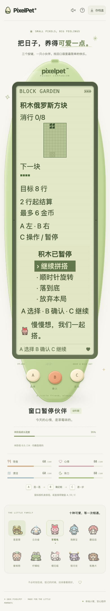

# 实时游戏的窗口失焦暂停

日期：2026-10-19。贪吃蛇、积木、池塘钓鱼和公园散步；不修改接星星/连连看规则，不新增玩法或按键。

## 行为与边界

原有隐藏页面暂停未覆盖「窗口仍可见但失去焦点」。现在收到窗口 blur 后立即失效本地运行许可，清除贪吃蛇待转方向。回到窗口只恢复接收新操作，不恢复旧会话；必须用原 A/B/C 菜单明确继续。

- 自动步进在安排和执行时都检查可见性及窗口状态；回调还核对安排时的会话代次。快速 blur → focus，即使 React 尚未清理旧计时器，也不会发送旧步进。
- 迟到的继续、旋转、落底、抛竿或自动一步，若已被服务端接受，仍保留实际保存结果；不会恢复运行许可、自动发下一步或自动领奖。积木「先暂停再执行菜单操作」也不能跨失焦继续后半段。
- 物理 A/B/C 控件之间的焦点移动不是窗口离开；冒泡的元素失焦/获焦不修改窗口状态。失焦不发送额外暂停写请求，不撤销已提交操作，服务端原有过期暂停/步数核对保持不变。
- 只暂停这四类游戏的本地计时；不冻结宠物需求、睡眠恢复或成长，不改变离线结算、养成参数、奖励、存档 schema 12 或旧档兼容。

截图检查另外发现大字号的积木暂停标题与棋盘相撞：阅读模式下贪吃蛇/积木标题现在自然增高、换行，积木侧栏改为完整一行。保持原棋盘尺寸和运行模式几何，不缩小文字/三键，不新增 LCD 可点击玩法控件。

## 验证

- 新增 43 项前端回归：新窗口暂停文件 31 项、既有迟到续局回归扩展 12 项。最终专项在旧 App 下 **39 失败 / 42 通过**，补丁后 **81 项通过**；含四款正在运行/迟到一步、快速切回、按钮间焦点移动、钓鱼继续/抛竿、咬钩窗口及积木两段操作。
- 最终前端全量 **1586 项 / 72 文件**、TypeScript 和生产构建通过；Go 无缓存 race、vet、构建及既有节奏算术 6 项通过。不是新增节奏游戏。
- 独立库真实 Chrome **38 组**通过：四游戏运行中失焦 4 组；迟到继续/一步、积木旋转/落底及两段操作、钓鱼抛竿共 26 组，分别覆盖返回窗口先于/晚于回复；贪吃蛇/积木 × 320/390px × 默认/双倍根字号的暂停布局 8 组。
- 游戏链路实际提交服务端后再暂扣浏览器回复，核对不额外发步进、不自动领奖、保存进度不丢、明确继续可用、蛇的旧转向不残留，以及 A/B/C 和 LCD 控件约束。布局检查标题不与棋盘相撞、子文字在标题边界内，积木棋盘仍为 82×122px，侧栏使用整行。键盘与触摸交替；不是全量设备/辅助技术认证。
- 最终双倍字号截图已查看，文字不再重叠；长暂停页仍需页面滚动才能到物理三键，不声称短屏内全部同时可见。

## 数据与运行

- 最终临时库：`/tmp/pixelpet-window-1QQKOU/test.db`；浏览器脚本 `/tmp/pixelpet-window-browser.mjs`；结果 `/tmp/pet-window-browser-results.json`。永久回归保存在前端测试文件，临时浏览器脚本不作为仓库固定入口。
- 仅启停自己的 18133 测试服务，不导入、重置或代操作玩家存档。玩家库 SHA256 保持 `a8b712d5419fe6227b255f4d63869612e451da7abddffd60124de8ee65c23eee`，原进程 38015 / 39567 保留，未主动刷新玩家页面。
- 未重启/部署原后端。构建更新忽略的 web/dist，原服务若读取同一目录，页面重载可能读到新前端；提交/推送不等于整个运行环境已升级。

本机 Chrome 自动化在切换标签/窗口时未产生可观察的原生 blur/focus，故本批浏览器用显式派发窗口事件验证真实页面与 HTTP 保存链路；这不等同于操作系统级应用切换认证。真实人工系统切换、自然长时间陪伴和用户试玩仍待验收。

持续迭代目标保留；后续优先真实反馈与可复现的照顾、成长、离开恢复和三键可读性问题，不把候选新游戏算作完成。
