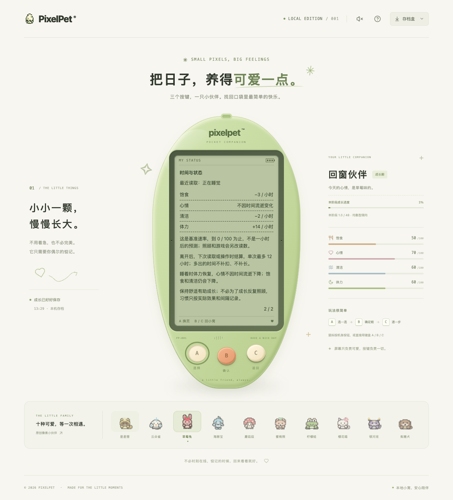

# 回到窗口时同步当前状态

日期：2026-10-19。补齐仍可见但失去焦点的窗口返回，以及返回时正在保存/读取的情况；不改变养成或小游戏规则。

## 问题与处理

原先仅首次加载、每 15 秒轮询及从隐藏页返回时读取。窗口仍可见、用户去另一个窗口照顾宠物再回来，旧界面可能继续显示清醒；返回恰逢保存或旧读取时，这次同步也会被直接忽略。

- 窗口收到 focus 且页面可见时请求当前状态，不必等下一次轮询。A/B/C 控件之间的焦点移动及冒泡的元素 focus 不算窗口返回。
- 返回碰到写请求或旧读取尚未结束时，保留一个待补读标记；结束后读取最新状态。期间多个返回信号合并为一次后续读取，不为每个信号排一个请求。
- 普通刷新沿用 visit；保存结果未知、坏档/时钟检查沿用 state 核对，不重放照顾、游戏操作或成功动画。正常 visit 保留既有回访小结确认行为，并非承诺返回绝不产生任何写请求。
- 页面隐藏时不执行补读；重新可见后再继续。卸载清除待补读标记与监听，不在已卸载页面发起排队读取。
- 既有 epoch/存档代次检查继续拒绝过时回复；换档会更新路由并丢弃旧菜单意图。
- 失焦的贪吃蛇、积木、钓鱼、散步仍需三键明确继续，刷新状态不会恢复本地运行许可。迟到的已保存一步保留，但不会自行发下一步或领奖。

仅修改前端同步编排；A/B/C、服务端逻辑、schema 12、离线封顶、成长、习惯、奖励和旧档兼容均不变。

## 验证

- 新增 `web/src/WindowReturnSync.test.tsx` **27 项**，原 App 下 **22 失败 / 5 通过**，修复后全部通过。覆盖三阶段/睡眠、窗口与元素焦点、隐藏、未知保存/坏档/时钟核对、换档、忙碌操作的接受/拒绝/结果未知、旧读成功/失败、同批 React 更新、卸载及迟到旧回复。
- 最终前端全量 **1613 项 / 73 文件**、TypeScript 与生产构建通过。恢复/暂停相关五文件专项 **147 项**通过。Go 无缓存 race、vet、构建及既有节奏算术 **6 项**通过；没有新增节奏游戏。
- 独立临时库真实 Chrome **28 组**通过：三阶段 × 清醒/睡眠 6 组；四款实时游戏 × 正常/暂扣已保存一步 8 组；focus/visibility × 照顾接受/结果未知/拒绝 6 组；focus/visibility × 旧读成功/失败 4 组；元素焦点、隐藏后返回、换档、断线后再次返回 4 组。
- 浏览器用真实 API 在另一操作端修改状态，在浏览器侧暂扣或丢弃响应；核对返回更新、补读、未知结果只读核对、没有重复照顾/自动步进/自动领奖，以及明确继续仍可用。交替桌面/390px/320px、键盘/触摸与部分双倍根字号，不是全部组合或全设备认证。
- 最终桌面状态说明页截图已查看，阶段、睡眠说明及原三键正常显示；不声称所有小屏内容无需滚动。

窗口 focus/blur 与 visibility 在自动化中是受控派发，不等同于原生操作系统应用切换验收；真实人工试玩及自然长时间体验仍待进行。

## 数据与运行

- 浏览器临时库：`/tmp/pixelpet-window-return-3imdpS/test.db`；临时脚本 `/tmp/pixelpet-window-return-browser.mjs`；结果 `/tmp/pet-window-return-browser-results.json`。永久回归在前端测试文件，临时浏览器脚本不是仓库固定入口。
- 仅启停自己的 18135 复现与 18136 验收服务。未重置、导入或代操作玩家存档；玩家库 SHA256 保持 `a8b712d5419fe6227b255f4d63869612e451da7abddffd60124de8ee65c23eee`，原进程 38015 / 39567 保留，未主动刷新玩家页面。
- 未重启/部署原后端。构建会更新忽略的 web/dist；原服务若共用该目录，后续页面重载可能读到新前端。提交/推送不代表整个运行环境已升级。

持续迭代目标保留；下一步优先真实试玩反馈及可复现的照顾、成长、离开恢复问题，不把候选小游戏当作已交付。
